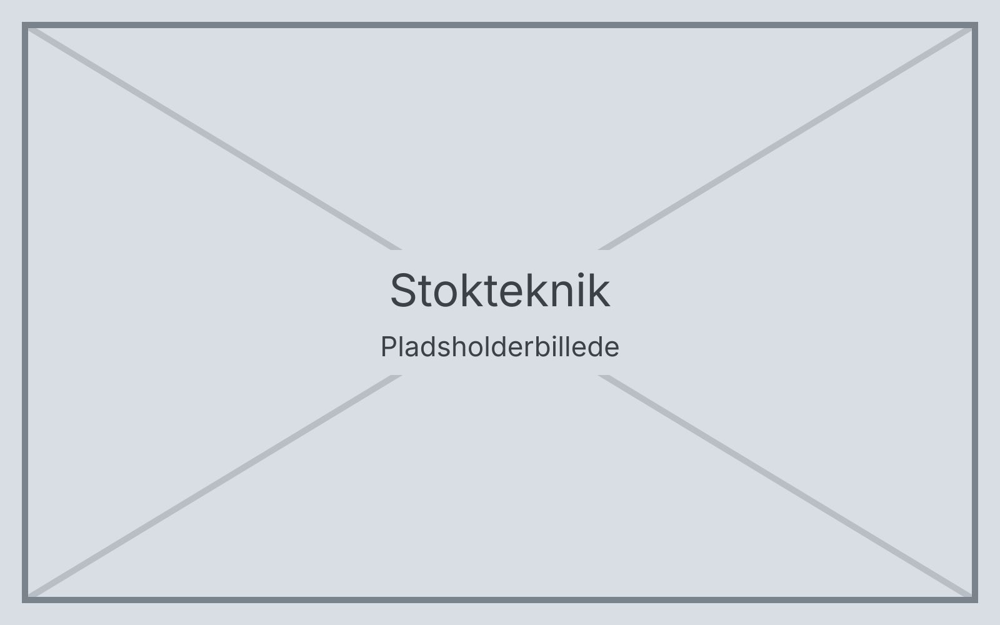

# Stokteknik

Med pendulteknikken (topunktsteknik) afsøger den lange stok området foran brugeren, før foden sættes ned.

## Grebet

1. Hold stokken med pegefingeren langs grebet og tommelfingeren ovenpå.
2. Hånden holdes midt foran kroppen i hoftehøjde.
3. Bevægelsen kommer fra håndleddet – ikke fra armen.

## Rytmen

- Stokkens spids rører jorden i den modsatte side af den fod, der sættes frem.
- Buen skal være lidt bredere end skuldrene.
- Hold et jævnt tempo, så stokken altid er et skridt foran.

## Typiske fejl

- Buen er for smal i den ene side.
- Hånden glider ud til siden af kroppen.
- Rytmen går i takt med samme fod.

Se også [Diagonal teknik](20-diagonal-teknik.md), som bruges i kendte indendørs omgivelser.
