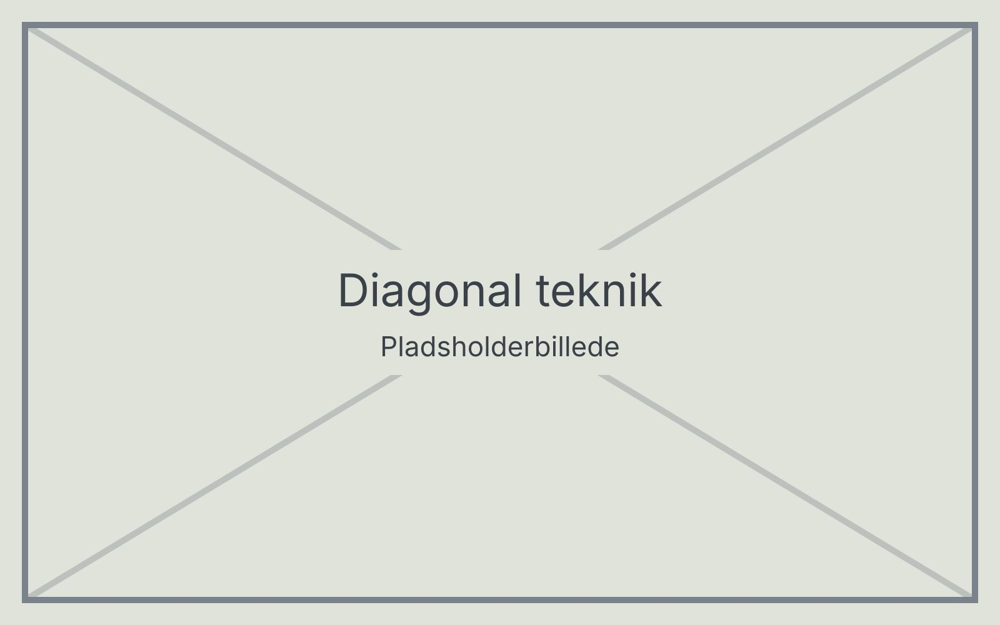

# Diagonal teknik

Ved diagonal teknik holdes stokken stille og skråt foran kroppen. Teknikken giver beskyttelse, men afsøger ikke underlaget, og bruges derfor mest indendørs i kendte omgivelser.

## Sådan gør du

1. Hold stokken med strakt arm skråt ned over kroppen.
2. Spidsen holdes en anelse over gulvet, lige uden for den modsatte skulder.
3. Grebet skal også dække den side, hånden er i.

## Hvornår bruges teknikken?

Diagonal teknik egner sig i kendte bygninger, fx på skolen eller hjemme. På ukendte steder og udendørs bruges i stedet [stokteknik med pendul](10-stokteknik.md).
