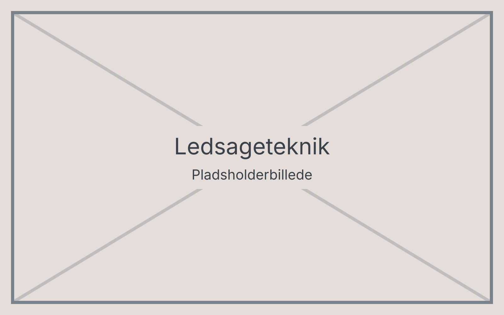

# Ledsageteknik

Ledsageteknik bruges, når en person går sammen med en seende ledsager. Brugeren holder ledsageren lige over albuen og går et halvt skridt bagved.

## Grundstilling

- Grib om ledsagerens arm lige over albuen med tommelfingeren på ydersiden.
- Hold overarmen tæt ind til kroppen.
- Gå et halvt skridt bag ledsageren i samme side som armen.

## Smalle passager

Ledsageren fører armen bag om ryggen. Brugeren strækker armen og går ind bag ledsageren, så de går på række.

## Trapper

Ledsageren stopper ved første trin og fortæller, om trappen går op eller ned. Ledsageren er altid et trin foran.
