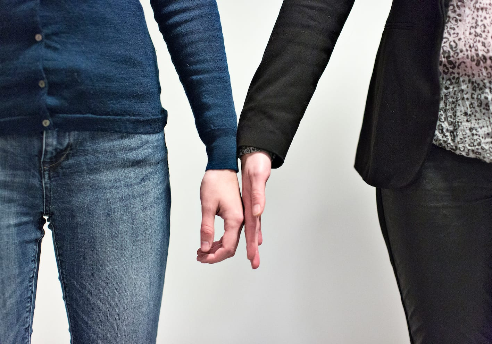
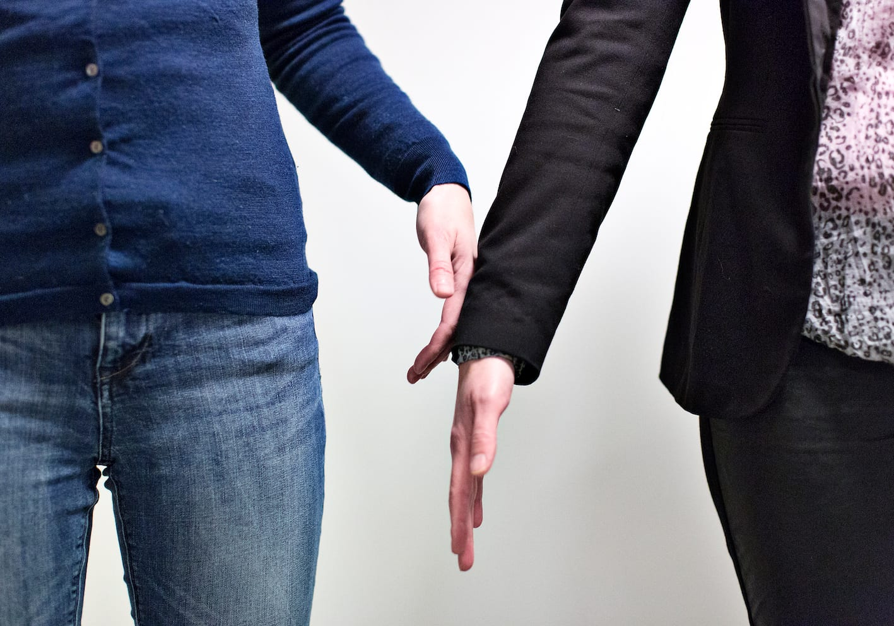
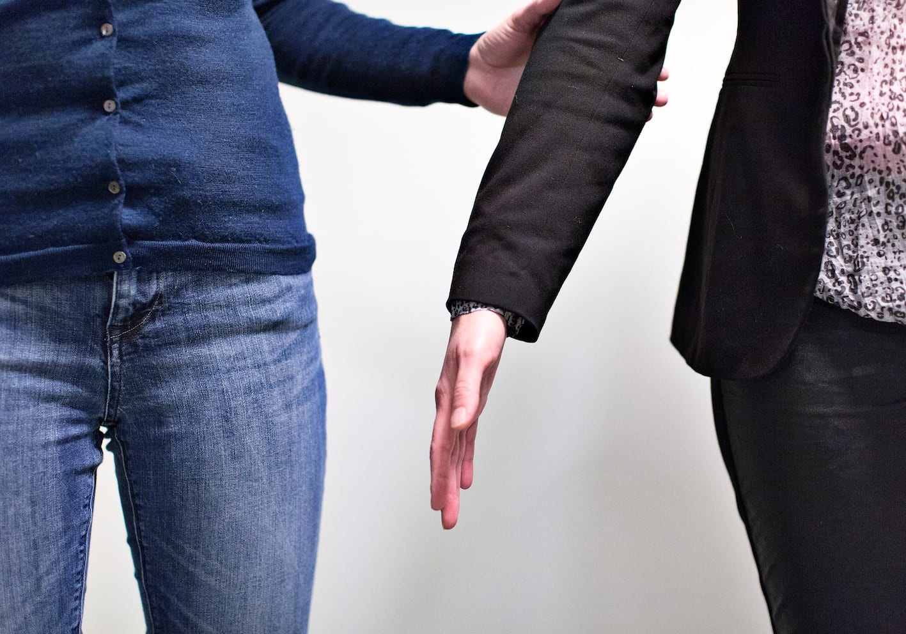

# Kontakt

Når kontakten mellem ledsageren og personen med blindhed etableres, kan det ske på initiativ fra begge parter.

__Når ledsageren tager kontakten__

- Billedserien nedenfor viser, hvordan ledsageren, efter at have givet sig verbalt til kende, stiller sig ved siden af Lykke og berører bagsiden af hendes hånd med sin egen håndryg.

- Lykke lader sin hånd glide op ad ledsagerens arm til over albuen og griber fat.

__Når personen med blindhed tager kontakten__

- Lykke finder hen til ledsageren, efter at ledsageren har givet sig verbalt til kende.

- Lykke stiller sig derefter ved siden af ledsageren skulder ved skulder.

- Lykke lægger hånden (tættest på ledsageren) på sin mave og fører den, med underarmen parallelt med gulvet over imod ledsageren, indtil hun har kontakt med ledsagerens arm. Dette gøres for at sikre, at hun ikke rører ledsageren på et upassende sted.
