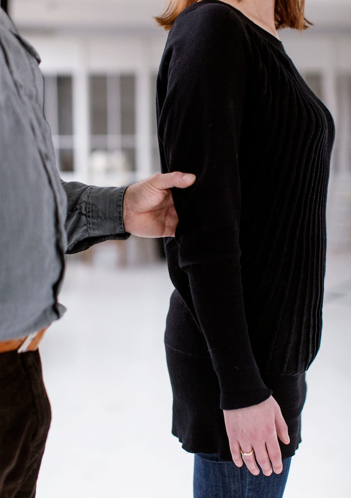

# Grebet

Det er personen med blindhed, som har fat i ledsagerens arm og ikke omvendt. Herved får personen bedre mulighed for at følge ledsagerens bevægelser og aflæse informationer samt mulighed for selv at afbryde kontakten, når det ønskes, fx hvis ledsageren skulle miste balancen.

- Nedenfor ses Bo, som viser, hvordan han tager fat i ledsagerens arm over albuen med et ”gaffelgreb”. Dvs. med tommelfingeren på ydersiden af ledsagerens arm og de fire andre fingre ind mod ledsagerens krop.

- Håndleddet skal være strakt og underarm og hånd pege i gangretningen.

- Grebet skal være fast nok til at sikre en fortsat kontakt, men samtidig være behagelig for begge parter.

Den arm, som personen med blindhed har fat i, kaldes her i teksten ”ledsagearmen” og hånden der gribes med kaldes ”ledsagehånden”.
