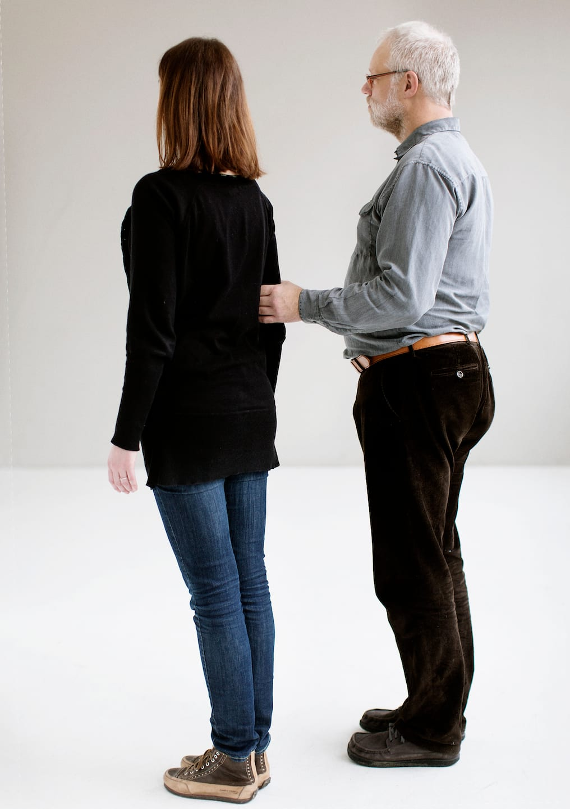
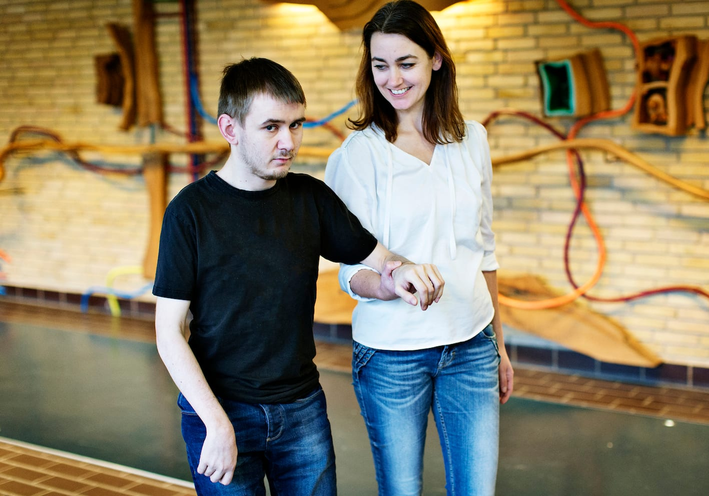
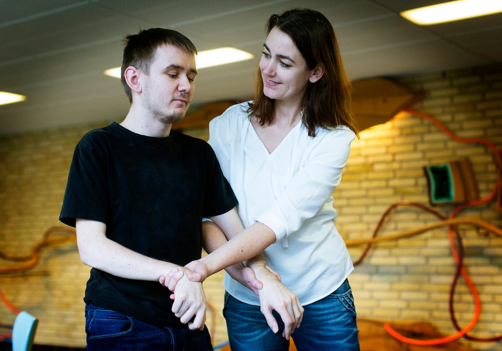

# Position

Ledsageren er ansvarlig for sikkerheden og skal fungere som et skjold for personen med blindhed. For at personen med blindhed skal kunne nå at reagere på forhindringer o.l. i tide, skal ledsageren gå et halvt skridt foran.

- Her viser Bo, hvordan han går et halvt skridt bag ledsageren med ansigtet i samme retning som hende.

- Bo har fat i ledsagearmen over albuen, mens underarmen peger fremad i gangretningen. (Hvis personerne er nogenlunde lige høje, svarer det til, at han bøjer albuen ca. 90 grader, så underarmen er parallel med gulvet).

- Ledsagearmen kan være strakt eller bøjet, men begge parter skal holde armen tæt ind til kroppen. Herved sikres den rette position, og det er nemmere at mærke bevægelserne.

- Ledsageren skal bibeholde en fremadrettet kropsholdning. Det hjælper til at give Bo den bedste fornemmelse af gangretningen og støtter hans orientering i omgivelserne.

- Ledsageren skal så vidt muligt gå i lige linjer og rette vinkler; ligeledes for at fremme orienteringen.

- Positionen gør det muligt for Bo at tage aktivt del i samarbejdet, fx regulere tempoet, lukke døre og selv afgøre, hvornår kontakten skal afsluttes.

Hvis ledsageren bliver nødt til at forlade personen med blindhed, ledsages han hen til et fast holdepunkt fx en stol, en væg eller andet, der har en kendt placering.

## Ekstra støtte

Hvis man er dårligt gående eller usikker, kan man som Marc viser, lade ledsageren give ekstra støtte ved at bruge det støttende greb.

- Ledsageren tager Marc under armen og holder fast i hans hånd, hvis armlængden tillader det - ellers rundt om hans håndled eller arm.

- Samtidig med støttegrebet kan ledsageren evt. række tværs over og tage fat i Marcs frie hånd med sin egen frie hånd.

