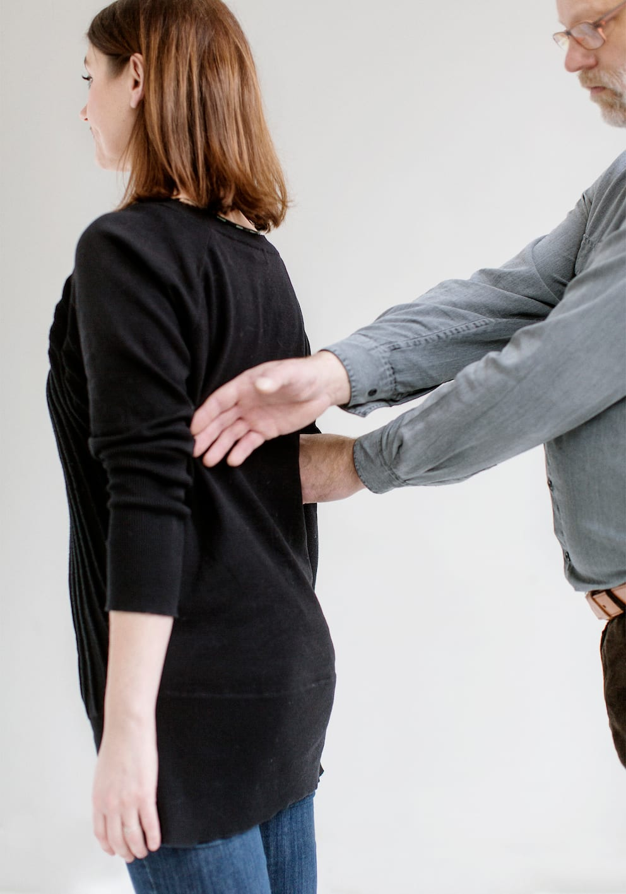
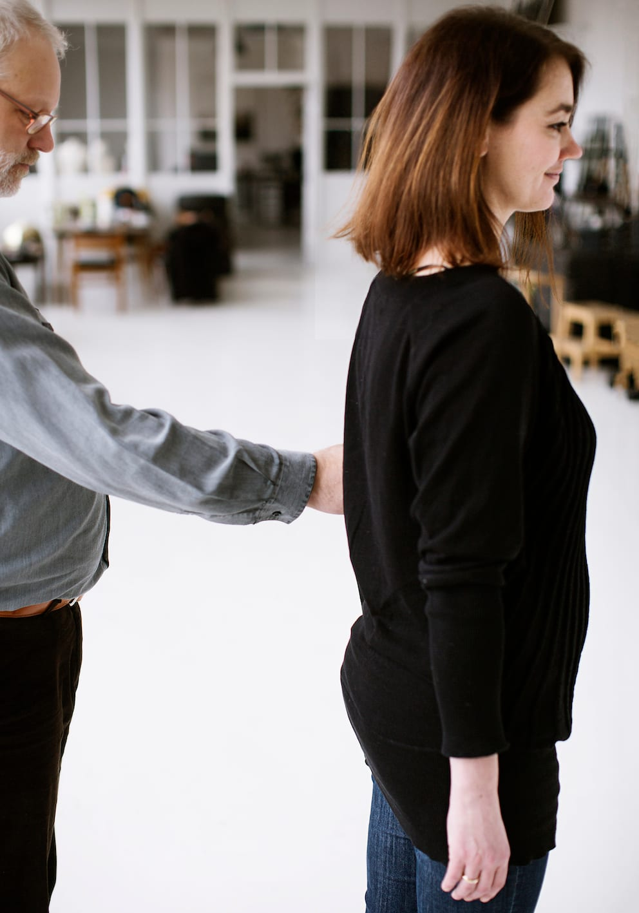
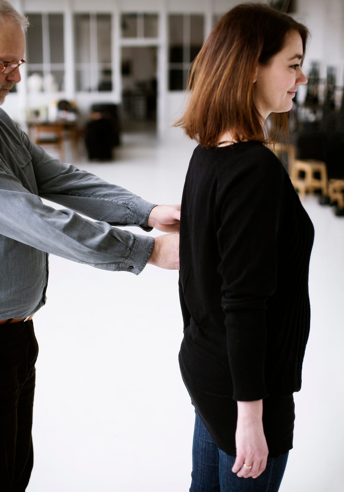
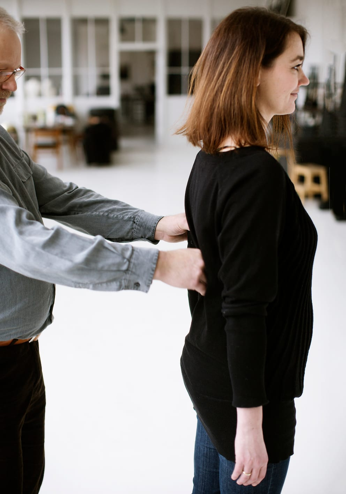
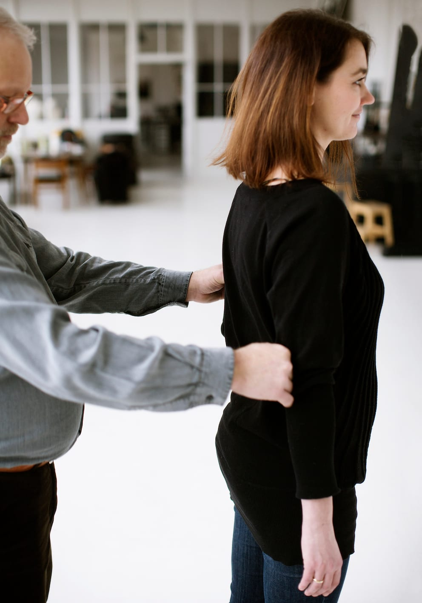
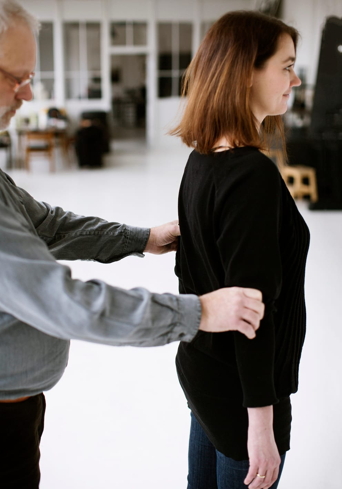
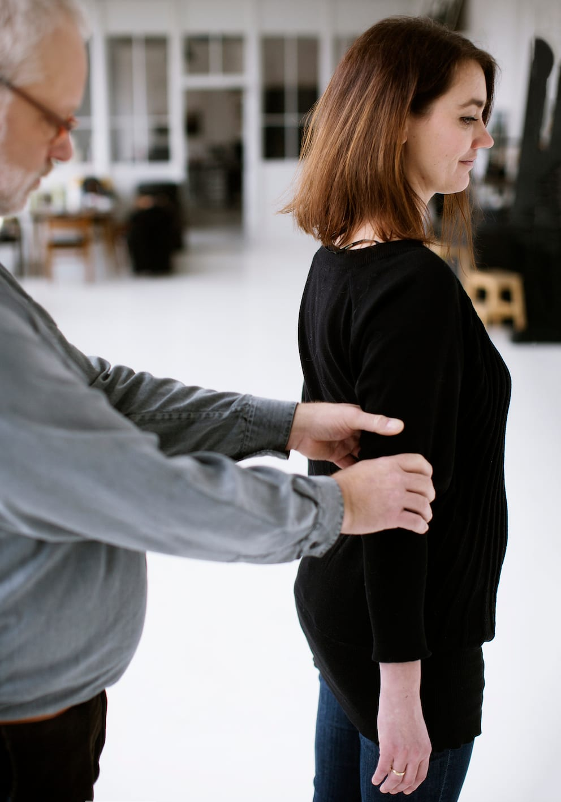
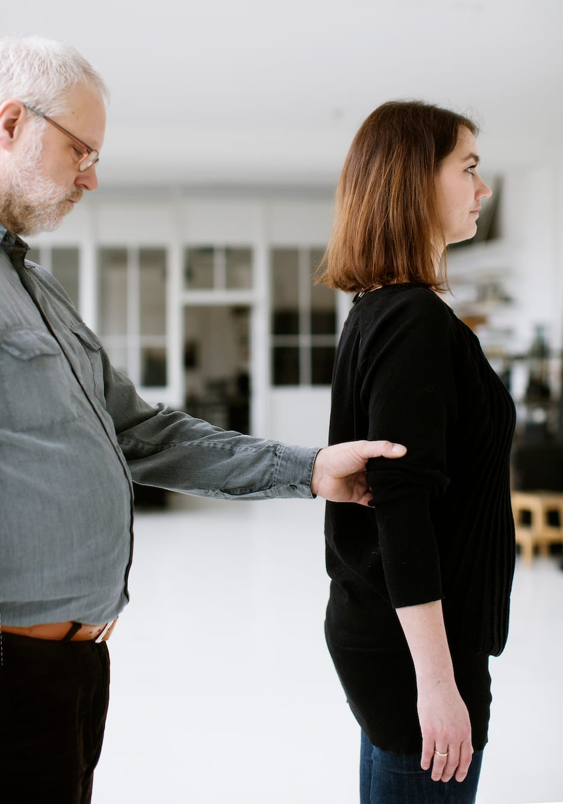

# Helt sideskift

I nogle situationer kan det være hensigtsmæssigt, at personen med blindhed skifter side for at holde i ledsagerens anden arm. Det kan fx være, når man skal gennem en dør, for at få fat i et trappegelænder, på befærdede steder, eller hvis man bærer på noget tungt.

Begge parter kan foreslå et sideskift. Sideskiftet kan foretages enten mens man går, eller når man står stille. Det er vigtigt, at personen med blindhed ikke slipper kontakten til ledsageren.

- Billedet viser Bo, som lader sin frie hånd krydse hen over ledsagerens ryg og griber fat i den modsatte arm, inden han slipper grebet i den arm, han først havde fat i.

- Herefter fortsætter parret som før. Bortset fra at de nu har byttet plads.

- Af hensyn til Bos orientering og retningsfornemmelse er det vigtigt, at ledsageren ikke drejer overkroppen, men holder retningen.

- Af hensyn til orienteringen er det også Bo, der skifter side bag ryggen af ledsageren, mens ledsageren bliver stående på samme sted.

En anden fremgangsmåde kan være, som fotoserien viser:

- Bo tager med sin frie hånd fat på ledsagearmen oven for sin ledsagehånd.

- Han slipper med den oprindelige ledsagehånd og fører den med håndryggen hen over ledsagerens ryg til den modsatte arm.

- Bo tager fat i denne arm over albuen og følger efter med den anden hånd. Samtidig flytter han sig bag ledsagerens ryg til den ønskede position.

- Så snart den anden hånd har kontakt med ledsagerens arm og tager fat med et gaffelgreb, slipper han med den første.

Hvis sideskiftet foregår, mens man går, er det vigtigt, at Bo strækker armene for ikke at træde ledsageren i hælene.
