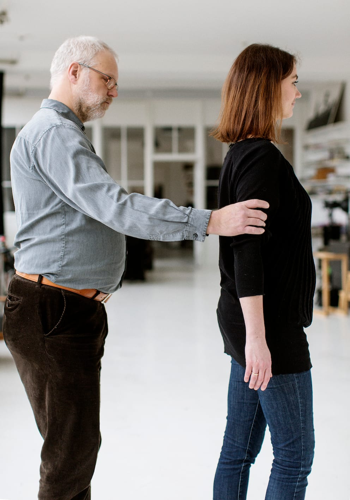
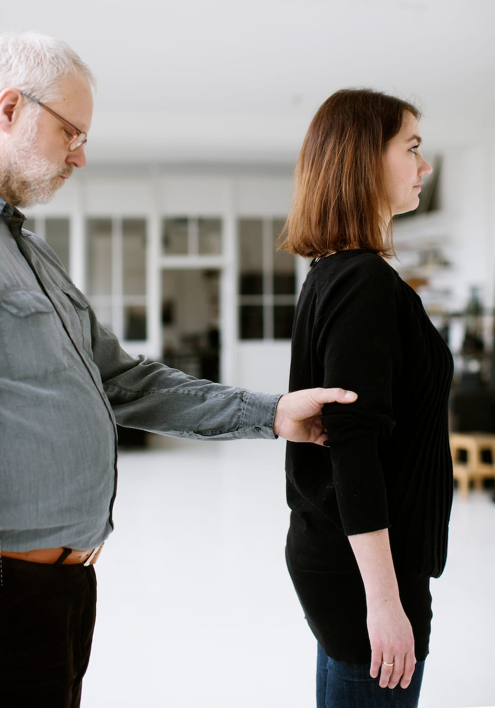

# Halvt sideskift

Hvis personen med blindhed foretrækker at blive ledsaget i én bestemt side, kan man, fx når man går gennem en dør, vælge kun at foretage et ”halvt sideskift”. Når opgaven er løst, kan personen vende tilbage til den oprindelige ledsageside.

”Halvt sideskift” kan med fordel anvendes i stedet for ”smal passage”, hvis det skal foregå over en længere strækning.

- Bo tager fat med sin frie hånd på ledsagearmen over sin egen ”ledsagehånd”.

- Han slipper med den første hånd og træder ind bag ledsageren i gåsegang.

- Bo kan strække armen for ikke at træde ledsageren i hælene.

- Når opgaven er løst,fx døren er lukket, skifter Bo igen hånd og genoptager den oprindelige position.

