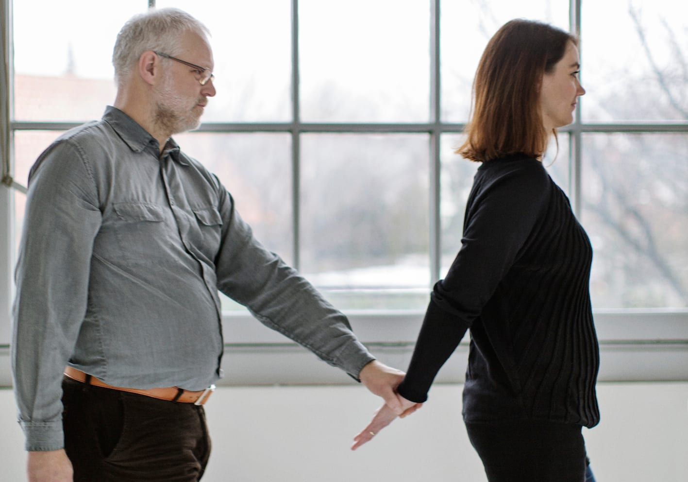
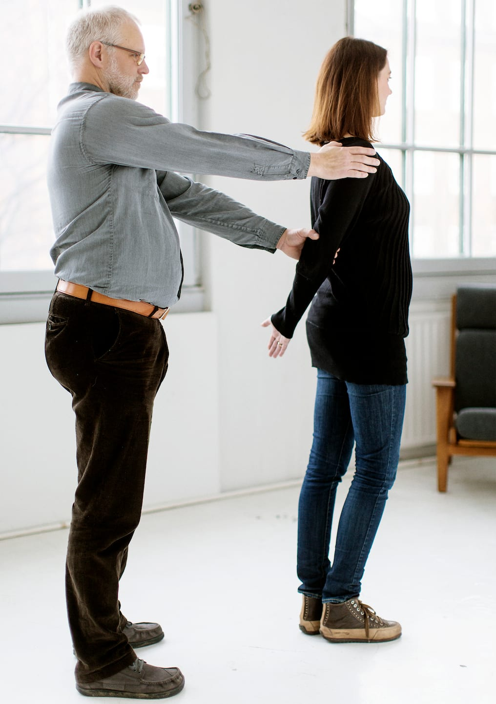
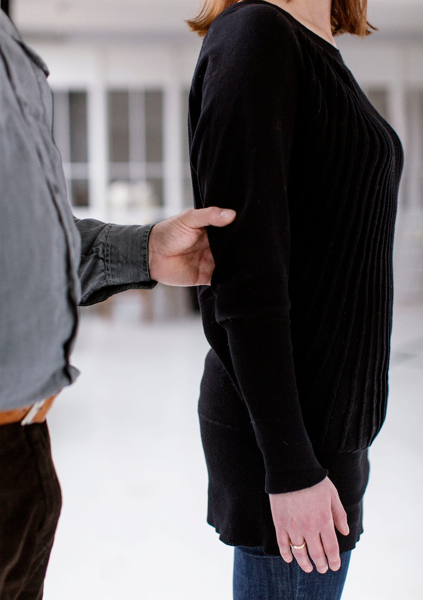
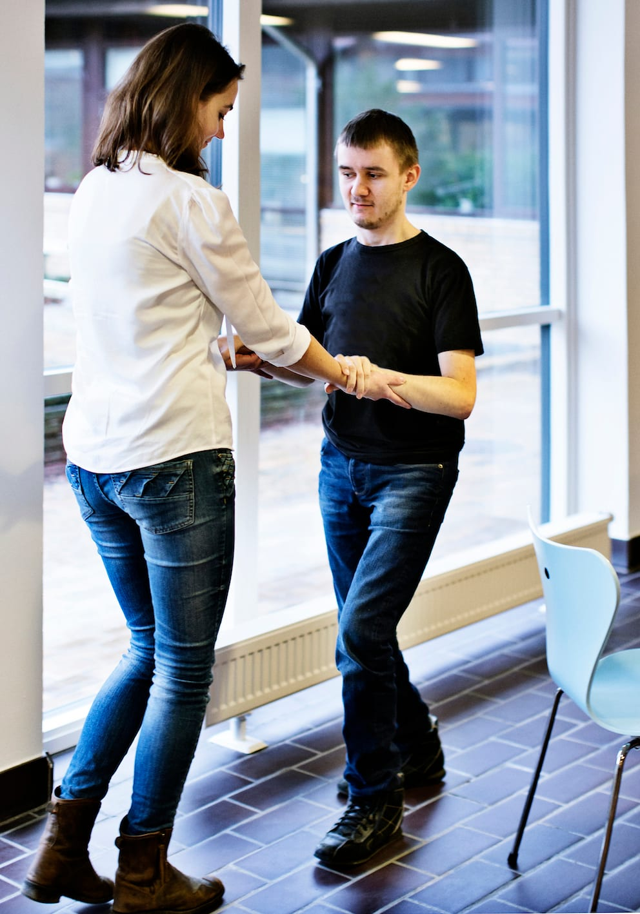

# Smal passage

Hvis man passerer et smalt sted kan det være nødvendigt at benytte en teknik, hvor man fylder mindre i bredden.

- Ved at føre sin strakte ledsagearm om bag ryggen kan ledsageren markere, at der er smal passage. På denne måde viser ledsageren Bo ind bag sig ”i gåsegang”. Samtidigt kan ledsageren fortælle ham, at de nu skal passere et sted, hvor der er smal passage.

- Bo træder ind bag ledsageren og strækker armen for ikke at træde hende i hælene. Bo kan flytte ledsagehånden ned og gribe om ledsagerens håndled for at skabe endnu mere afstand.

- Bo kan sikre sig, at han går lige bagved ledsageren ved kort at lægge sin frie hånd på ydersiden af ledsagerens skulder.

- Det er bedst, hvis ledsageren ikke vender sig om eller drejer kroppen – det hjælper Bo til at bibeholde orienteringen.

- Når det smalle sted er passeret, fører ledsageren sin ledsagearm tilbage til udgangspositionen, og de fortsætter som oprindeligt.

- I nogle situationer, fx mellem stolerækker i et teater, kan man vælge begge to at gå sidelæns med ledsageren forrest.

## Ekstra støtte

Hvis der er behov for mere støtte, kan man, som Marc viser, lade ledsageren gå baglæns foran og give ekstra støtte ved at holde rundt om begge hans underarme.

