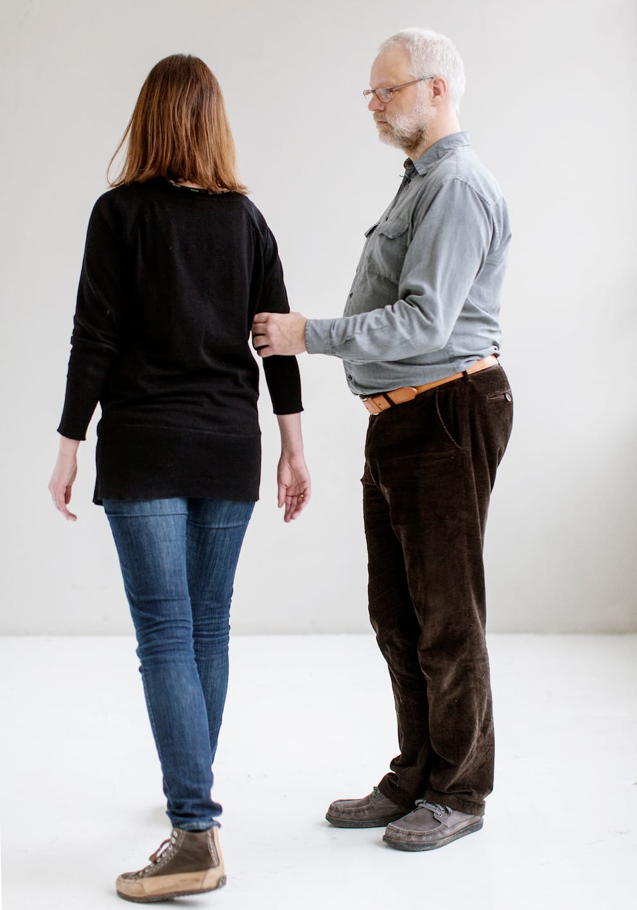

# 90°-drejning

Ledsageren skal så vidt muligt gå i lige linjer og rette vinkler for at lette orienteringen for personen med blindhed.

- Ledsageren standser kort som signal til retningsændring.

- Ledsageren drejer i rette vinkler, og gør det gerne lidt kantet og tydeligt.

- Personen med blindhed bibeholder grundpositionen under drejningen.

- Ledsageren må være opmærksom på at holde tempoet lavt, for at undgå en centrifugal virkning.
