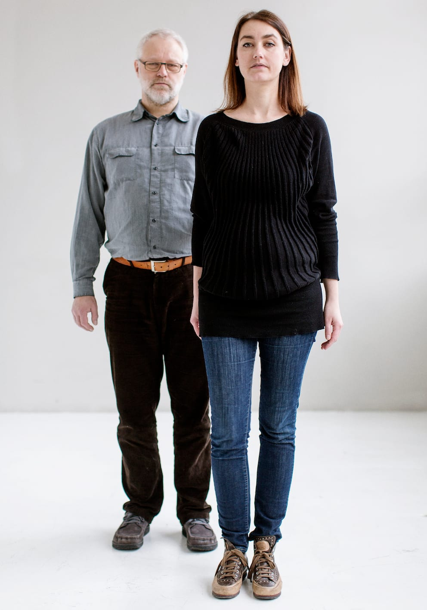
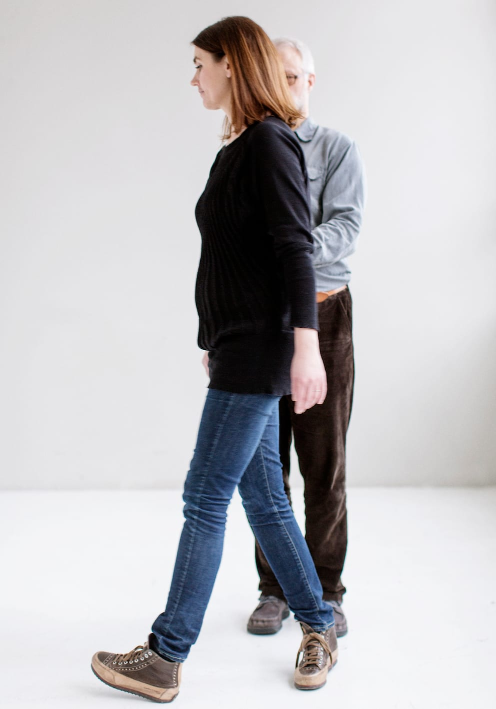
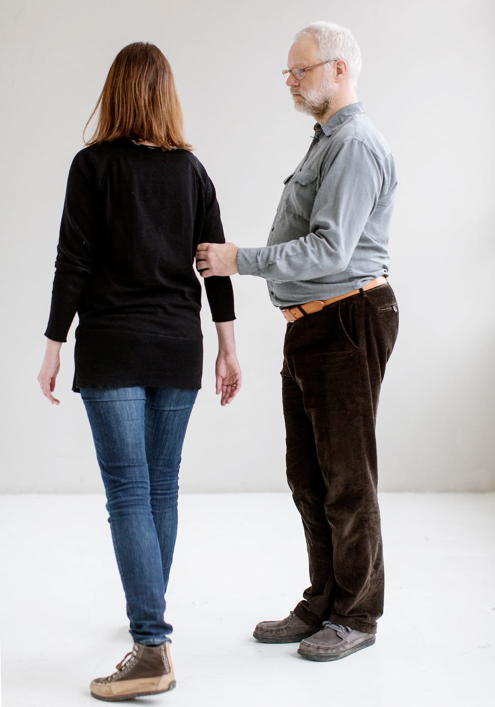
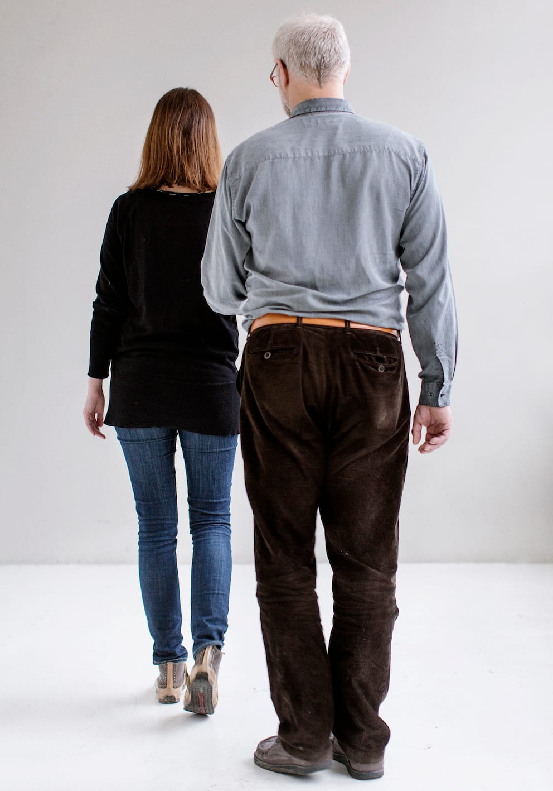
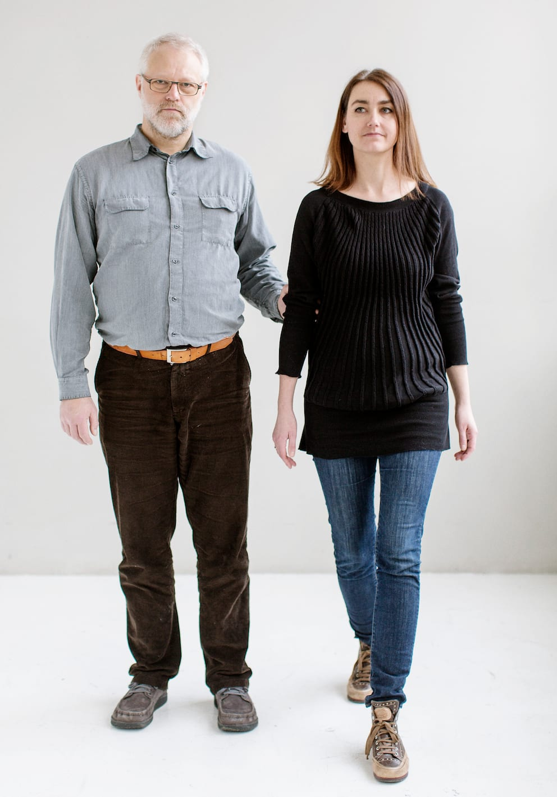
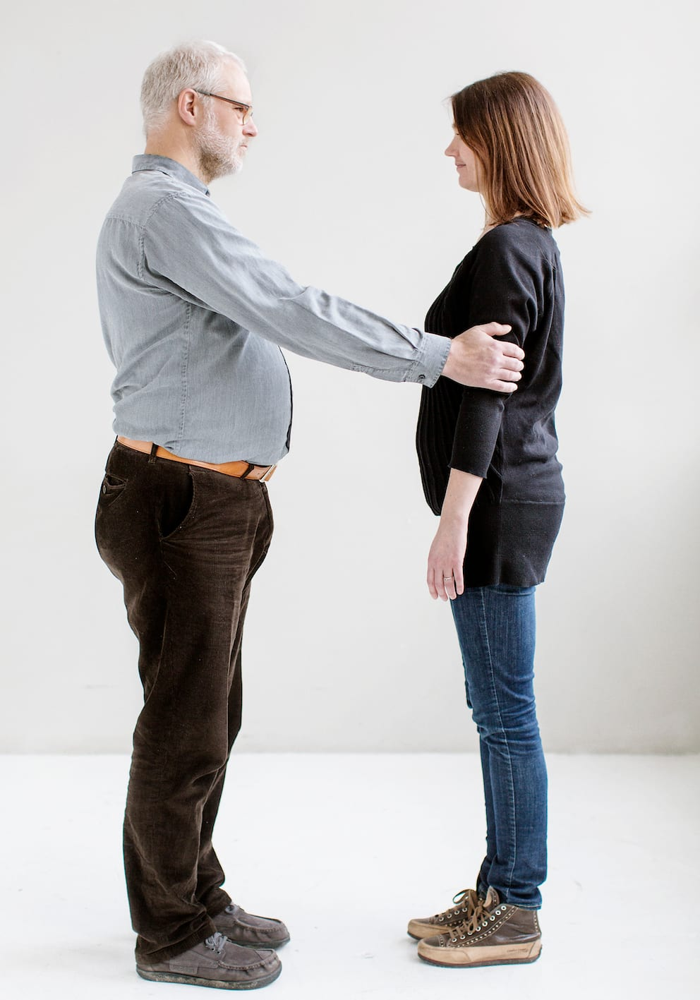
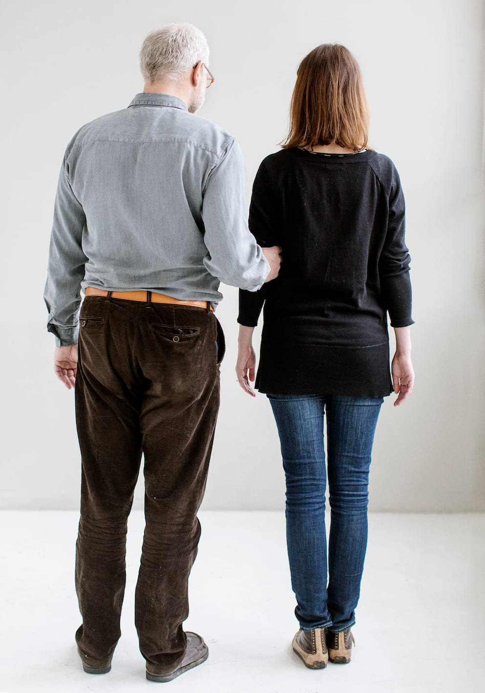

# 180°-retningsskifte

Billedserien nedenfor illustrerer, hvordan man kan vende om og gå i modsatte retning på en ubesværet måde.

- Det er vigtigt, at ledsageren går rundt om Bo. På den måde skal Bo blot dreje på stedet, og kan fortsætte i den modsatte retning.

- Hvis ledsageren derimod drejer om på stedet, kommer hun til at svinge Bo rundt som i en karussel, hvilket kan føles ubehageligt og forstyrre orienteringen for Bo.

Hvis pladsen er trang fx i en elevator, kan man benytte en anden metode:

- Bo eller ledsageren giver signal til retningsændringen og standser.

- Ledsageren træder et skridt tilbage, så hun står på linje med Bo.

- Begge drejer sig mod hinanden, mens kontakten opretholdes.

- Derefter kan Bo tage fat med sin frie hånd om ledsagerens anden arm og først slippe det oprindelige greb, når det nye greb er etableret.

- Herefter drejer begge 90°, så de står med ansigtet i den retning, de kom fra.

- Den oprindelige ledsageposition genetableres, idet de går videre.
