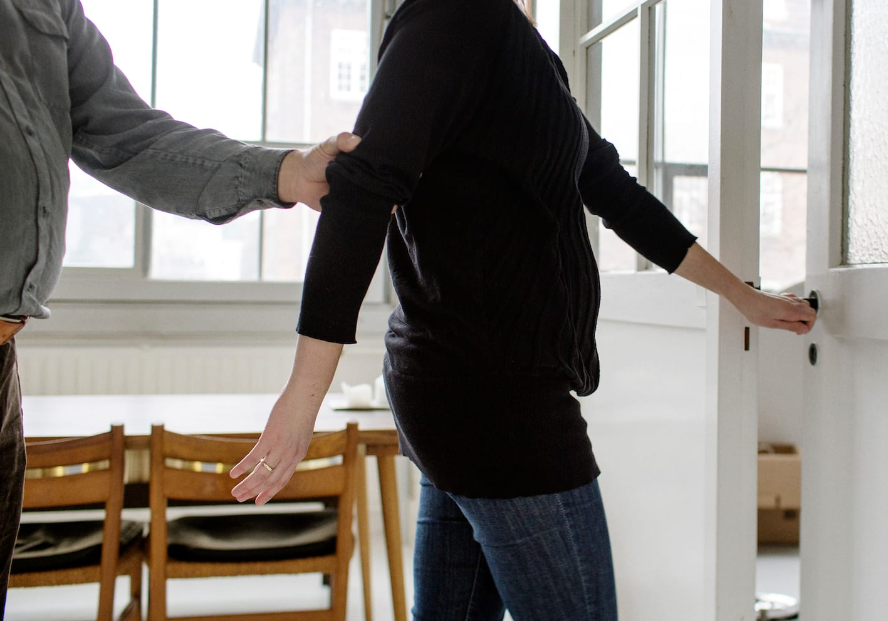
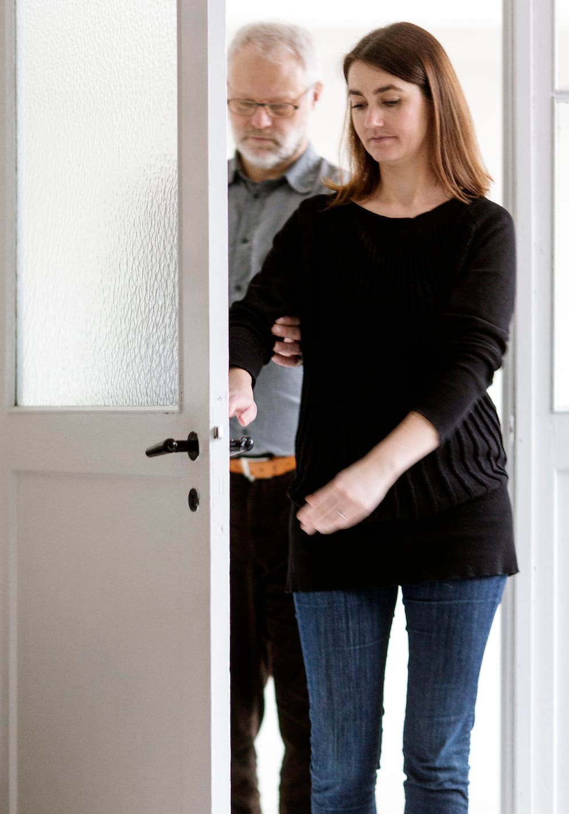
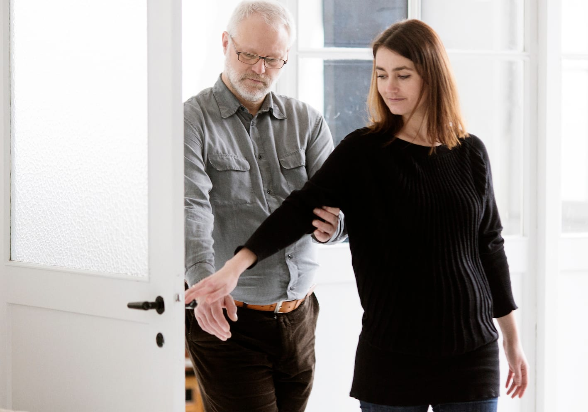
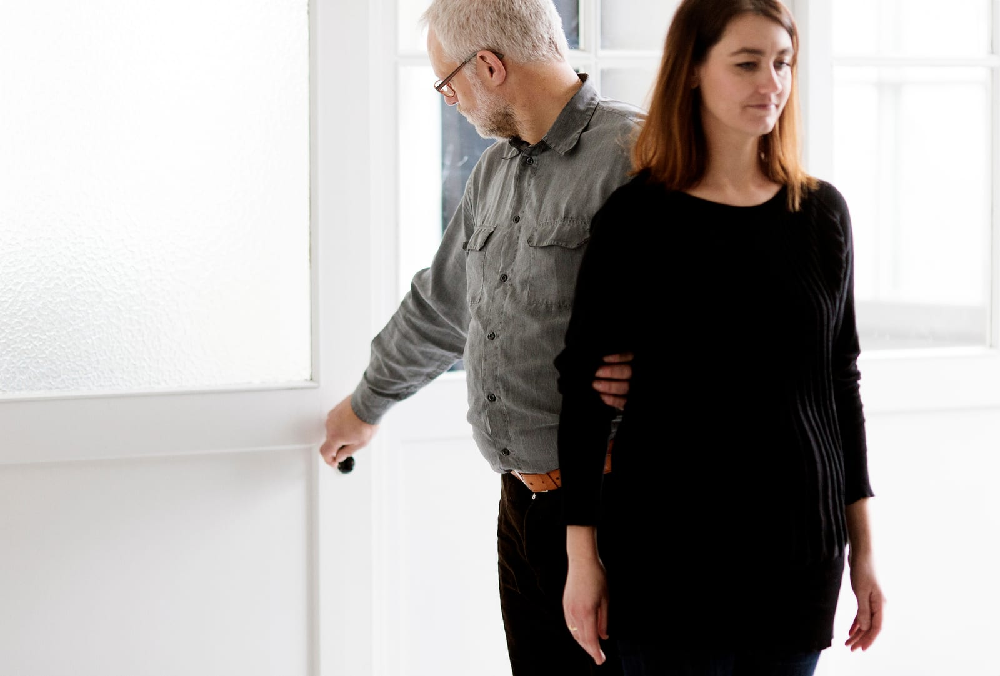
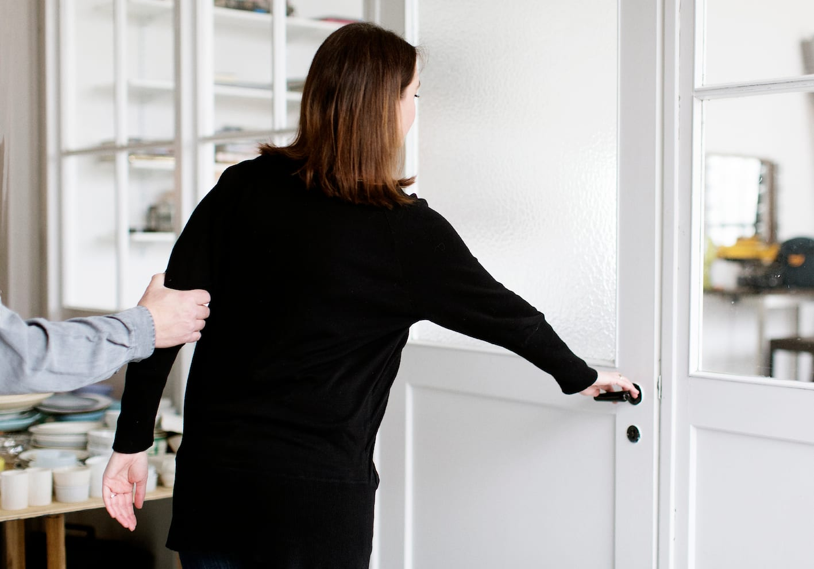
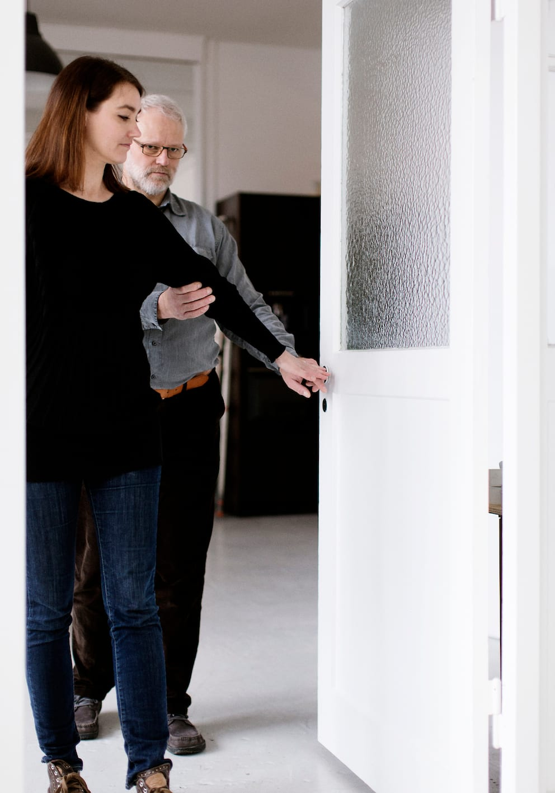
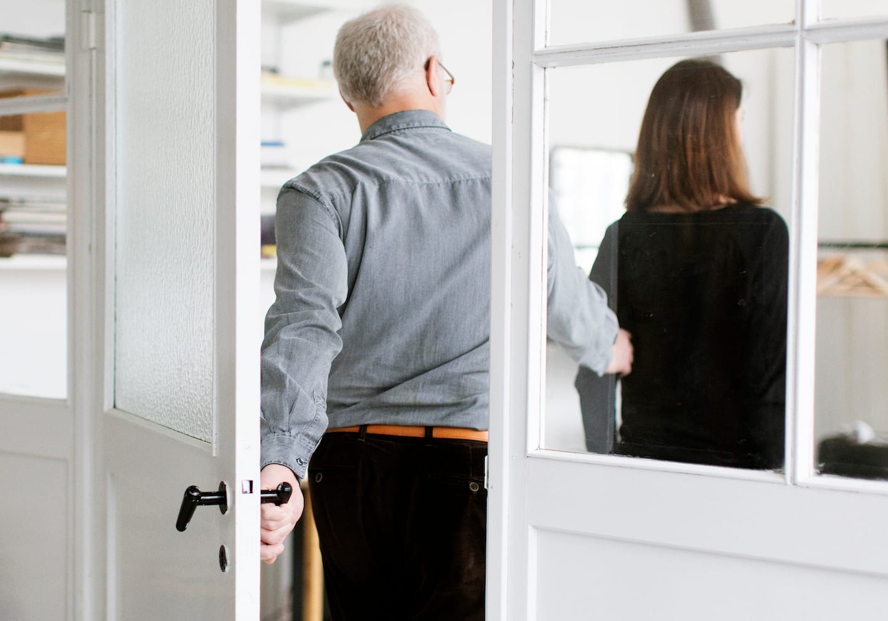
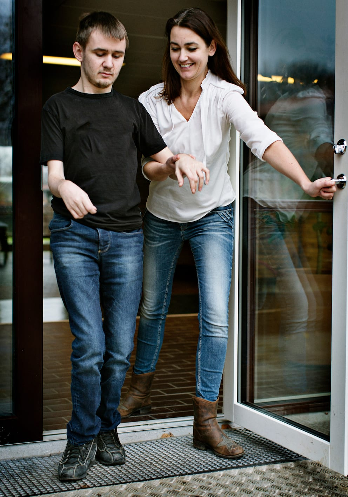

# Døre (helt sideskift)

Det er nemmest, hvis personen med blindhed befinder sig i den side, hvor dørens hængsler er, så det kan være nødvendigt at foretage et helt sideskift, inden man går gennem døren.

Når man nærmer sig døren, skal ledsageren på afstand vurdere, hvordan døren er opbygget, og opfordre til et sideskift, hvis det er nødvendigt. Hvis det er muligt vurderes det også, om døren åbner imod eller væk fra parret.

__Hvis døren åbner væk fra parret__

- Ledsageren åbner døren med sin frie hånd og markerer samtidig smal passage.

- Når parret er kommet næsten igennem døråbningen, skifter ledsageren hånd og griber dørhåndtaget med ledsagehånden.

- Bo fører sin frie hånd ned langs undersiden af ledsagerens arm – finder dørhåndtaget og overtager det.

- Når de er kommet igennem døråbningen, stopper ledsageren og lader Bo lukke døren. Det er vigtigt, at ledsageren bibeholder retningen fremad.

__Hvis døren åbner imod parret__

- Ledsageren åbner døren med sin frie hånd. Begge bliver måske nødt til at træde et skridt baglæns for at kunne åbne døren.

- Når døren er næsten åben, skifter ledsageren hånd og griber håndtaget på den anden side af døren.

- Bo lader sin fri hånd følge undersiden af ledsagerens arm, indtil han finder dørhåndtaget og overtager det.

- Ledsageren markerer smal passage.

- Bo trækker døren med sig, mens de går gennem døråbningen.

- Når de er kommet igennem døråbningen, stopper ledsageren kort og lader Bo lukke døren.

## Ekstra støtte

Ved behov for ekstra støtte kan ledsageren gå baglæns forrest og holde Marc i hænderne eller rundt om underarmene, som når man passerer et smalt sted.

Alternativt kan ledsageren bevare støttegrebet, og gå sidelæns igennem. Ledsageren håndterer døren med sin frie hånd. Ledsageren er her i dørens hængselside.

Hvis døråbningen er for smal, går ledsageren baglæns.
