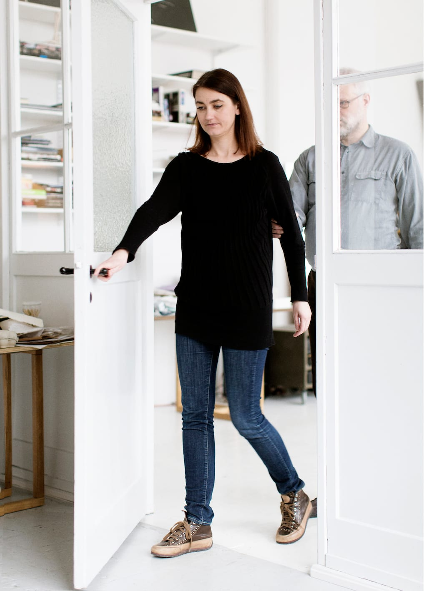
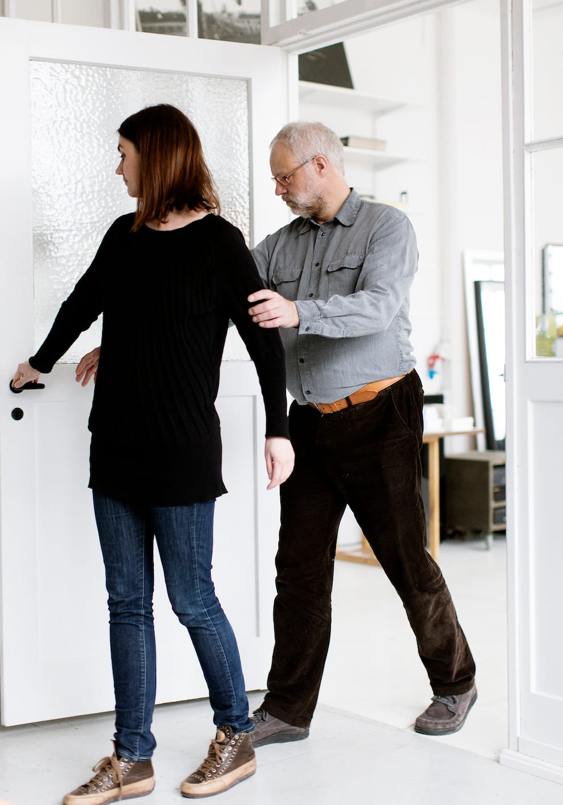
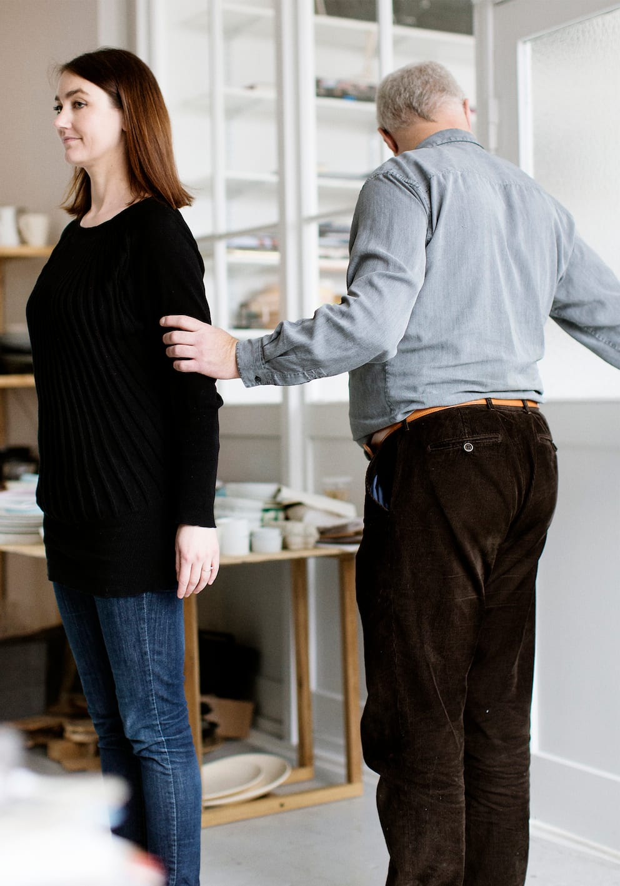
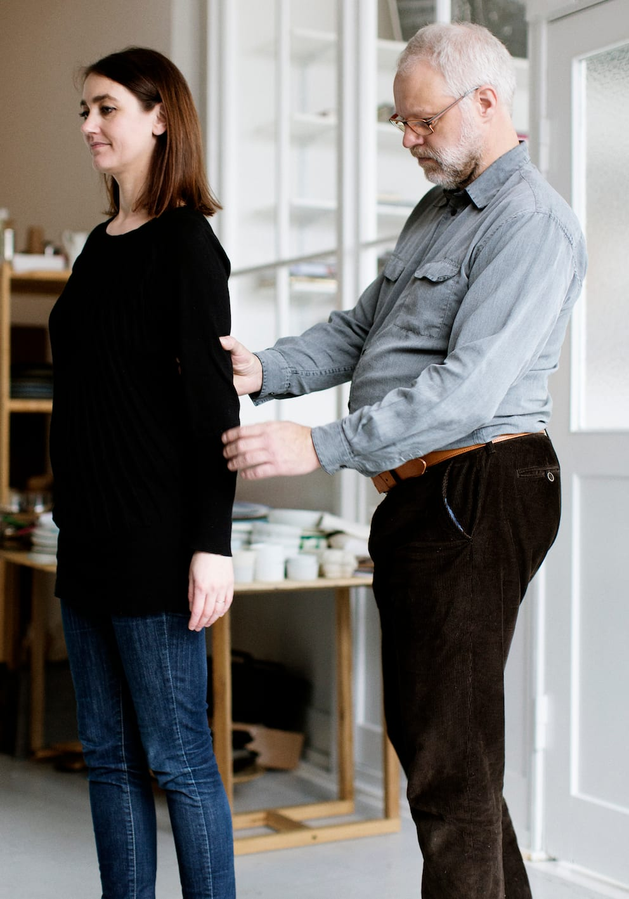
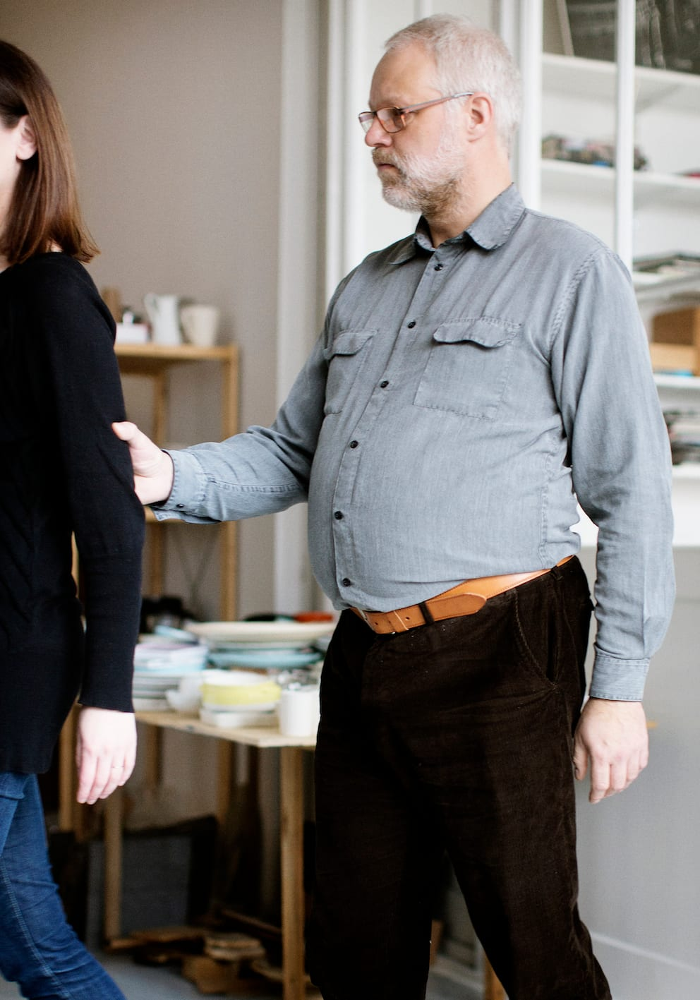
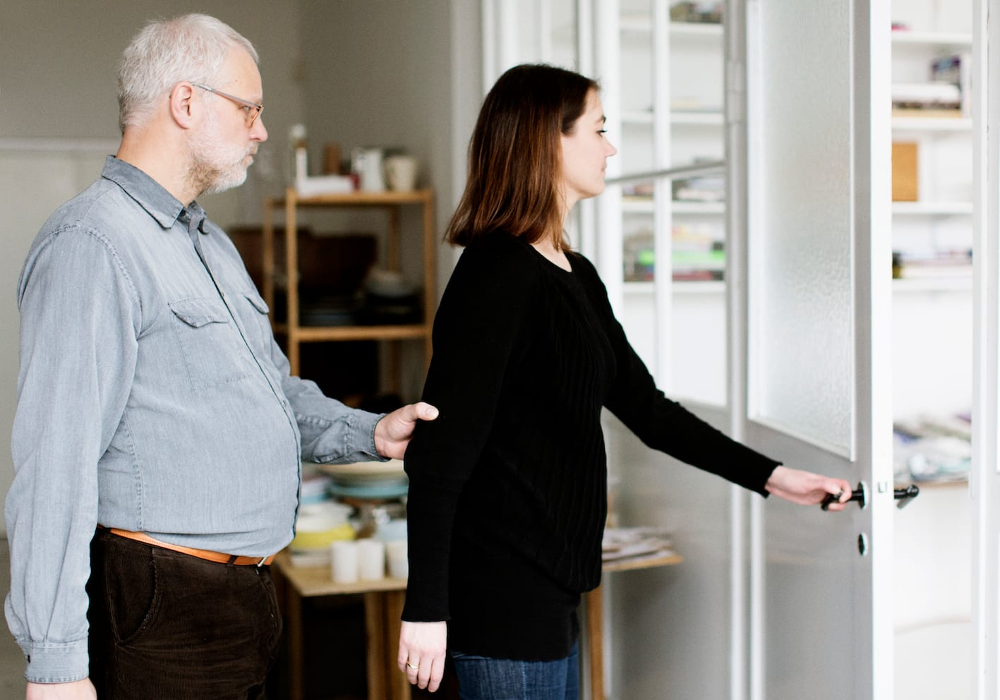
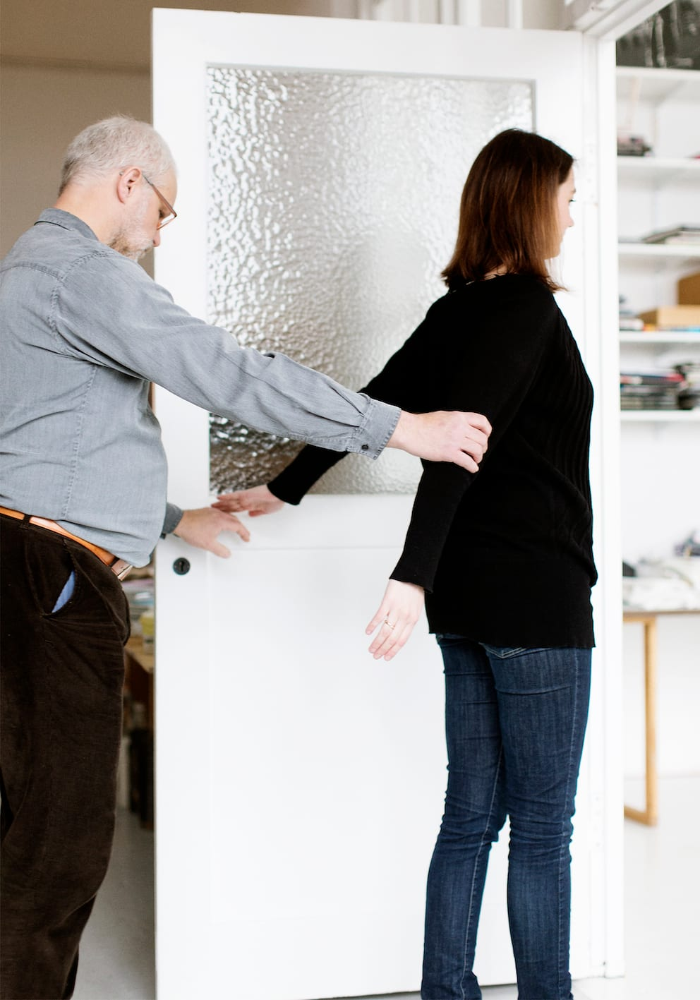
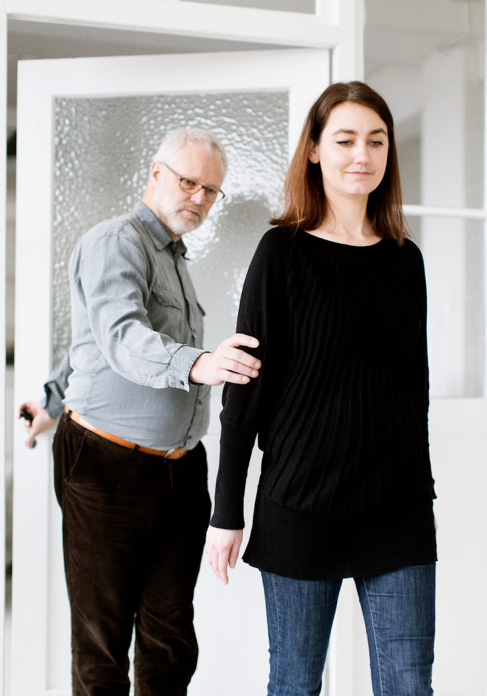
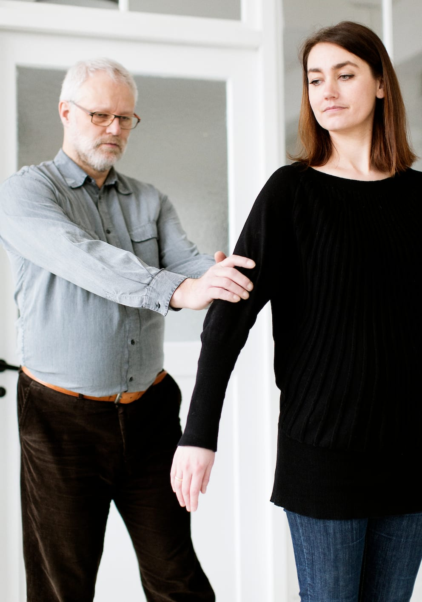
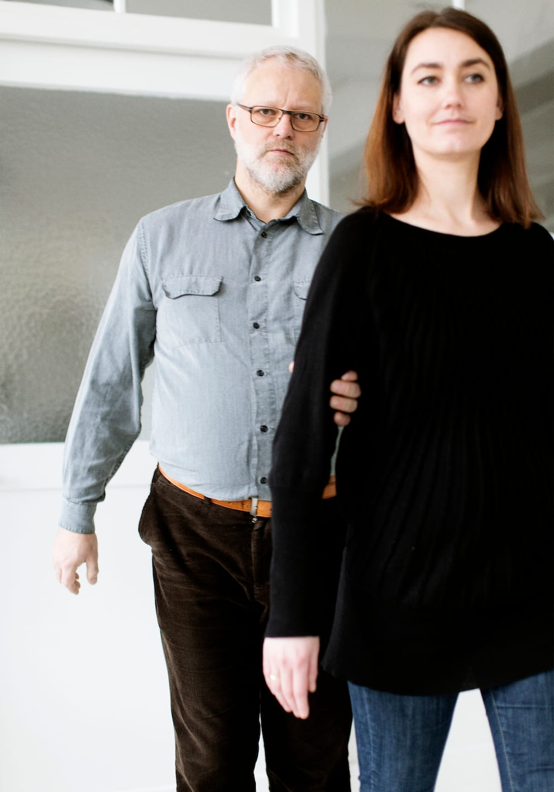

# Døre (halvt sideskift)

Personen med blindhed skal have hånden fri i den side, hvor hængslerne er, så personen kan gribe fat i håndtaget undervejs. Hvis dette ikke er tilfældet opfordres til halvt sideskift undervejs. Personen udfører kun et halvt sideskift, mens døren passeres ”i gåsegang”. Derefter genoptages den oprindelige position.

__Hvis døren åbner væk fra parret__

På billederne neden for ses Bo, som bliver ledsaget gennem en dør, som åbner væk fra ham.

- Ledsageren åbner døren med sin frie hånd.

- Når parret er næsten igennem døråbningen, foretages et halvt sideskift og Bo finder og overtager dørhåndtaget med sin frie hånd.

- Når de er kommet igennem døråbningen, stopper ledsageren og giver Bo mulighed for at lukke døren.

- Bo genoptager nu sin oprindelige ledsageposition.

__Hvis døren åbner imod parret__

- Ledsageren åbner døren med sin frie hånd. Begge bliver måske nødt til at træde et skridt baglæns for at kunne åbne døren.

- Når døren er åben, griber ledsageren fat i håndtaget på den anden side af døren. Samtidig foretager Bo et halvt sideskift.

- Bo overtager nu dørhåndtaget og trækker døren med sig, mens de gå gennem døråbningen.

- Når de er kommet igennem døren, stopper ledsageren og giver Bo mulighed for at lukke døren.

- Bo genoptager nu sin oprindelige ledsageposition.

