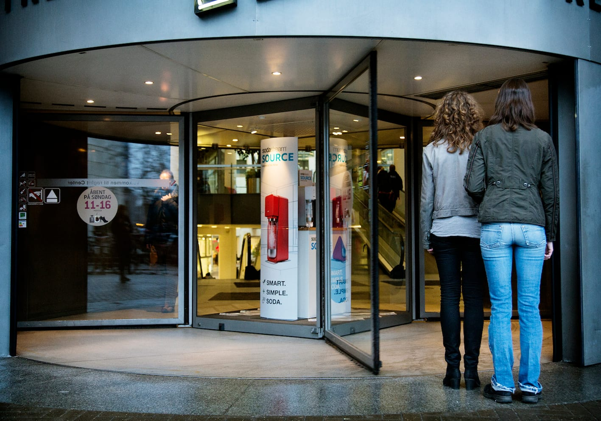
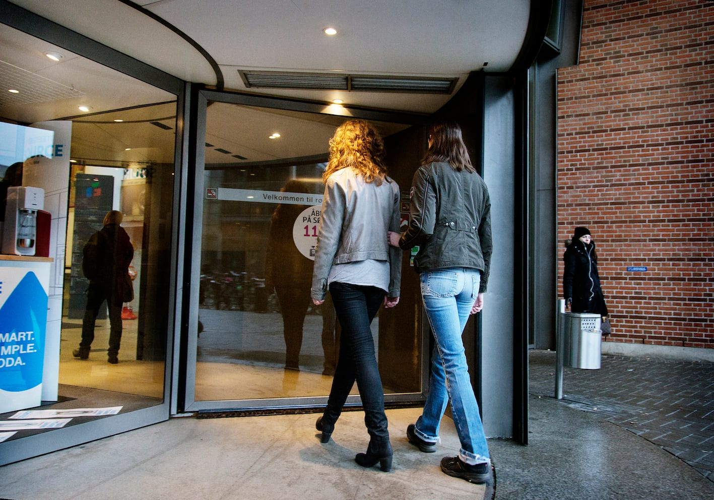
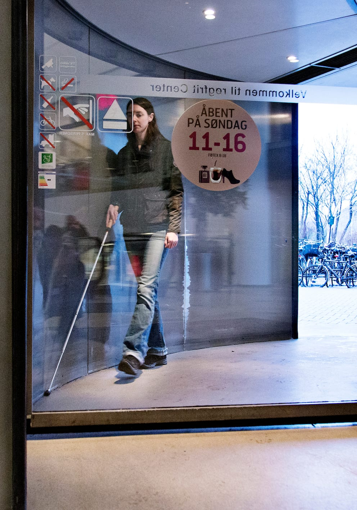

# Svingdøre

- Ledsageren stiller sig ved åbningen og fortæller Lykke, at de er kommet til en svingdør.

- Det kan være en god idé også at fortælle lidt om, hvordan den er bygget op, og hvordan pladsforholdene er.

- Hvis der er plads til begge i én sektion, kan man fortsætte med almindelig ledsageteknik evt. som ved smal passage. Lykke går til højre for ledsageren mens svingdøren passeres.

- Hvis der ikke er plads til begge, er det nødvendigt at bryde kontakten, og Lykke må gå gennem svingdøren på egen hånd i sin egen sektion, enten før eller efter ledsageren.

- Inde i svingdøren følger Lykke væggen med højre albue eller håndryg, mens hun går rundt. Når kontakten med væggen ophører, kan hun forlade svingdøren.

