# Trapper

- Ledsageren går frem mod trappen i en ret vinkel. Det kan være nødvendigt med et sideskift, hvis man vil benytte et gelænder.

- Ledsageren stiller sig helt fremme ved trappens første trin og fortæller derefter Bo, om trappen går opad eller nedad.

Her illustrerer billederne, hvordan Bo bliver ledsaget hhv. op og ned ad trapper.

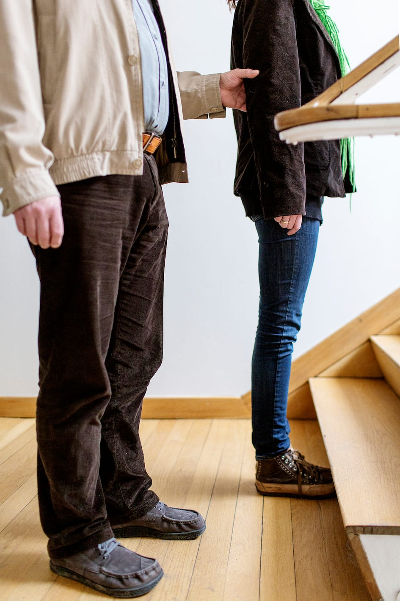
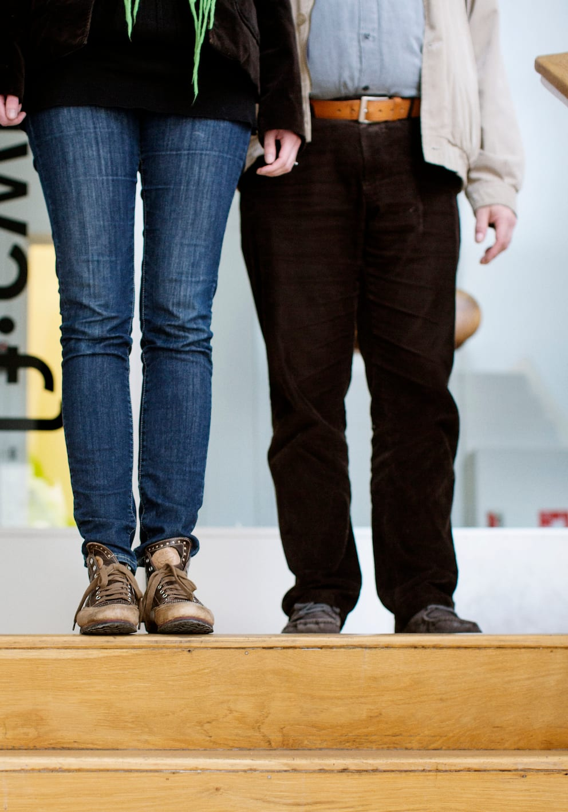

- Hvis der er et gelænder, kan ledsageren vise det ved at lægge sin ledsagehånd på gelænderet. Bo lader så sin frie hånd følge ledsagerens arm ned til gelænderet og tager fat.

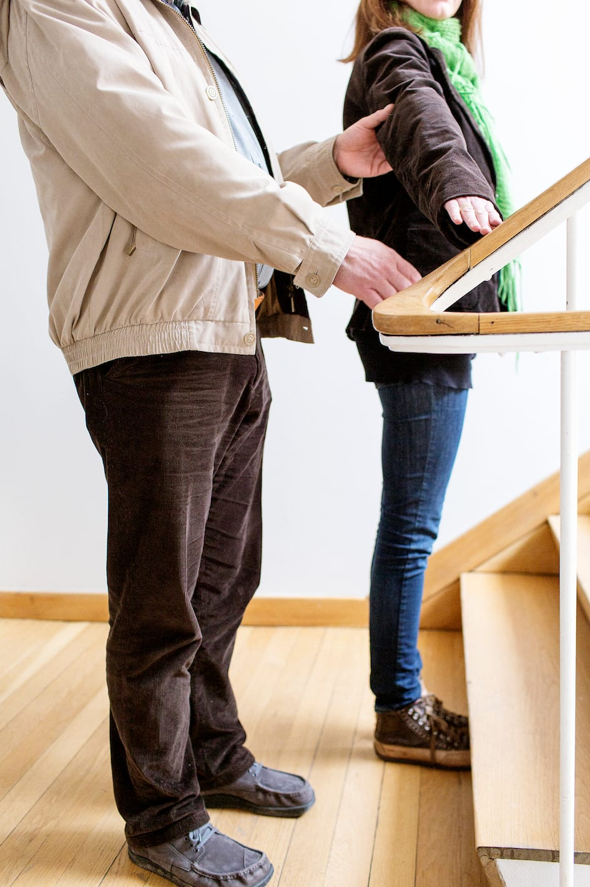
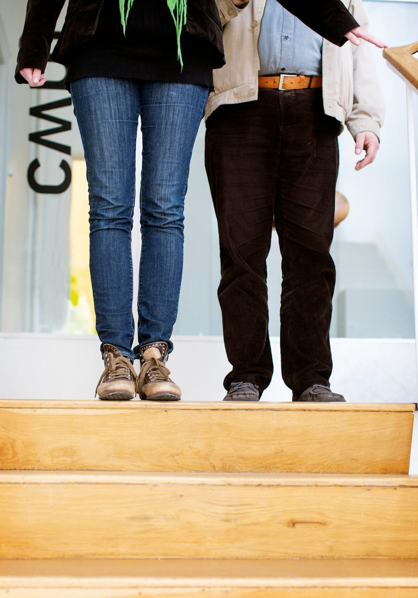

- Ledsageren går op/ned på det første trin og venter på, at Bo træder hen til trinnet. Han kan evt. lokalisere trappekanten med foden, inden han begynder at gå op/ned. Han er stadig et skridt bag ledsageren.

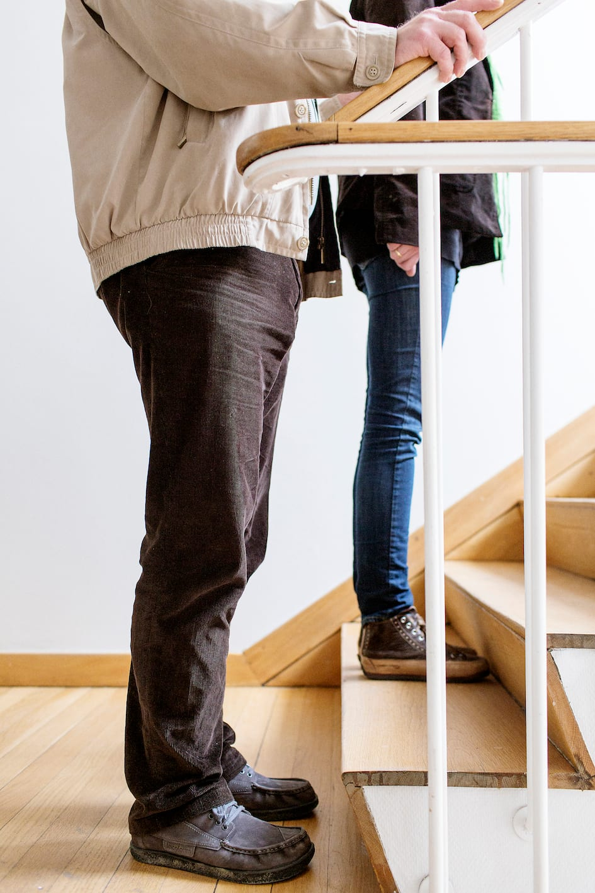
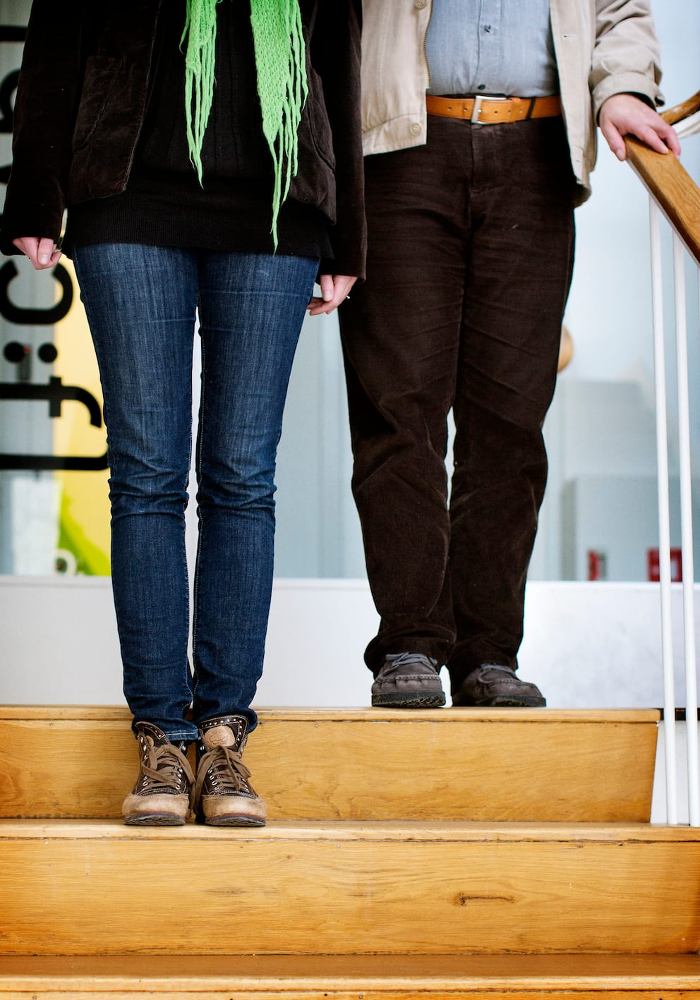

- Sammen går parret nu op/ned ad trappen et trin forskudt af hinanden.

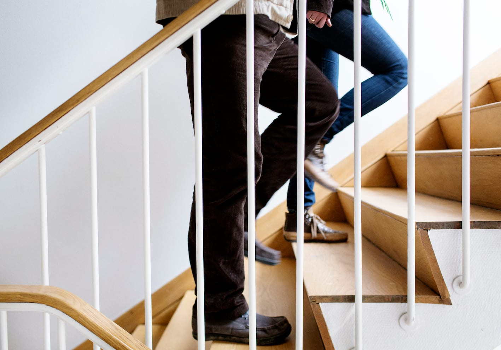
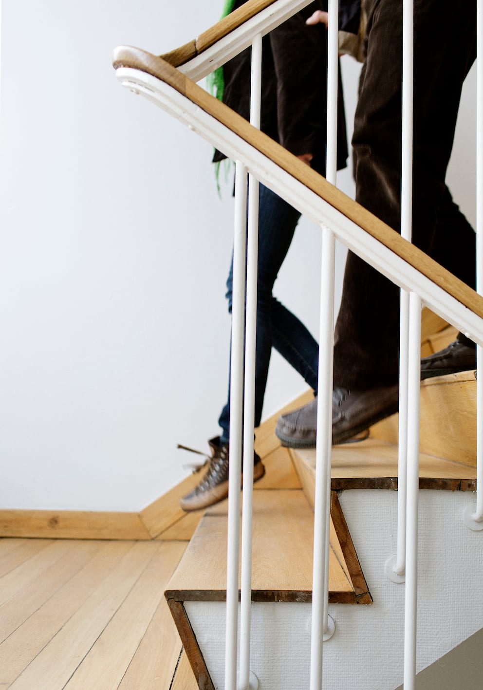

- Når ledsageren er helt oppe/nede ad trappen med begge fødder, går hun et skridt frem og stopper. På den måde venter hun på, at Bo også kommer op/ned af det sidste trin og viser samtidig, at trappen er slut.

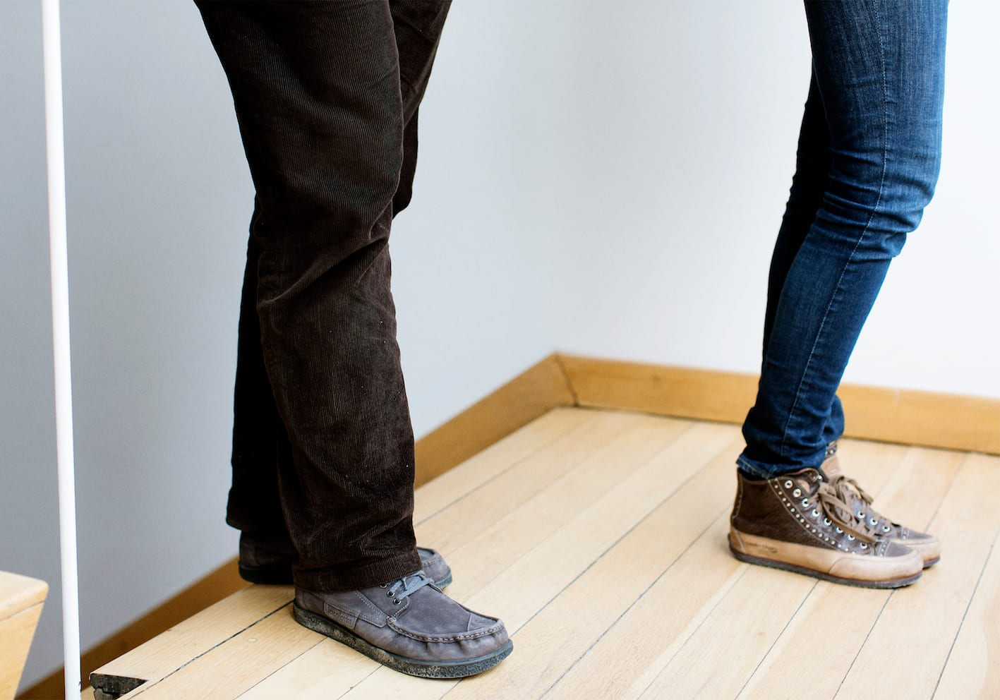
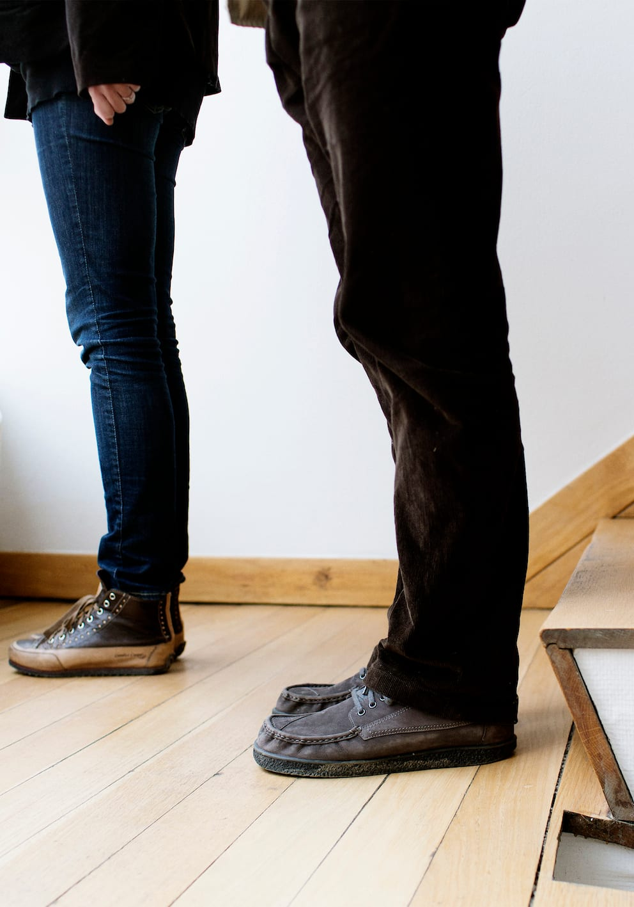

Hvis trinnenes bredde varierer fx ved en vindeltrappe, skal personen med blindhed gå i den side, hvor trinnene er bredest.

__Ledsageren stopper altså 3 gange__

- Når ledsageren står ved starten af trappen.

- Når ledsageren er et trin oppe/nede, og personen med blindhed er nået hen til trappens start.

- Når ledsageren har set, at personen med blindhed er færdig med trappetrinnene.

Personer med mobilitystok foretrækker ofte at blive ledsaget hen til trappen og selv gå op eller ned.

## Ekstra støtte

- Hvis der er brug for ekstra støtte, kan ledsageren benytte det støttende greb og gå på samme trin som Marc og med samme fod forrest.

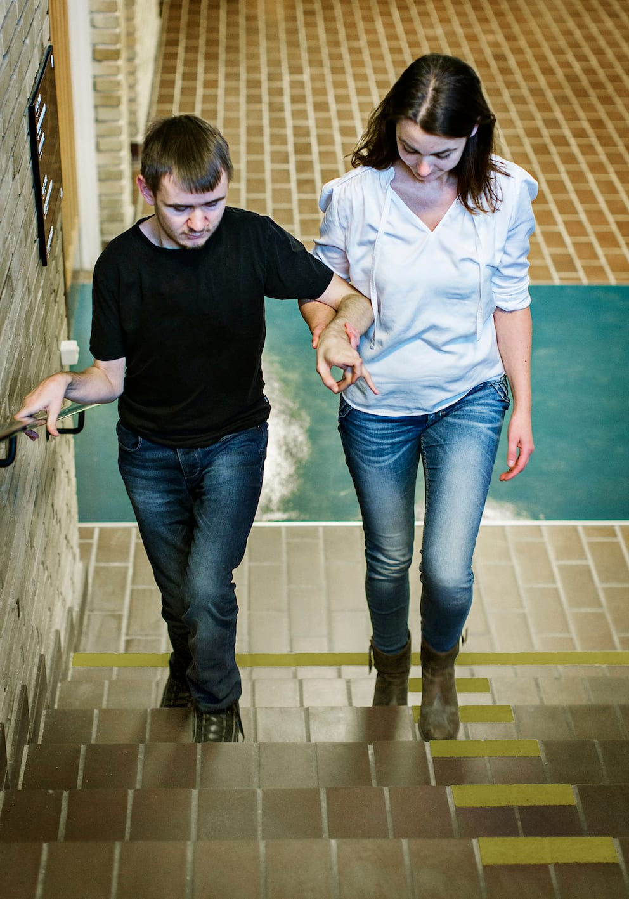

- Alternativt kan ledsageren kan gå baglæns på trappen foran Marc, mens grebet bevares. Begge holder da fast i gelænderet.

- Særligt ængstelige personer kan vælge at gå baglæns ned ad trappen med støtte af gelænderet, mens ledsageren står nederst på trappen som sikkerhed. Her giver ledsageren ekstra støtte omkring Marcs hofter.

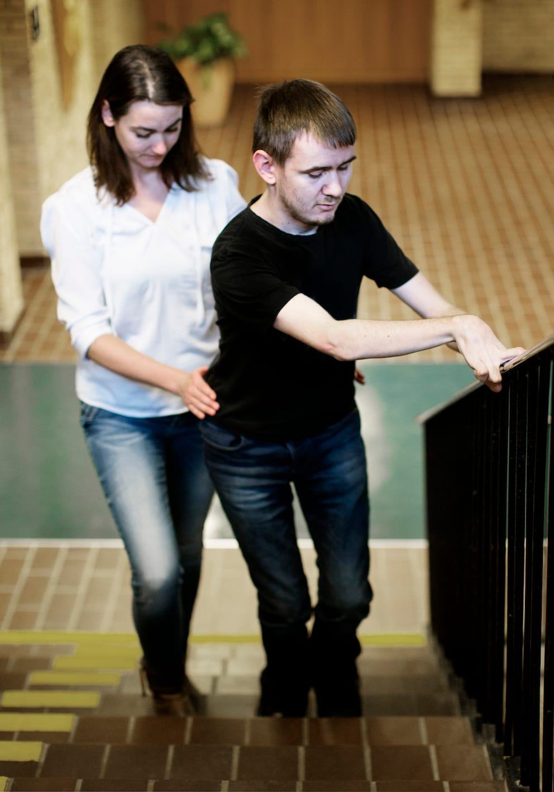
