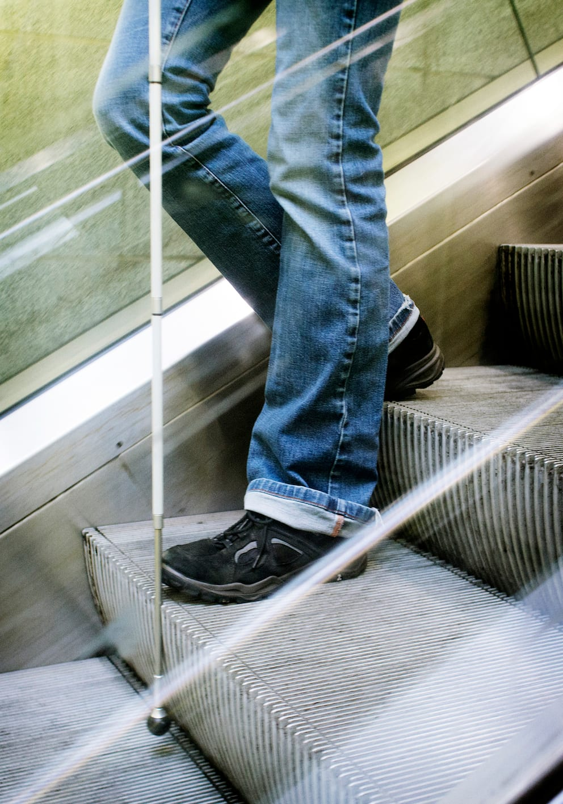

# Rulletrapper

- Ved starten af rulletrappen fortæller ledsageren om trappen, og om den går op eller ned.

- Derefter viser ledsageren med sin ledsagehånd, hvor håndlisten er og fortæller, hvornår trappen kan betrædes.

- Lykke kan stå med en fod på hver sit trin for derigennem at få at vide, hvornår trappen ender. Man ved, at man er nået til trappens slutning, når niveauforskellen mellem trinnene udlignes og håndlisten flader ud.

- Hvis rulletrappen er smal, kan det være nødvendigt at afbryde kontakten og lade Lykke gå ud på trappen alene med ledsageren foran eller bagved.

- Hvis der er plads til begge, placerer ledsageren sig således, at Lykke er tættest på gelænderet.

- Ved slutningen af trappen er det vigtigt, at Lykke bliver modtaget at ledsageren og går videre med det samme for ikke at stå i vejen for de næste, der kommer kørende.
