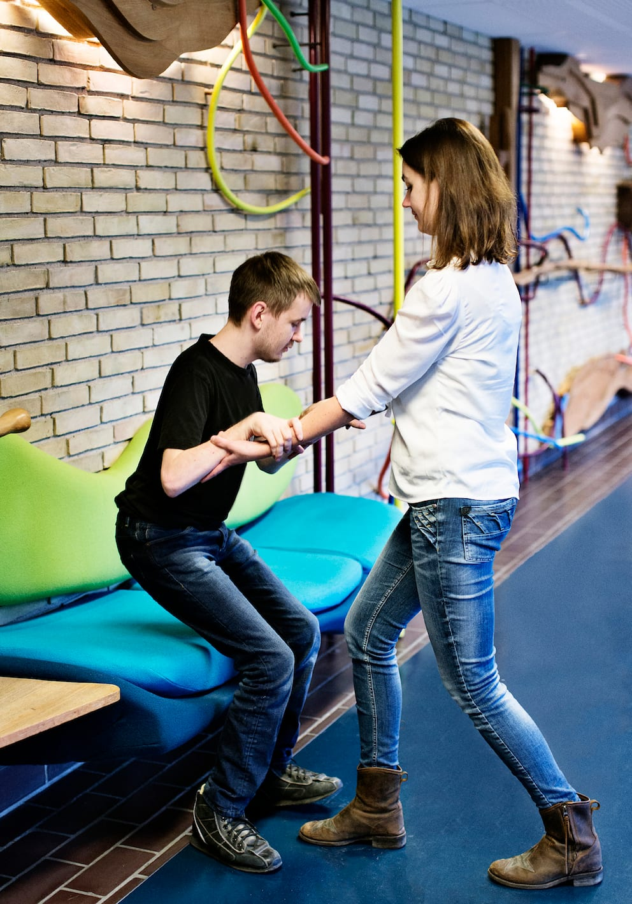

# Fritstående møbel

- Ledsageren følger personen med blindhed hen til møblet, så han så vidt muligt ankommer med front mod sædet.

- Ledsageren viser ham siddepladsen ved at lægge sin ledsagehånd på møblet og forklarer, om det er på ryglæn, armlæn eller sæde.

- Han følger ledsagerens arm ned til møblet og slipper hermed grebet om ledsagerens arm.

- Ledsageren forklarer evt., hvordan møblet er placeret i rummet.

- Personen med blindhed undersøger møblet for at finde ud af, hvilket slags møbel det er, og for at sikre sig, at der ikke ligger noget på sædet. Evt. anvendes beskyttelsesteknik.

- Personen vender sig om, kontakter stolen med begge underben for at rette ind på sædet og sætter sig derefter ned.

## Ekstra støtte

- Hvis man har brug for ekstra støtte, skal man, som Marc viser, stå foran siddepladsen med ryggen til sædet og have kontakt til møblet med begge knæhaser.

- Ledsageren stiller sig her ansigt til ansigt med Marc og holder fast i hans hænder eller overarme for at støtte ham, mens han sætter sig.

- Hvis møblet er en stol, kan ledsageren evt. stille sig bagved stolen for at sikre, at den ikke rykker sig, mens Marc sætter sig.

- Som ekstra sikkerhed kan Marc evt. få et armlæn eller et bord at støtte sig til, mens han sætter sig ned.
