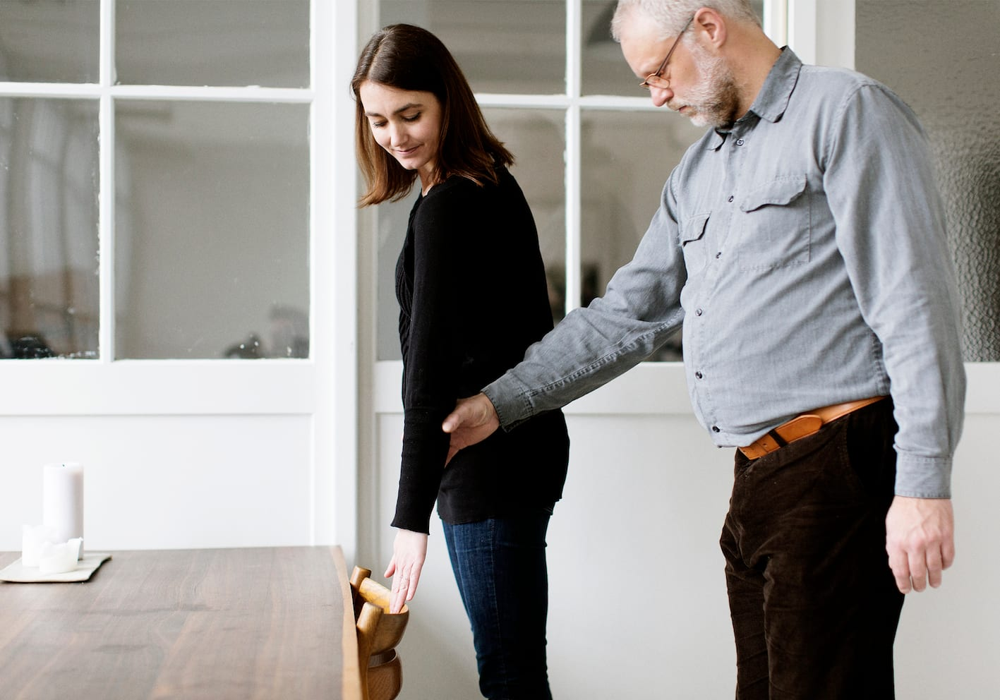
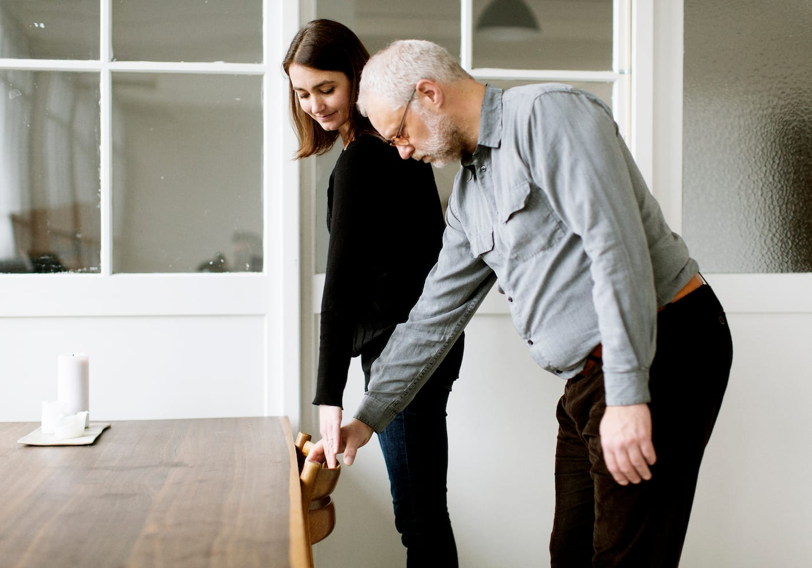

# Siddepladser ved bord

- Ledsageren lægger sin ledsagehånd på ryglænet.

- Bo følger ledsagerens arm ned til ryglænet, lægger sin ledsagehånd på ryglænet  og fører derefter den frie hånd fremad, til han får fat i bordet.

- Bo trækker selv stolen ud og bibeholder samtidig forbindelsen til bordet.

- Han sætter sig ned, når han har tjekket at sædet er frit.

- Bo kan sikre sig, at stolen står vinkelret på bordet ved at lægge begge tommelfingre på bordkanten. Når han holder begge albuer ind til kroppen, er det let at korrigere, hvis stolen står skråt i forhold til bordet.

- Når Bo rejser sig igen, sætter han stolen ind under bordet og får herved et referencepunkt for retningen.
