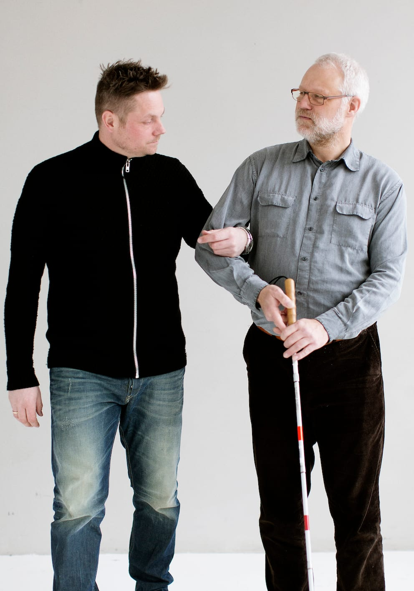
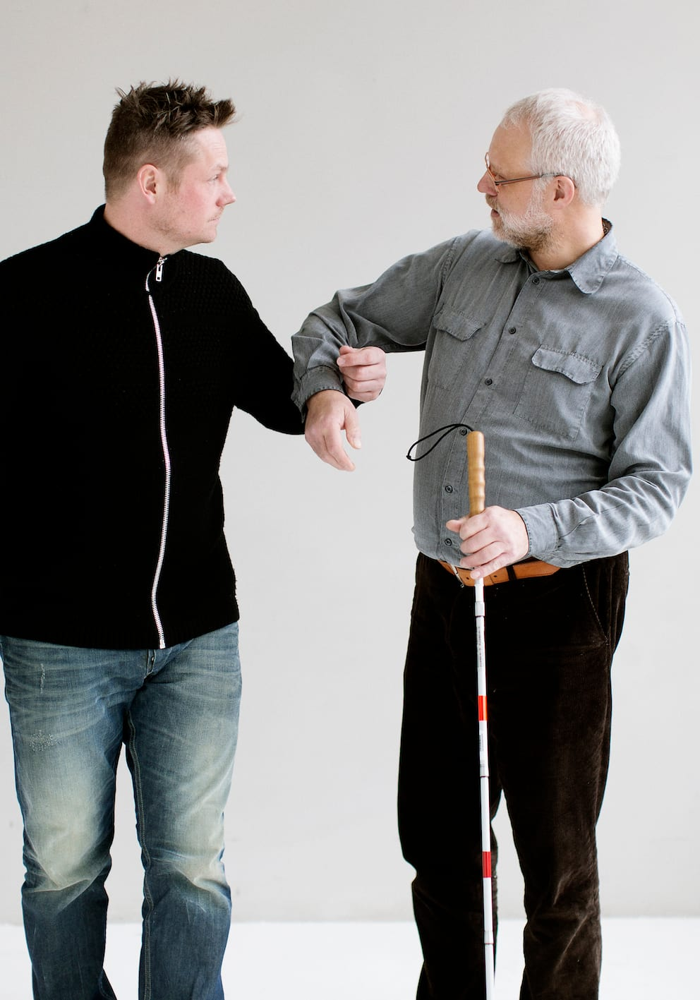
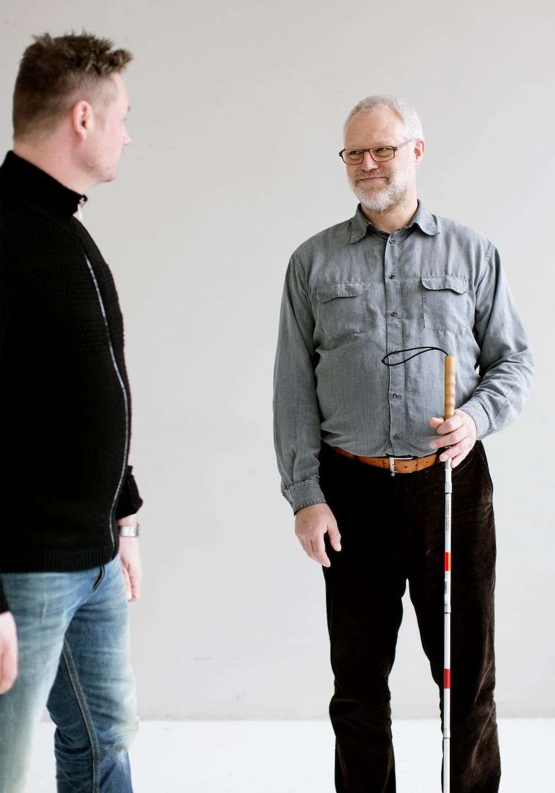

# Afslå hjælp

- Personen med blindhed kan komme ud for, at andre tilbyder hjælp ved at gribe fat i ham og begynde at trække/skubbe ham frem.

- Hvis man, som Bo på billedserien, ikke ønsker at tage imod hjælpen, kan han frigøre sig ved at gøre armen slap og trække den ud af grebet.

- Det er vigtigt at Bo samtidigt forklarer, at han ikke ønsker den tilbudte hjælp.

- Det kan være nødvendigt at flytte stokken over i den anden hånd, før man kan trække armen fri af grebet.
