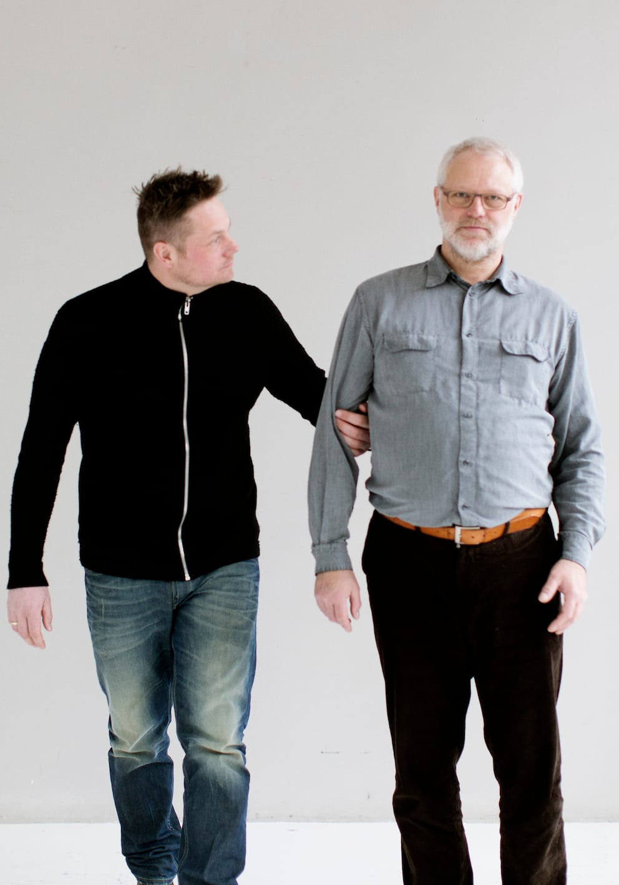
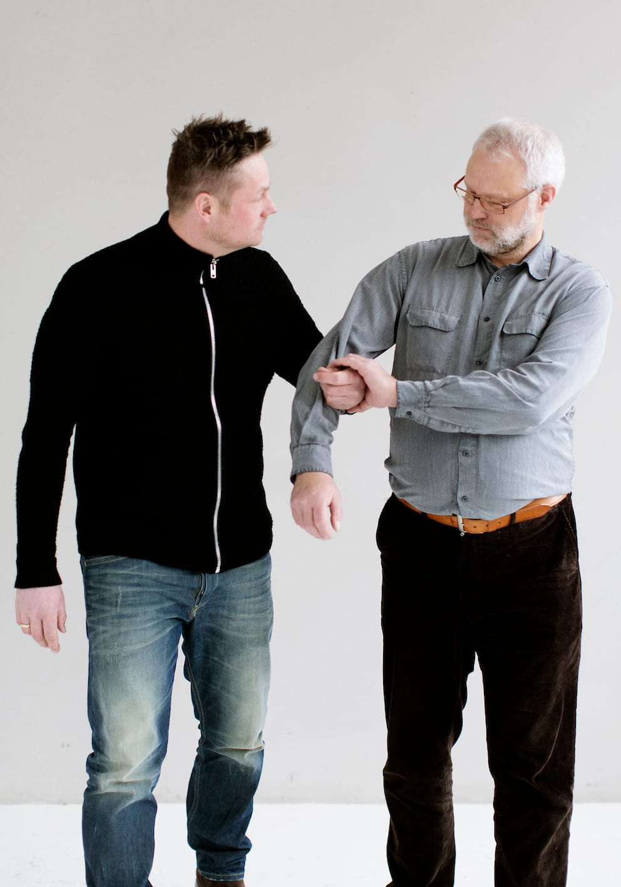
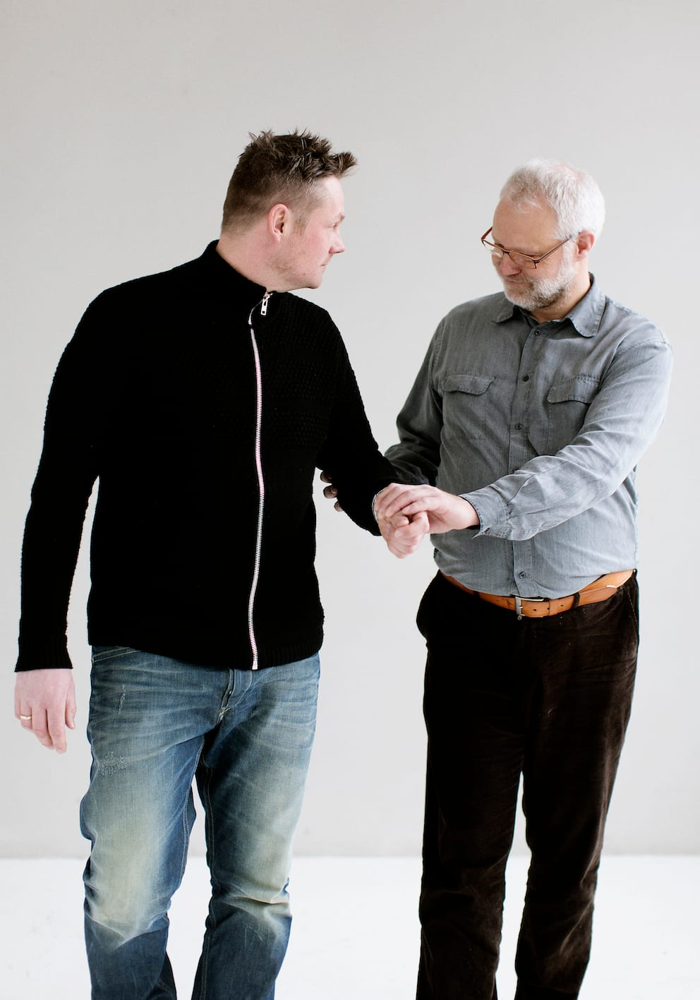
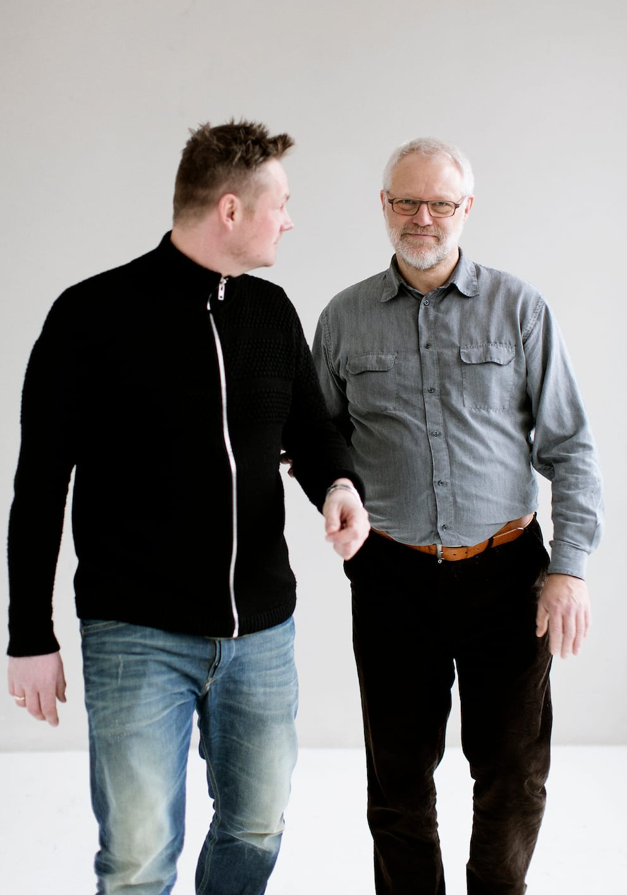
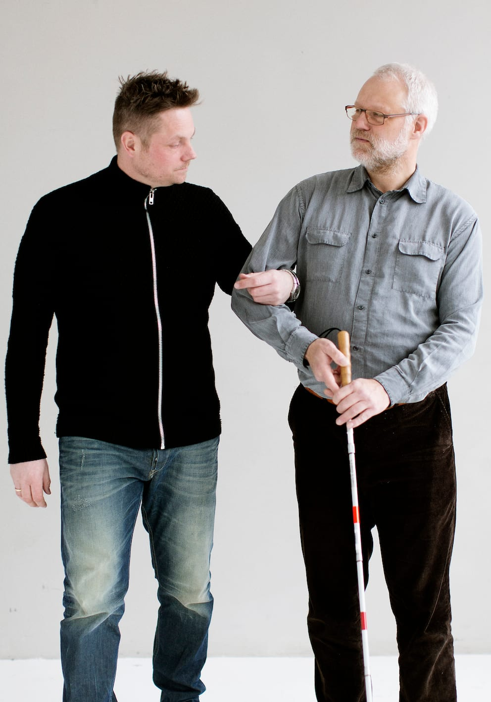

# Modtage den rette hjælp

Hvis personen med blindhed bliver tilbudt hjælp ved at en uerfaren ledsager griber fat og begynde at trække/skubbe vedkommende frem, kan personen selv korrigere positionen, så det kan foregå mere sikkert og behageligt.

- Bo skifter her til den korrekte ledsageposition ved at gribe om ledsagerens  håndled, trække sin arm fri og i stedet gribe fat i ledsagerens arm.

- Det er vigtigt, at Bo samtidigt informerer om, at han hellere vil holde fast på den måde.

- Det kan være nødvendigt at flytte stokken over i den anden hånd, før man kan trække armen fri af grebet. Stokken holdes så i den hånd, der griber om ledsagerens håndled.

