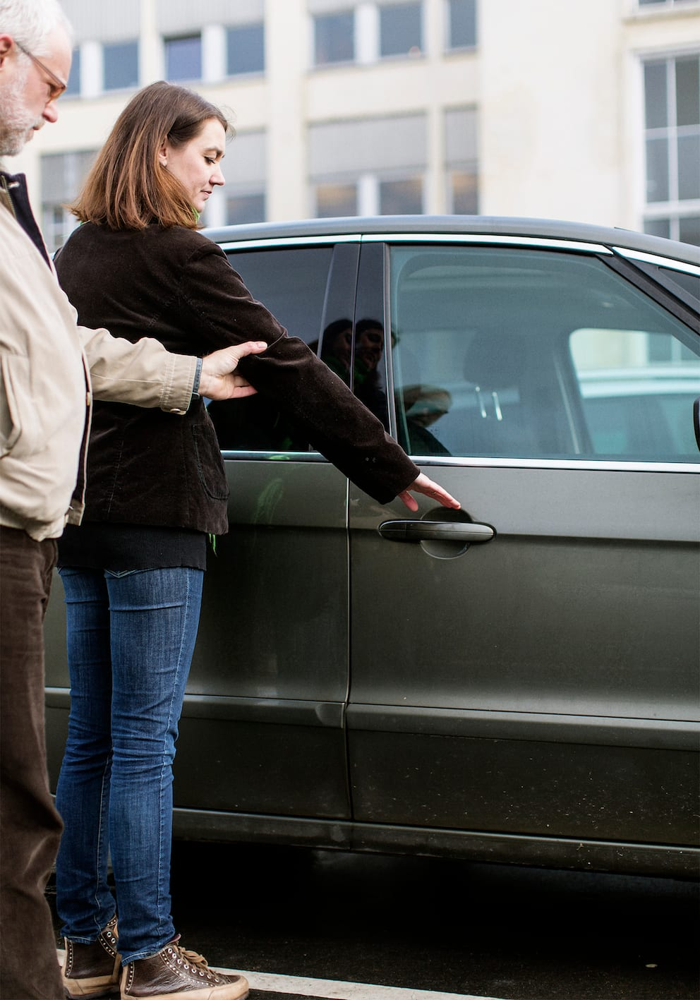
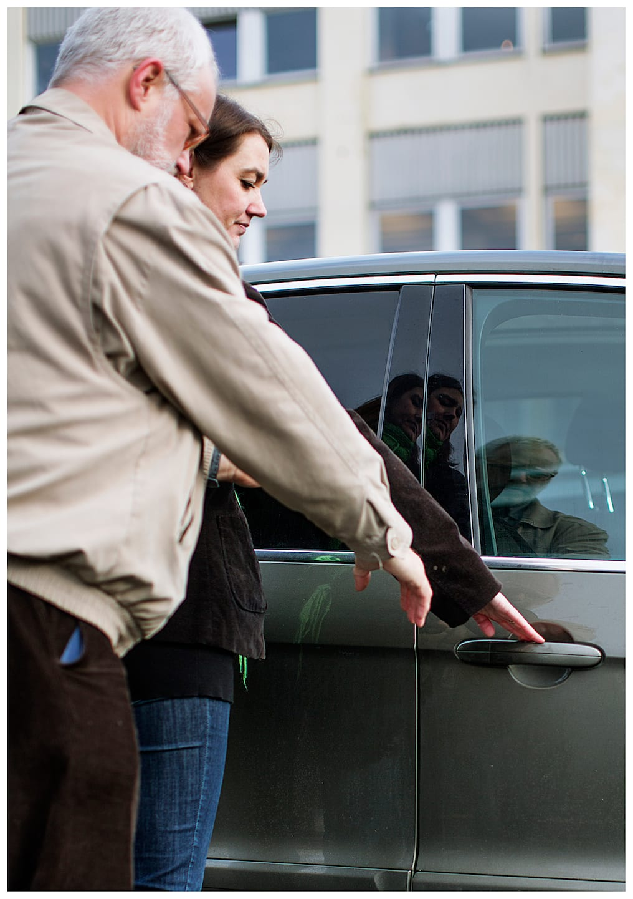
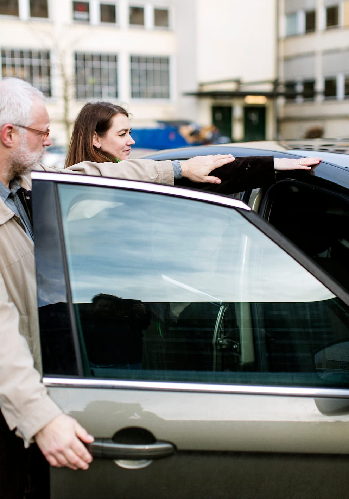
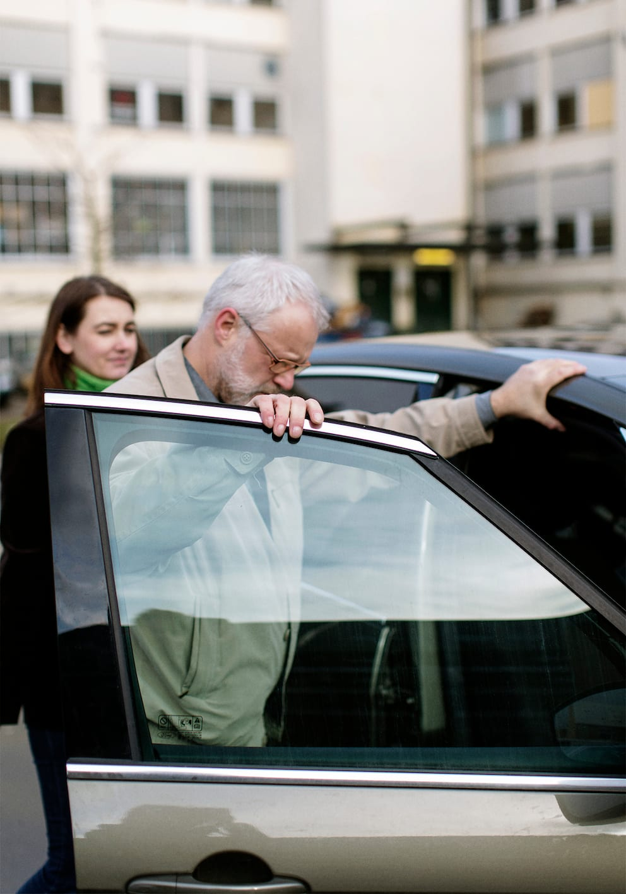
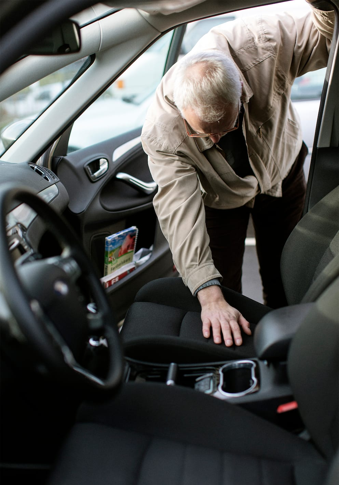

# Bildøre

- Når personen med blindhed skal ledsages ind i en bil, lægger ledsageren sin ledsagehånd på bildørens håndtag.

- Bo viser her, hvordan han med sin frie hånd følger ledsagerens arm ned til håndtaget og åbner døren.

- Ledsageren viser derefter, hvor bilens tag er.

- Bo lægger én hånd på bilens tag og én hånd ovenpå bildøren, mens han sætter sig ind.

- Bo skal vente med at lukke døren, til ledsageren siger, at det er i orden. Ledsageren skal sikre, at der ikke er fx cyklister eller parkerede biler i vejen, eller fingre, der kan komme i klemme. Det gælder både ved ind- og udstigning.

- Som Bo viser, skal man huske at tjekke med hånden, om sædet er tomt, inden man sætter sig.

