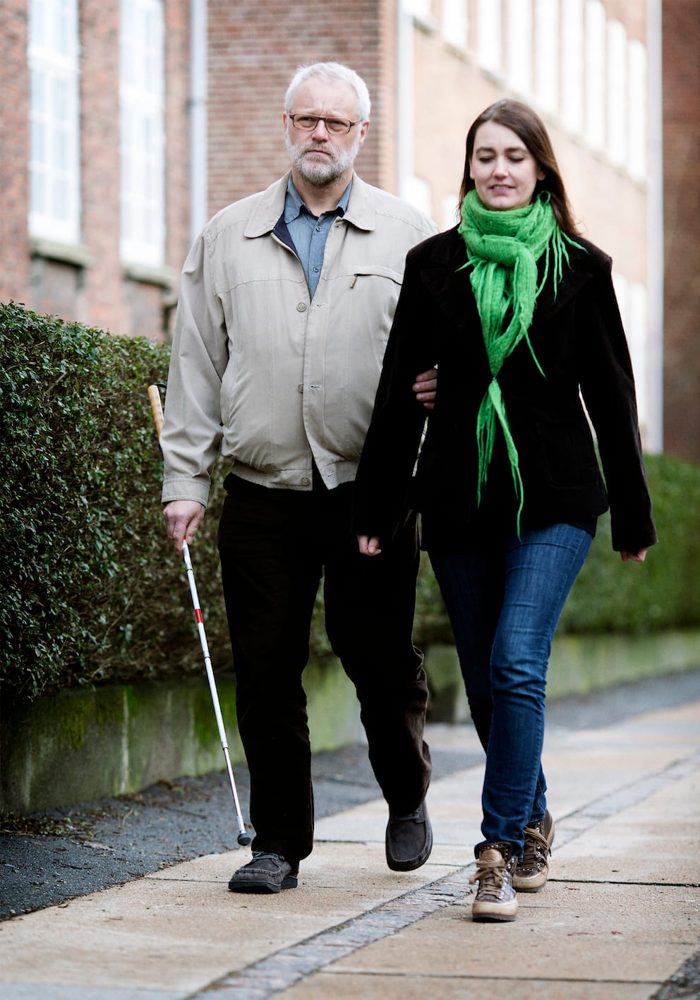
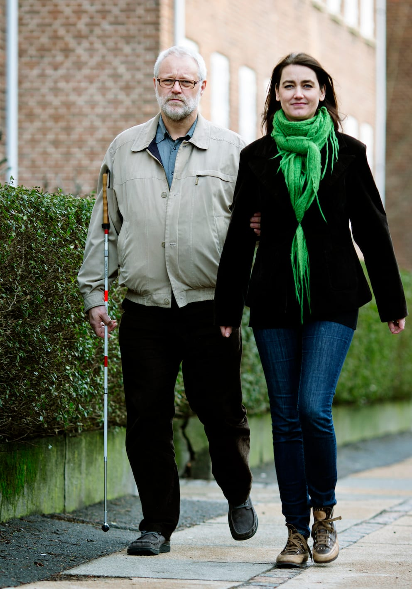
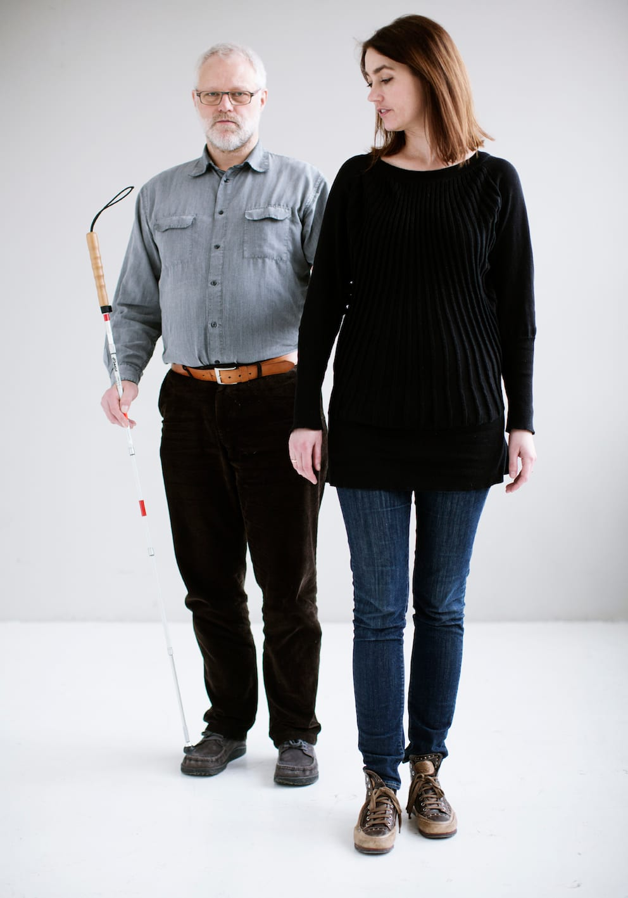
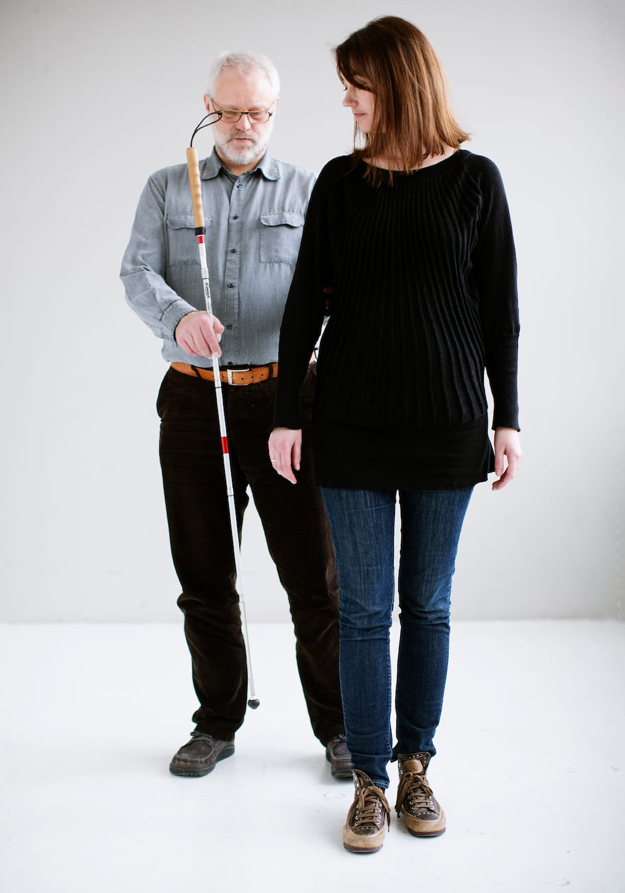
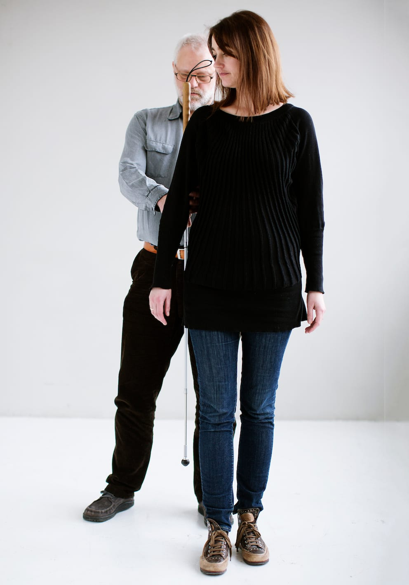
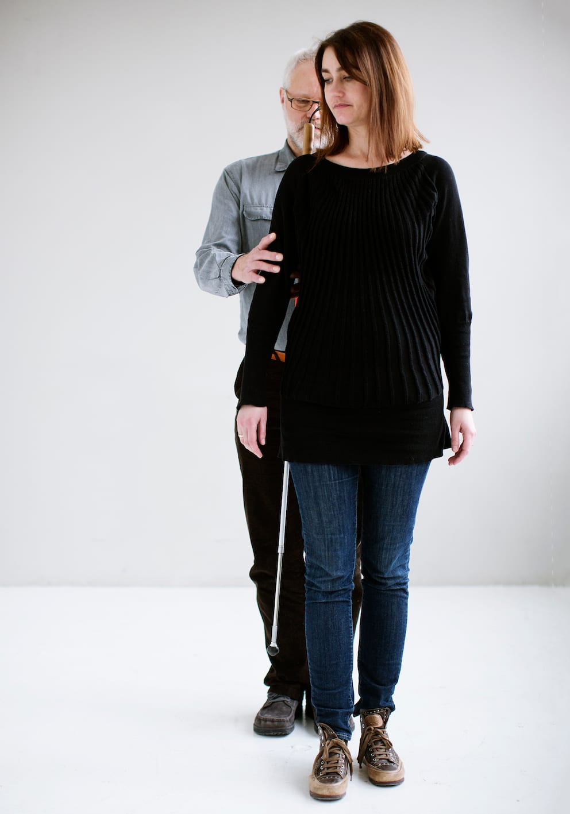
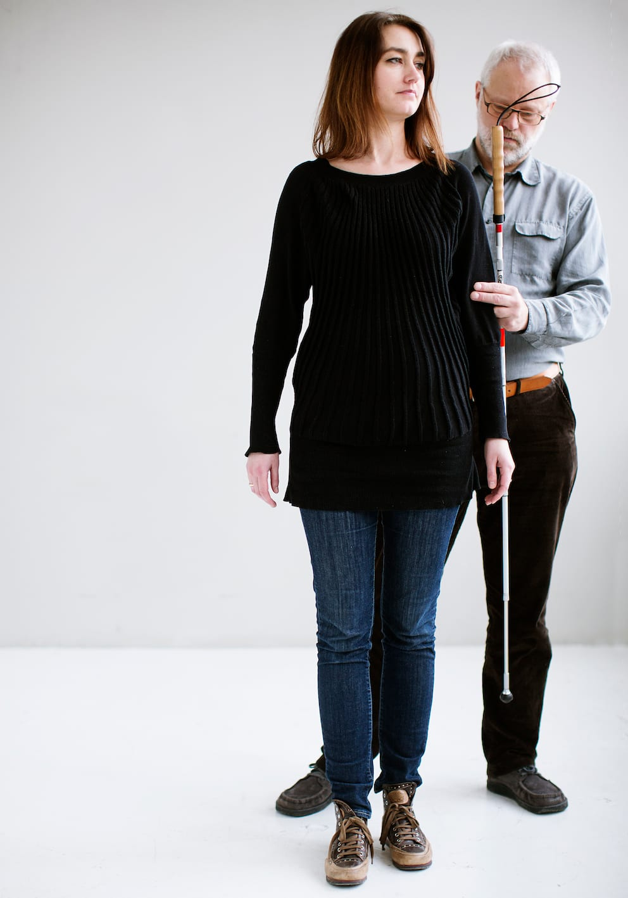
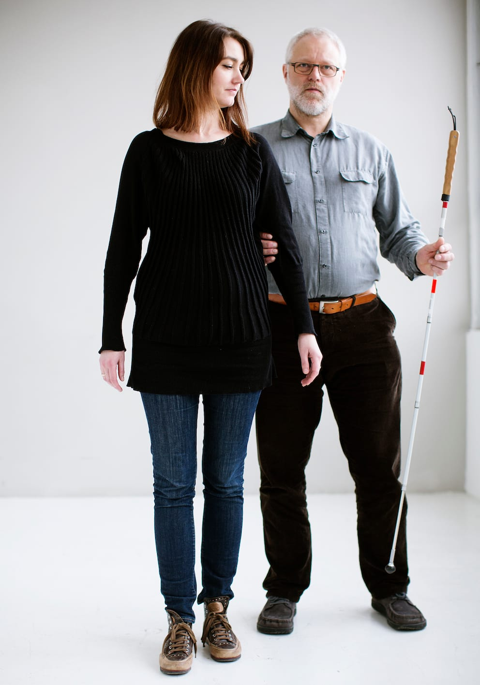
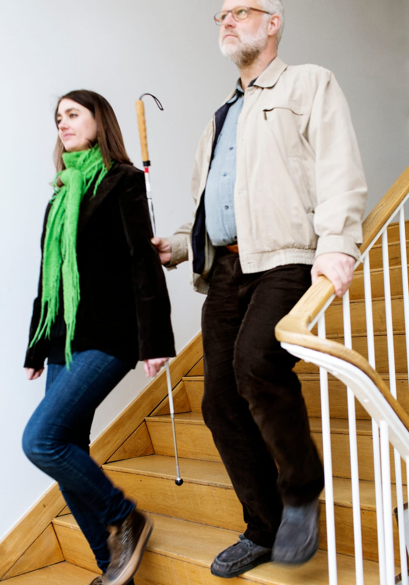

# Stok

Når man bliver ledsaget, kan stokken spille en større eller mindre rolle afhængig af, personens ønsker og behov og fx afhængig af, hvor erfaren ledsageren er.

- Hvis ledsageren er uerfaren, kan stokken have en beskyttende funktion. Er ledsageren erfaren, er dette måske ikke nødvendigt.

- Hvis stokken skal have en beskyttende funktion kan man, som Bo viser, holde stokken skråt ind foran kroppen (diagonalt). Herved kan stokken beskytte mod forhindringer og nedadgående niveauændringer, fx trappetrin.

- Man kan også vælge at lade stokken fungere som markering overfor omgivelserne, når man bliver ledsaget. Det kan fx være, hvis ledsageren er erfaren. Stokken holdes lodret og ind til kroppen, så den ikke er i vejen for ledsageren eller personen med blindhed.

Det kan være lidt vanskeligt og kræve lidt øvelse at håndtere stokken, når man bliver ledsaget, fx ved sideskift, på trapper og gennem døre.

- Hvis stokken skal ende med at skifte hånd, som fx ved et helt sideskift kan det være en god ide at starte med at med at flytte stokken over i den anden hånd, inden sideskiftet foretages.

- I tilfælde hvor man gerne vil have en hånd fri fx til at holde fast i gelænderet på en trappe, kan man placere stokken under tommelfingeren på sin ledsagehånd.

