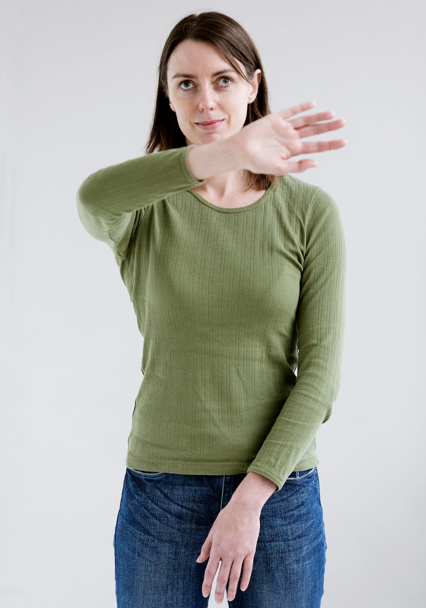

# Introduktion - beskyttelsesteknikker

Beskyttelsesteknikker anvendes primært, når man færdes over en kortere strækning i kendte omgivelser uden brug af en ledsager, en mobilitystok eller en hund.

Teknikkerne kan benyttes til at lokalisere specifikke ting med kendt placering og de kan anvendes, hvor der er mistanke om forhindringer fx ved udforskning af ukendte rum.

Beskyttelsesteknikker giver kun begrænset beskyttelse fra hoftehøjde til hovedhøjde og giver således ingen beskyttelse mod niveauændringer eller forhindringer fra hoftehøjde og nedefter.

