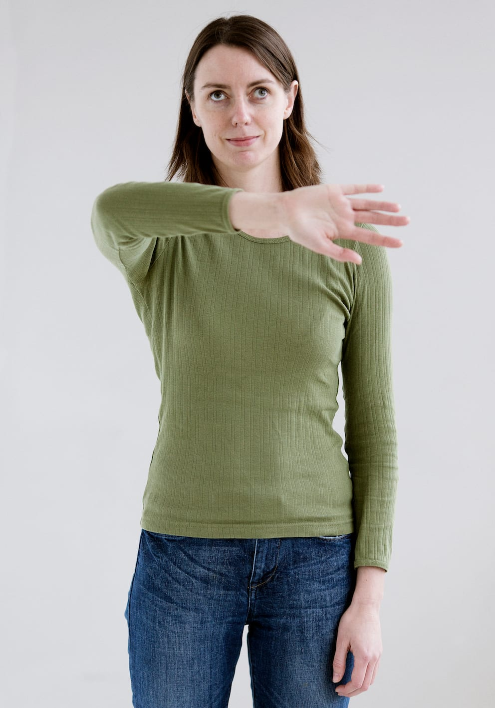
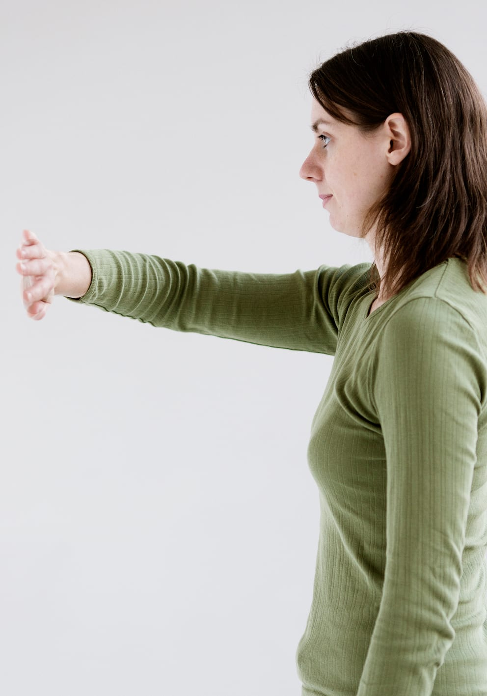
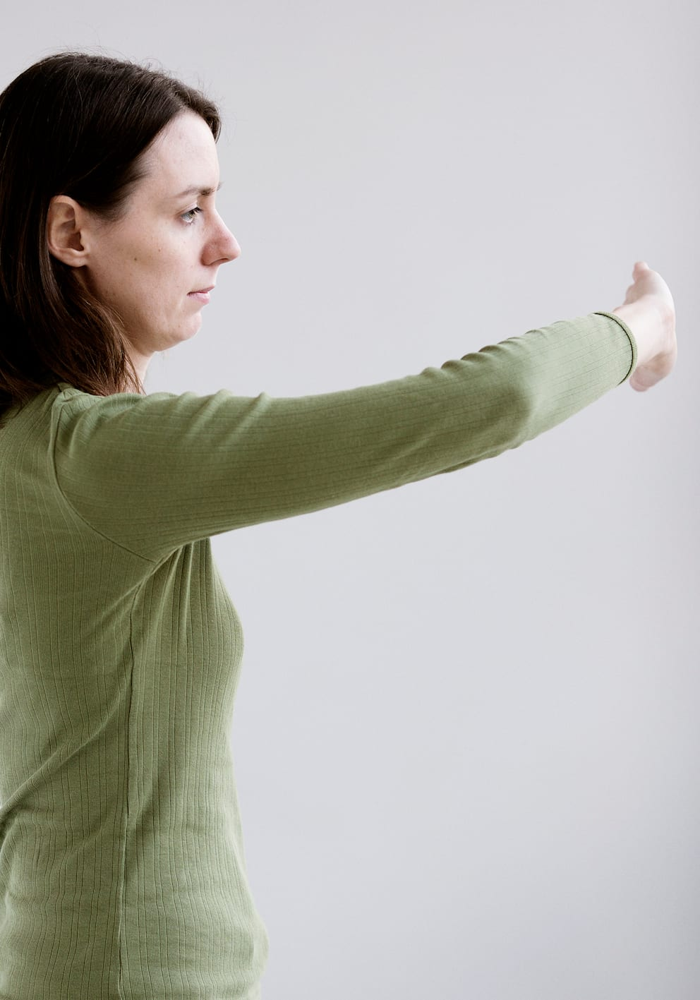
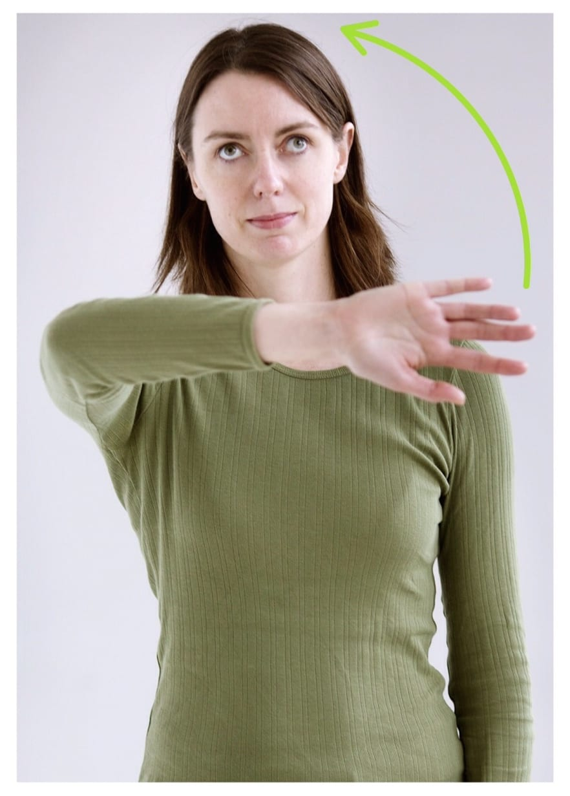
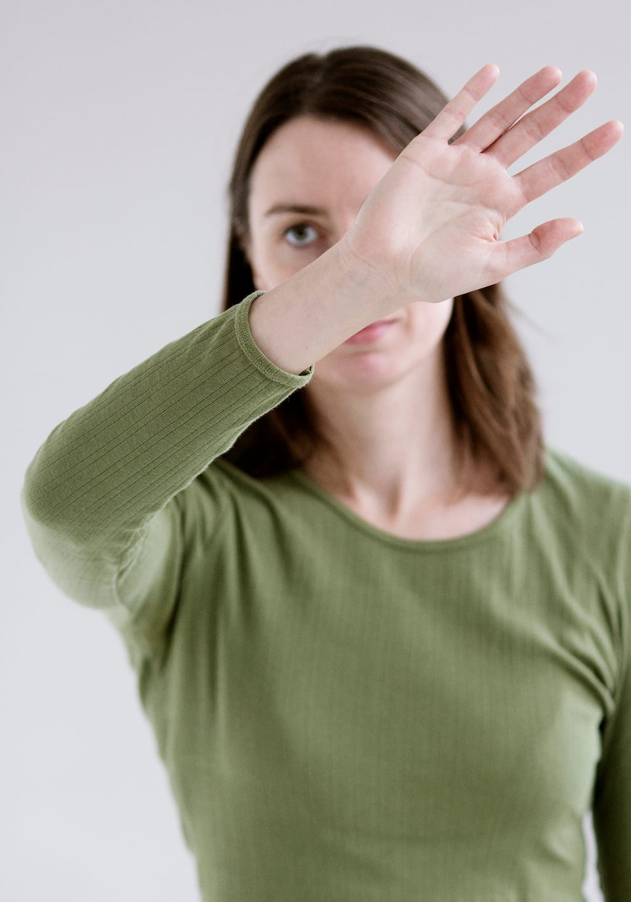

# Høj arm

Teknikken fungerer som beskyttelse af overkroppen og hovedet/skuldrene.
Den kan anvendes til at lokalisere ting i hovedhøjde, fx overskabe i et køkken eller lamper.
Høj arm kan ligeledes anvendes til lokalisere forhindringer i det lodrette plan, fx en åbent-stående dør. På billederne viser Lykke positionen for høj arm set fra forskellige vinkler.

Høj arm kan udføres på 2 måder:

1.
- Armen svinges frem i gangretningen og op til vandret, dvs. holdes parallelt med gulvet.

- Albuen bøjes i en vinkel på lidt mere end 90o. Hånden føres ind foran kroppen og skal være lidt længere fremme end albuen.

- Håndfladen vendes fremad og hånden og fingrene holdes strakt.

- Hånden trækkes så langt over til modsat side, at fingrene når lidt udenfor modsat skulder.

2.
- Hånden lægges på modsat skulder.

- Håndfladen vendes fremad og hånden føres fremad i gangretningen mens armen holdes parallel med gulvet til en vinkel på lidt mere end 90 grader (så hånden er lidt længere fremme end albuen).

- Hånden trækkes så langt over til modsat side, at fingrene når lidt uden for modsatte skulder.

## Ansigtsbeskyttelse

Ansigtsbeskyttelse kan udføres på 2 måder:

- Enten kan man føre hånden skråt op foran ansigtet, lige som en vinduesvisker.

- Eller også kan man lægge håndryggen på næsen med håndroden ud for næsetip-pen. Fingrene peger opad. Derefter føres armen ud fra ansigtet, til hånden er lidt længere fremme end albuen.
