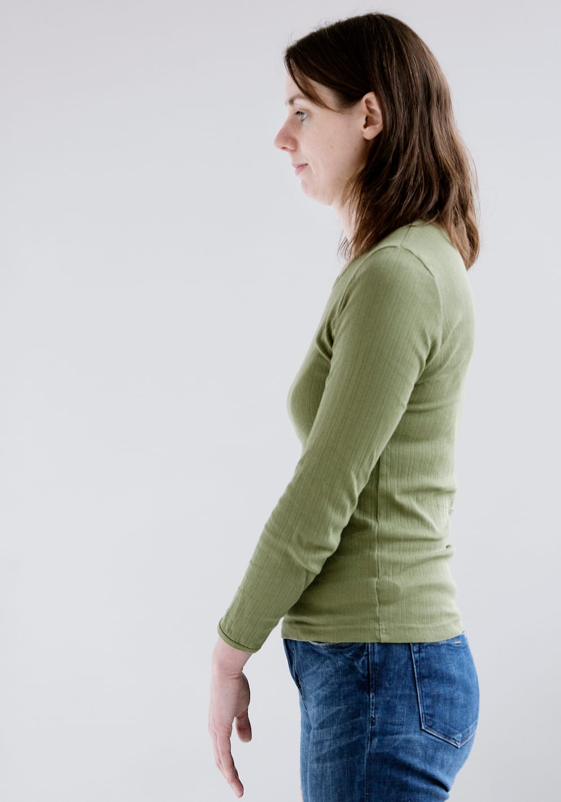

# Lav arm

Teknikken giver mulighed for at lokalisere ting i talje-/hoftehøjde samt beskyttelse mod forhindringer, fx borde, stole o.l.

- Armen svinges frem i gangretningen til den er 15 20 cm længere fremme end kroppen.

- Armen føres derefter strakt ind foran kroppen, så hånden holdes i midterlinjen.

- Fingrene er afslappede, og håndfladen vendes mod kroppen.

Denne teknik er ofte mangelfuld for høje personer. En sammenrullet avis eller lignende i hånden kan forlænge rækkevidden.
