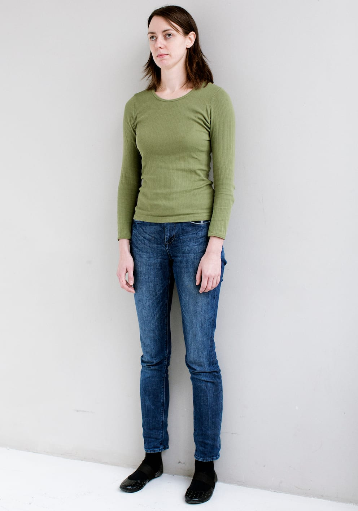
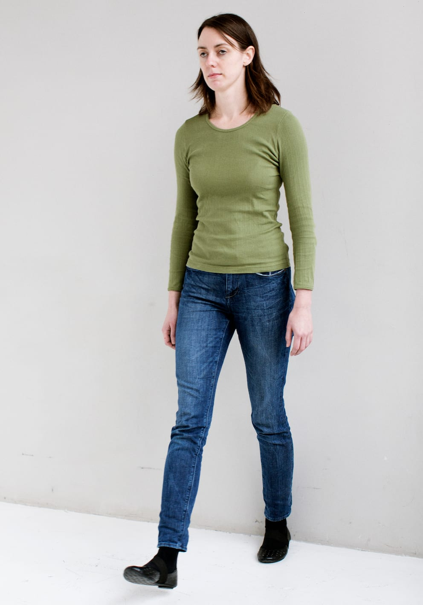

# Vinkelret

Vinkelret retningstagen drejer sig om at etablere en retning ved at benytte en linje, som er vinkelret på den ønskede færdselsretning.

- Lykke benytter to ens kropsdele fx hælene eller skulderbladene, som hun hviler mod ledelinjen fx en væg.

- Hvis det fx kun er muligt at rette ind med hælene, rettes resten af kroppen systematisk ind efter dem, før man går.

- Lykke kan her forestille sig en mental lige linje frem mod målet, inden hun går fremad.

- Det er kun muligt at rette ind efter genstande, hvis position i rummet/omgivelserne er bekendt.
