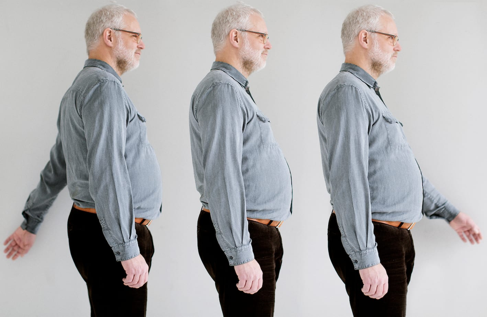

# Parallelt

Parallel retningstagen drejer sig om at etablere/fastholde en retning ved at benytte en parallel linje (eller parallelle lyde).

- Her er det Bo, der viser, hvordan man placerer sig med kroppen parallelt til objektet (eller lyden), der skal bruges som ledelinje (fx en væg). Dvs. med den ene skulder mod væggen.

- Bo bruger armen til at rette ind med ved at føre den i et fejesving frem og tilbage langs væggen med håndryggen mod væggen.

- Hvis der bruges en auditiv kilde (fx trafik) rettes ind parallelt til den.

- Bo kan forestille sig en mental lige linje parallelt til objektet (eller lyden) for at kunne etablere en lige linje at færdes i.

- Linjens position i rummet må naturligvis være kendt for at kunne bruges som ledelinje.
