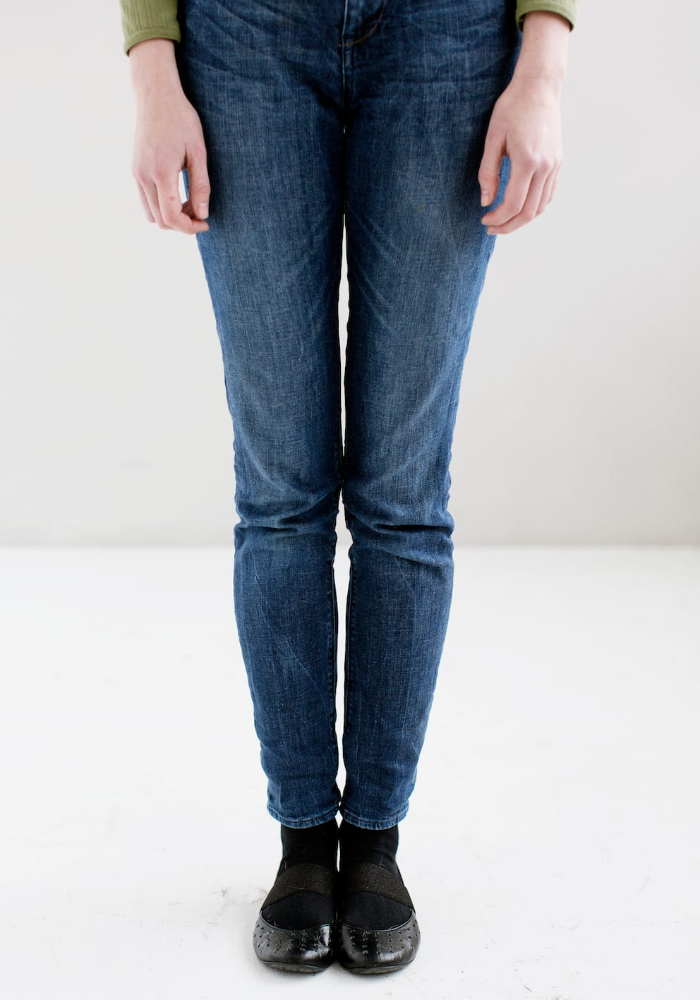
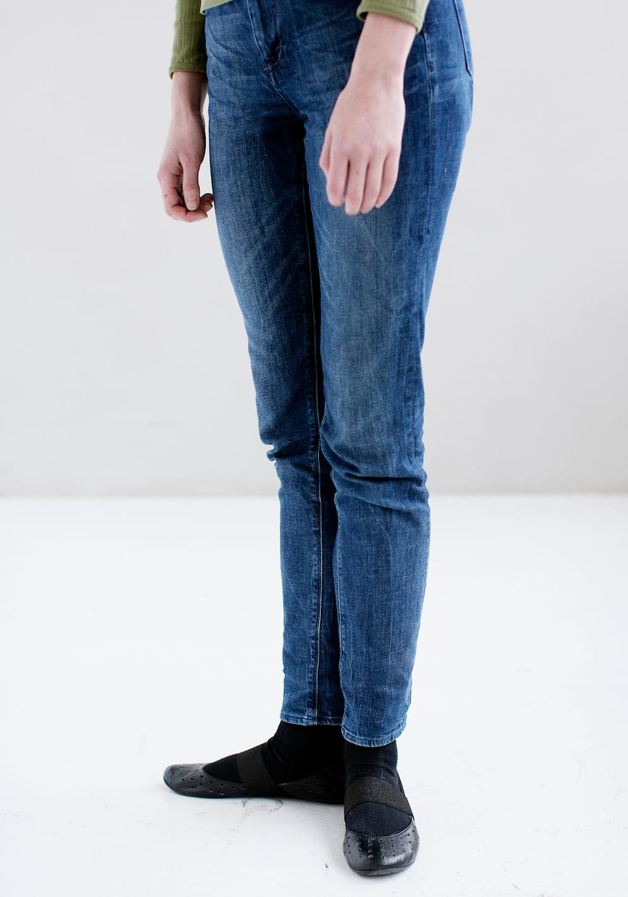
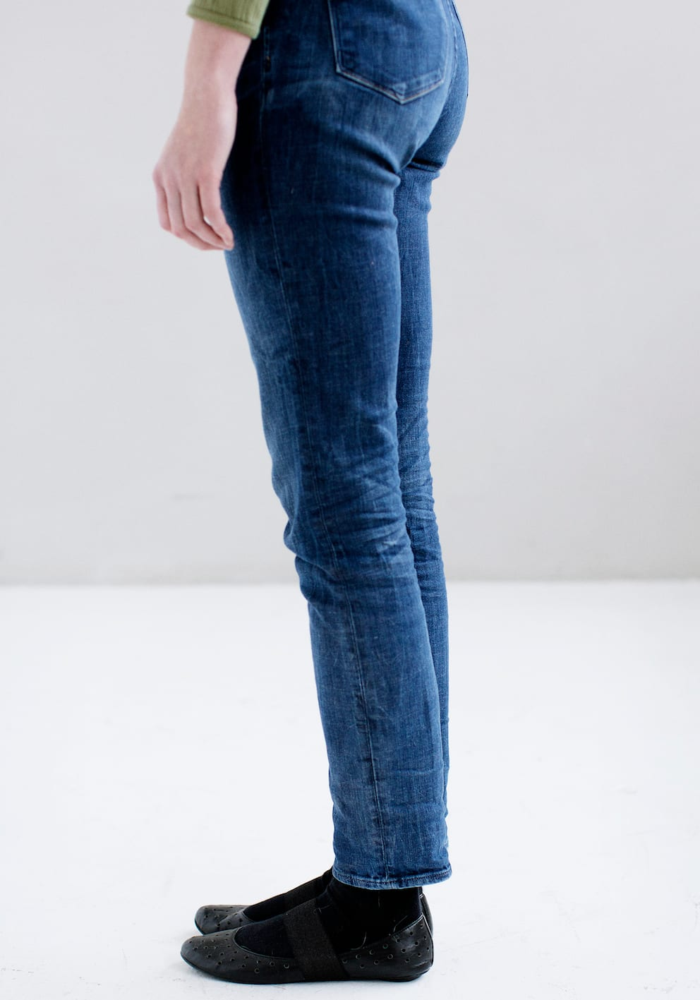
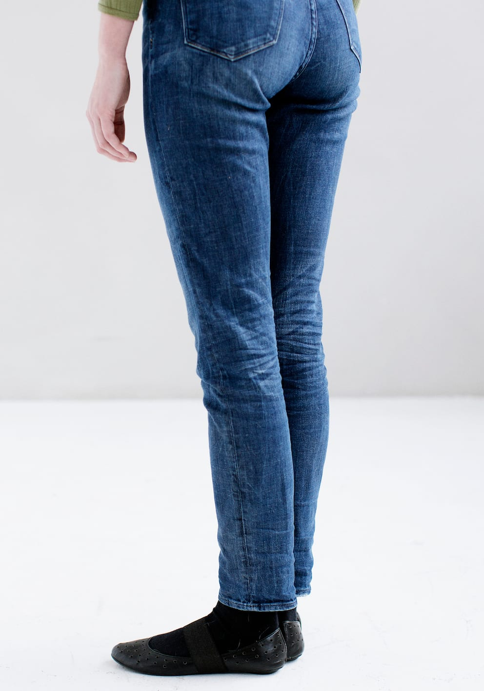
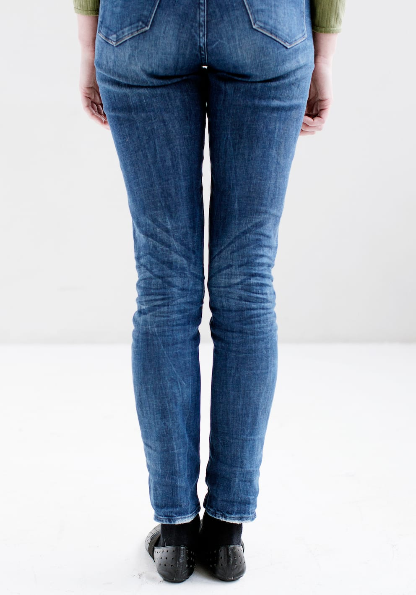
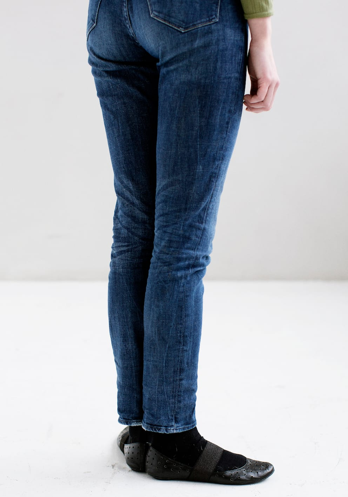
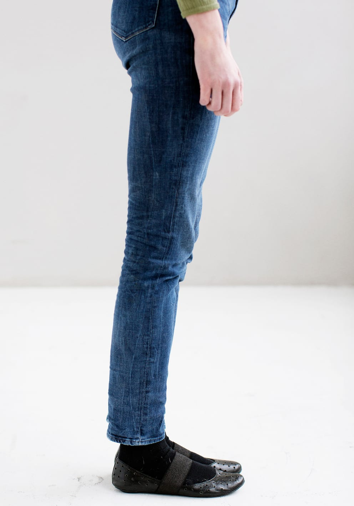
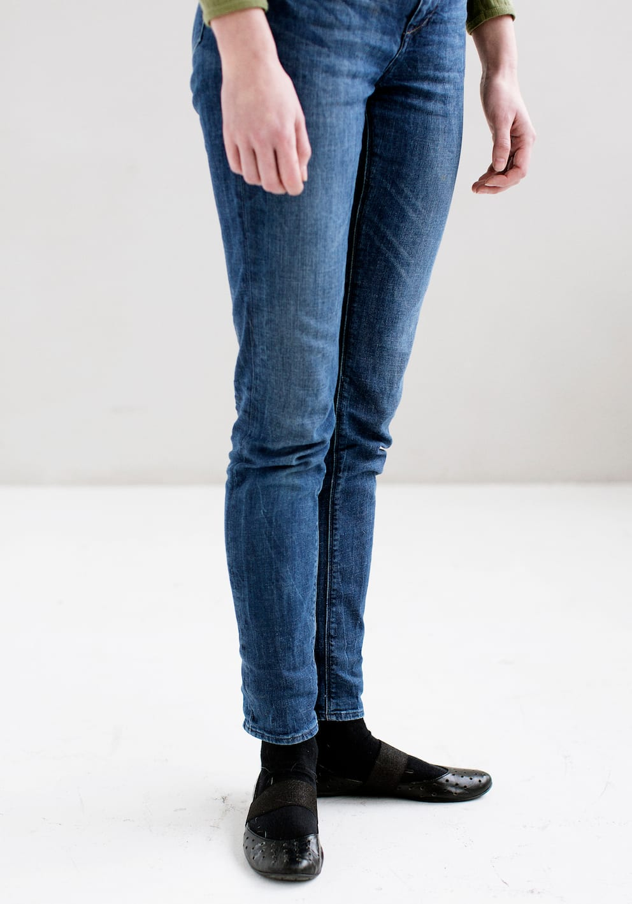

# Ur-metoden

Ur-metoden går ud på at etablere en retning ved at dreje sig i intervaller på nøjagtig 90 grader svarende til kvarters-intervaller på en urskive.

Lykke står her med fødderne samlet. Retningen skal være kendt.

Den ene fod drejes ud i en 90-graders vinkel (til det strammer i knæet), mens hælene forbliver samlede.

Den anden fod løftes og sættes ”på plads” ved siden af den første fod. Første fod må ikke flyttes. Herefter rettes kroppen ind i den nye retning.

