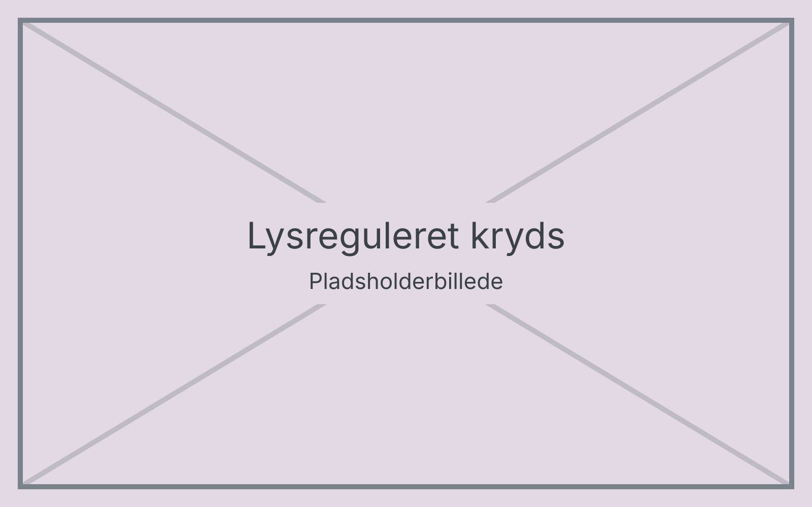

# Lysregulerede kryds

Mange lysregulerede kryds har en signalknap med lydsignal og en vibrator, der fortæller, hvornår der er grønt.

## Signalknappen

- Find stolpen ved fodgængerfeltet. Lydsignalet tikker langsomt, når der er rødt.
- Mærk efter pilen under knappen – den peger i gåretningen.
- Når lydsignalet bliver hurtigt, og knappen vibrerer, er der grønt.

## Krydsningen

Gå straks over, når der er grønt, og brug samme teknik som ved [almindelig krydsning](10-krydsning.md). Vent på næste grønne lys, hvis signalet allerede har været grønt et stykke tid.
