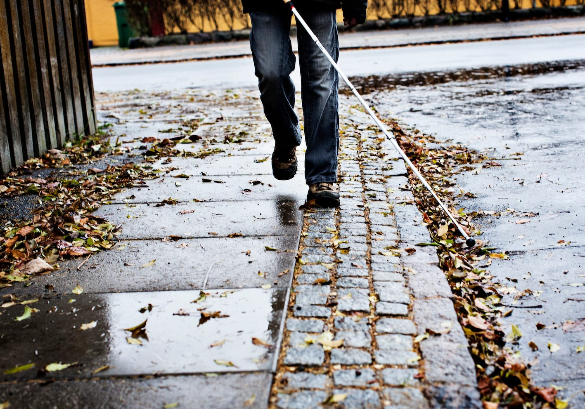
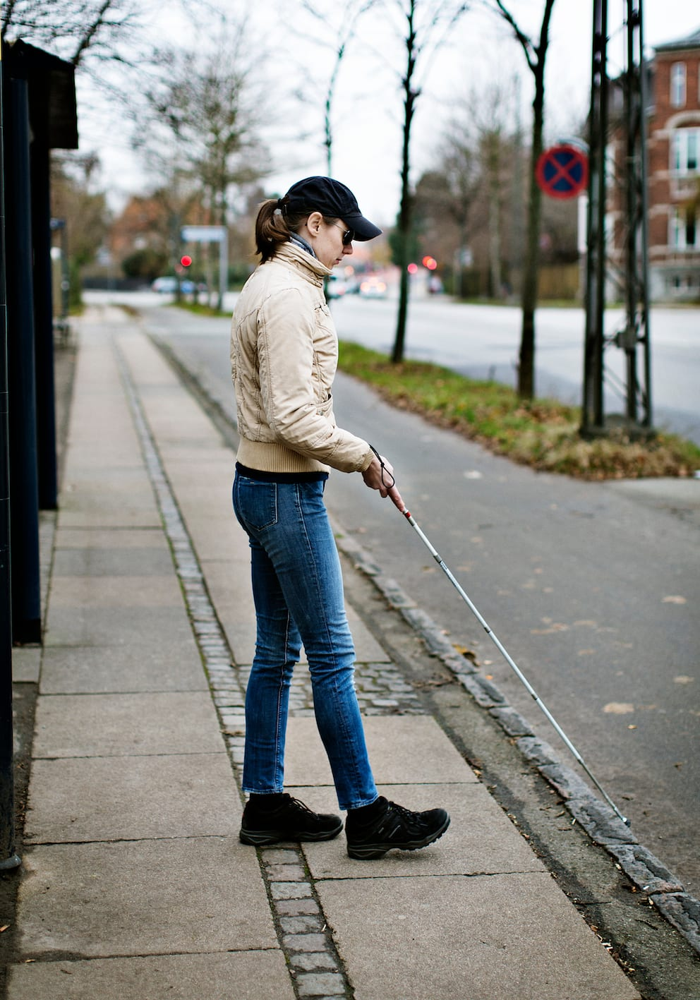
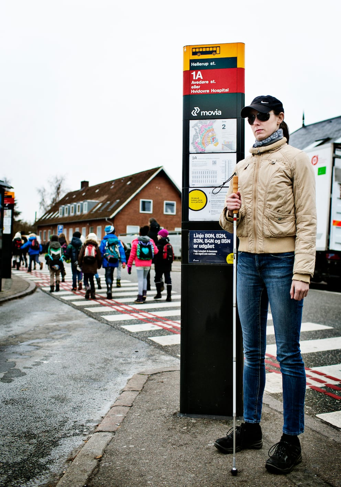

# Den lange stok (mobilitystokken)

Med brug af mobilitystokken og den rette teknik kan personen med blindhed få den nød-vendige information om omgivelserne, for at kunne færdes sikkert og uafhængigt i forskellige situationer og omgivelser.

__Beskyttelse og informationer__

Mobilitystokken giver personen med blindhed mulighed for at forudse objekter, niveauændringer samt  identificere skift i underlaget i det område, som foden træder ned på næste gang.

Stokken yder beskyttelse af kroppen fra brystet og nedefter og giver personen ca. 1 meters varsel om forhindringer og underlagsskift forude.

__Markering__
Mobilitystokken markerer over for omgivelserne, at den pågældende person har en synsnedsættelse og giver derved medtrafikanterne mulighed for at vise de fornødne hensyn og tilbyde hjælp.

__Grundregler ved brug af mobilitystokken__

- Personen med blindhed bør ikke give stokken fra sig, men selv anbringe den og altid vide, hvor den er.

- Når stokken ikke er i brug, bør den altid holdes lodret.

- Hvis spidsen er mere end 2 cm over jorden, holdes stokken altid lodret.

Stokkens udformning, type og længde bør afgøres på baggrund af en praktisk afprøvning med udgangspunkt i de ønsker og forudsætninger, som personen med blindhed har.
O&M-uddannelsen kvalificerer O&M-instruktøren til at foretage denne afdækning og afprøvning i samarbejde med borgeren.
