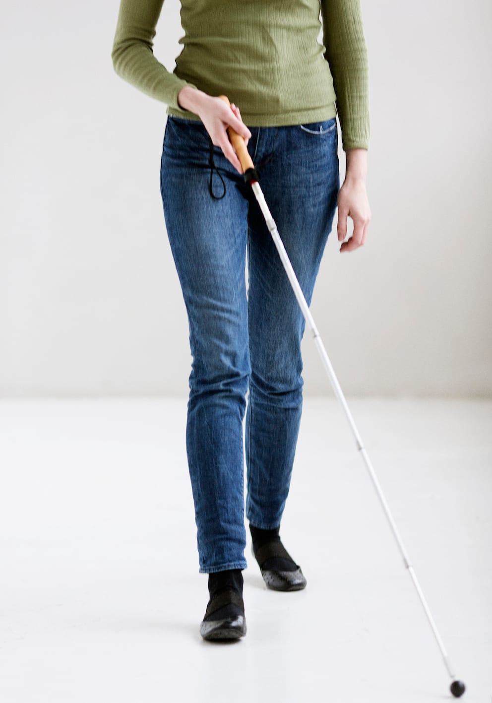

# Pendulteknik

Pendulteknik er betegnelsen for den teknik, som giver bedst beskyttelse og størst mængde af informationer. Teknikken kan gøre personen i stand til at opdage nedadgående niveauer og selv små ændringer i underlaget. Den sikrer beskyttelse af begge sider af kroppen og kan således anvendes til selvstændig færden i både kendte og ukendte omgivelser.

Pendulteknik er den vigtigste og mest brugte stokketeknik (de fleste vil bruge den mere end 90% af tiden).

Pendulteknikken består af 3 elementer som skal udføres præcist for at opnå den bedst mulige sikkerhed.

1. Grebet om stokkehåndtaget
2. Stokkebevægelsens buebredde
3. Rytmen hvormed stokken bevæges

Alle elementer beskrives enkeltvis.
