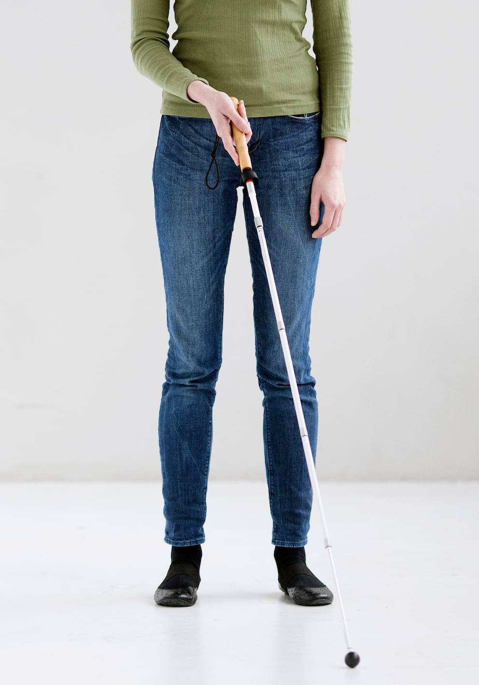
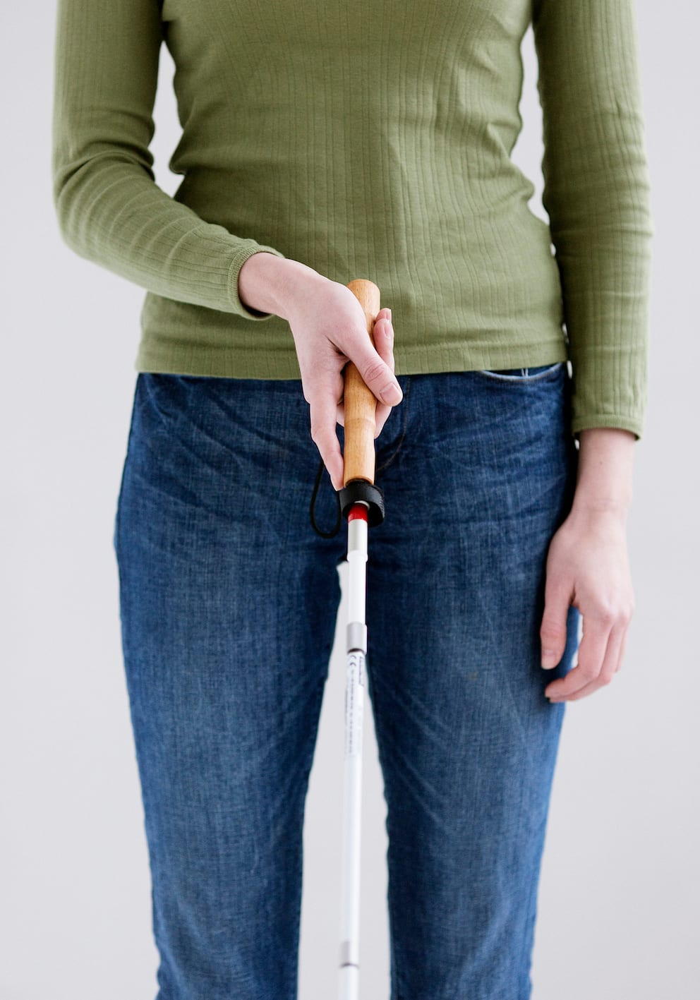
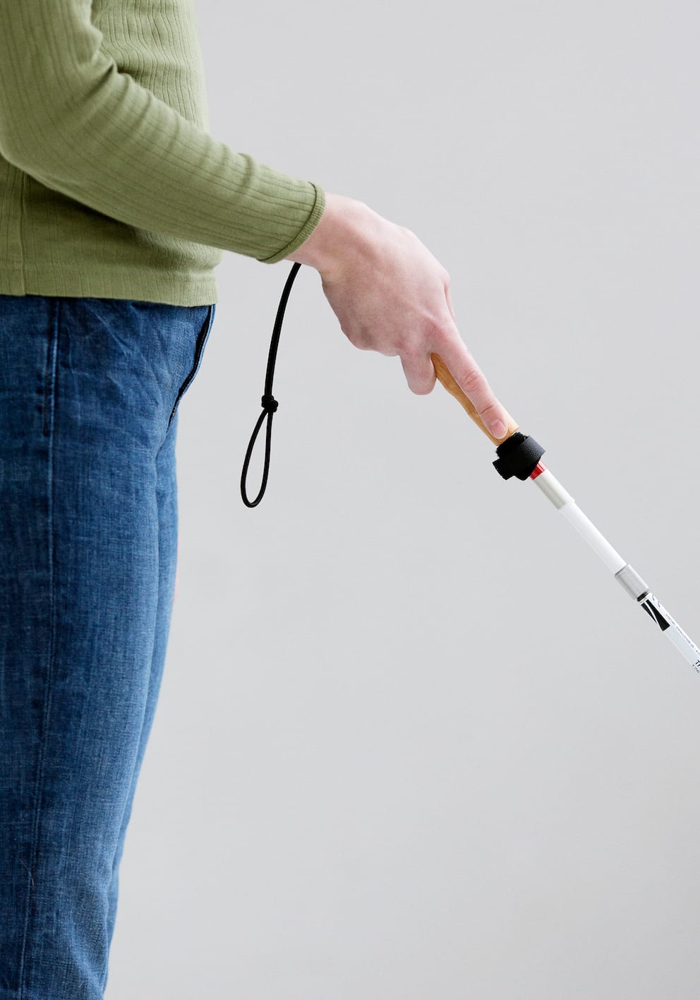
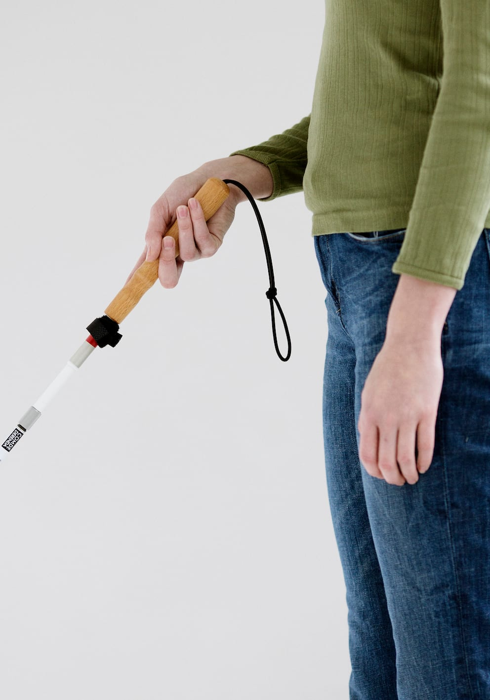

# Grebet om stokken og håndens placering

- Lykke griber om stokken med hånden strakt fremad, som når man giver hånd.

- Stokken holdes i den dominante hånd.

- Pegefingeren strækkes parallelt med stokkehåndtaget pegende ned ad stokken mod spidsen. Er der en flad side på grebet, placeres pegefingeren ned langs denne.

- Hånden holdes midt for kroppen i en afstand til kroppen svarende til en håndsbredde.

- Tommelfingeren er placeret diagonalt ovenpå grebet.

- De resterende fingre er bøjede under grebet for at give støtte.

- Toppen af grebet flugter med håndroden.

- Albuen er let bøjet og overarmen ligger ind til kroppen.

- Håndleddet roteres udad, således at knoglerne ved tommelfingerens rod peger mod loftet og håndryggen peger til siden.

