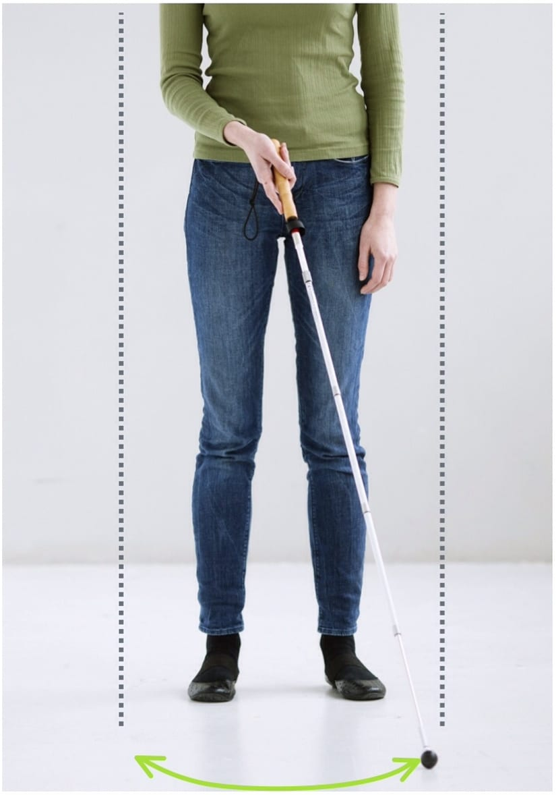

# Buebredde/bevægelsen

- Stokken bevæges fra side til side ved en bevægelse (fleksion-ekstension) af håndleddet. Denne bevægelse får stokken til at beskrive en bue på gulvet med spidsen.

- Spidsen holdes i gulvet under hele bevægelsen og når ca. 2,5 cm udenfor kroppens bredeste punkt til begge sider (skuldre eller hofter).

