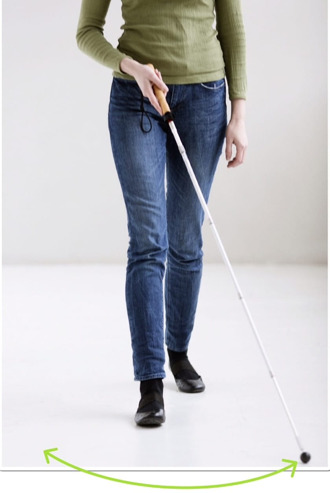

# Rytme

- Stokkens bevægelser er synkroniseret med fødderne, hvilket resulterer i et skiftende fod/stok mønster. Dvs., at når højre fod sættes i gulvet, rammer stokken gulvet ud for venstre fod. Området, hvor Lykke skal sætte foden ved næste skridt, undersøges, mens foden stadig er tilbage.

- Dette mønster sikrer så lang en reaktionstid som muligt, svarende til et helt skridt.
