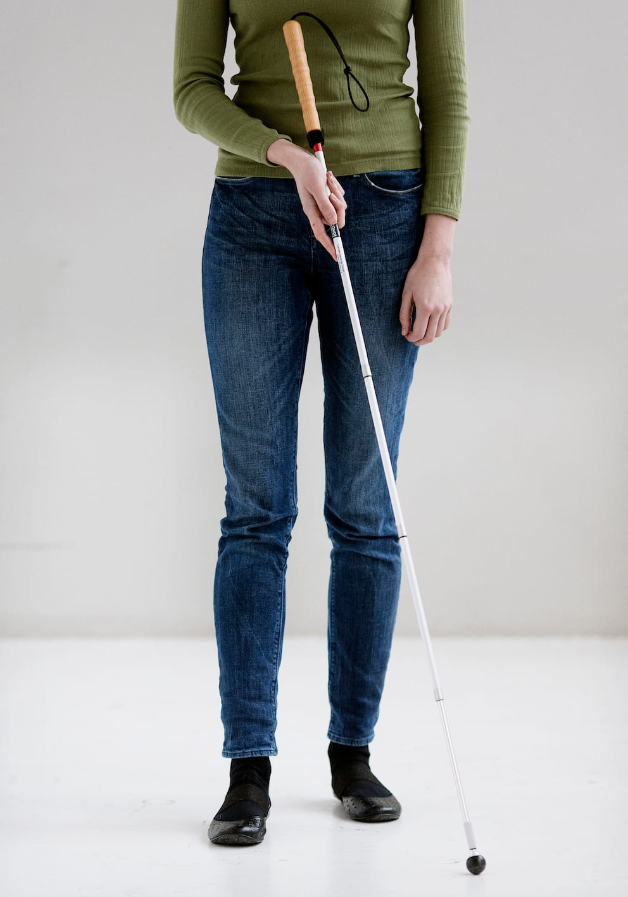
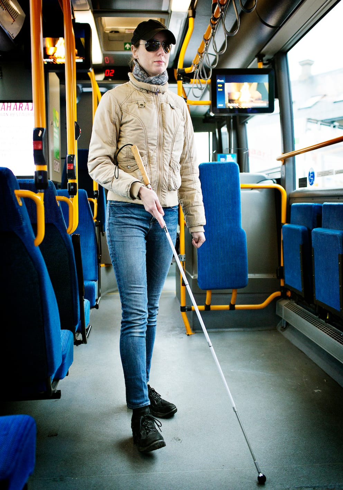
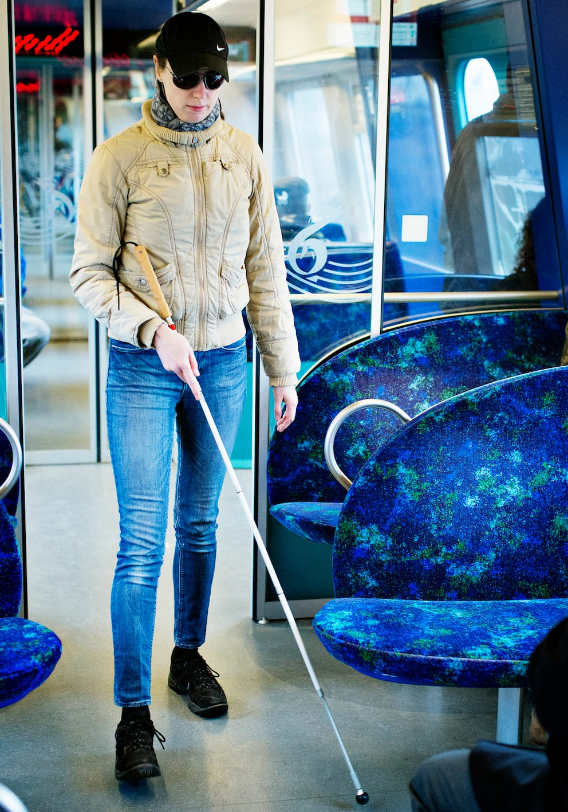

# Kort stok

Teknikken kan være nyttig indendørs og i meget befærdede omgivelser, hvor det er hensigtsmæssigt at fylde mindre af hensyn til medtrafikanter og øvrige omgivelser.

- Lykke lader sin hånd glide ned ad håndtaget og griber fat under håndtaget for at forkorte stokken.

- Lykke anvender her almindeligt pendulgreb, men kunne også benytte et blyantsgreb (se under ”lodret stok”).

- Hun anvender almindelig pendulteknik, men gør buen lidt smallere for fx at undgå at medtrafikanter falder over stokken.

- Tempoet nedsættes for at kompensere for den nedsatte beskyttelse.
