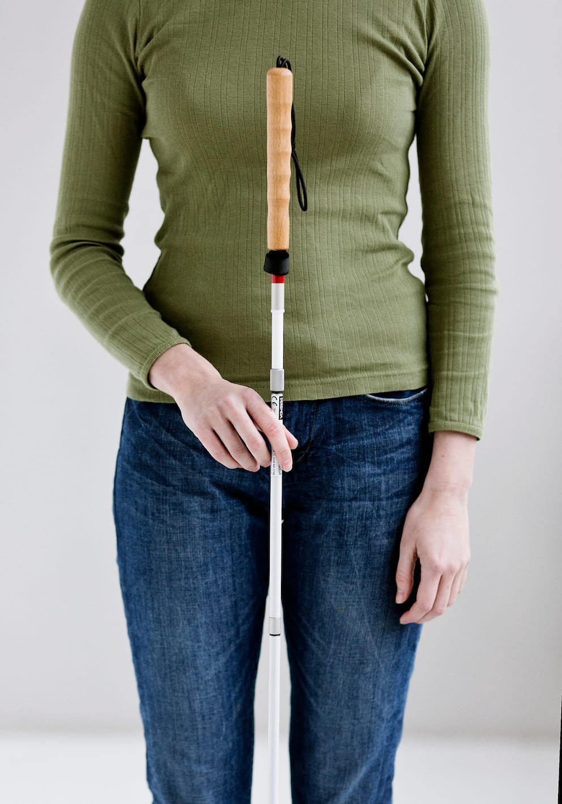
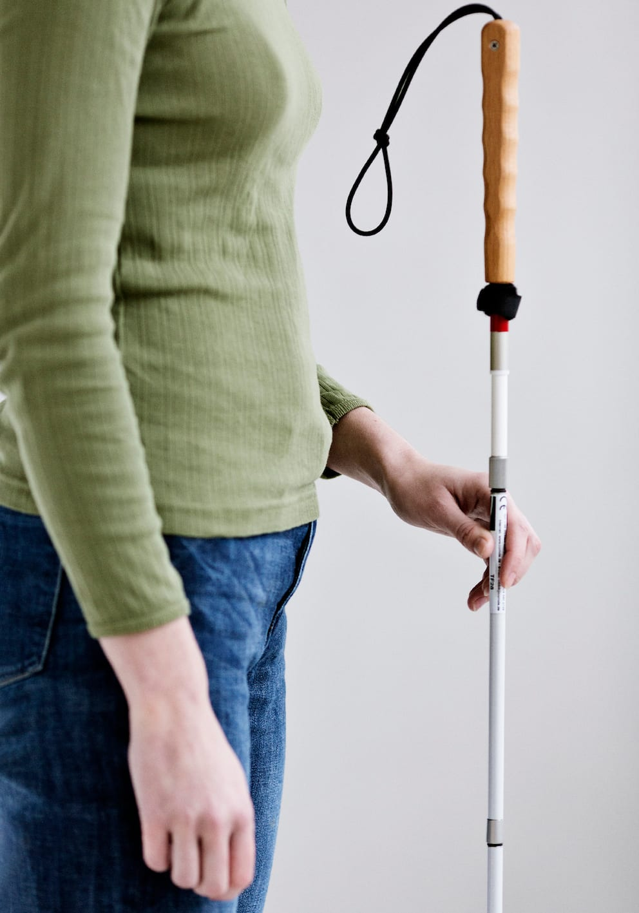
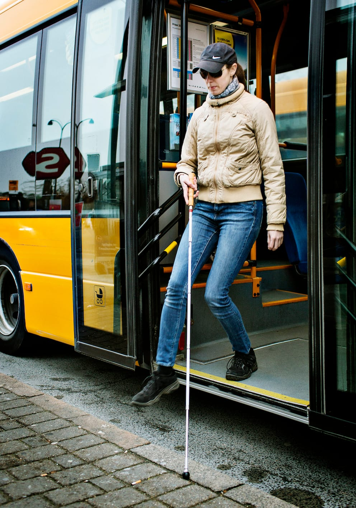
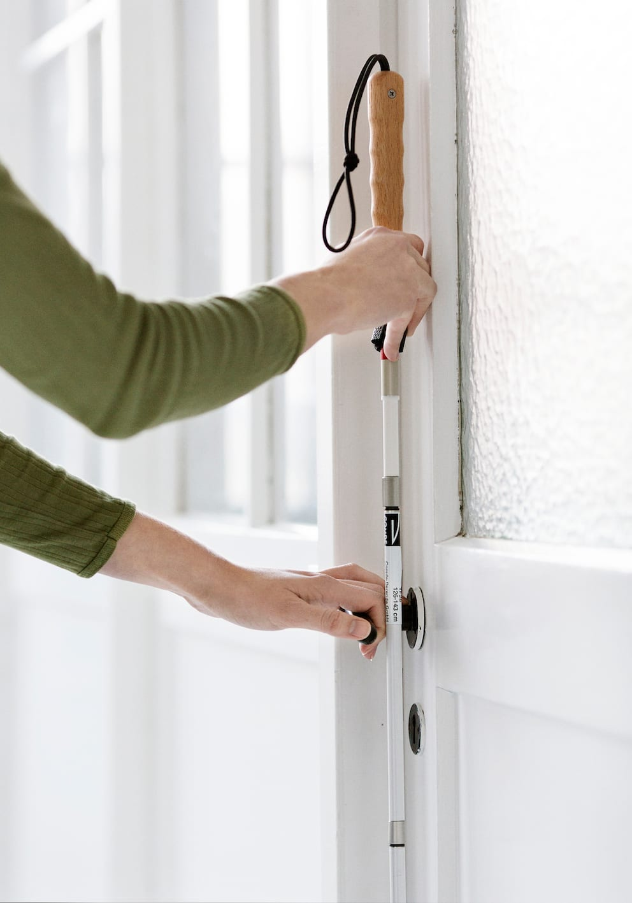

# Lodret stok

Lodret stok anvendes bl.a. til at tage kontakt med et objekt og undersøge det på en sikkerker og effektiv måde.

Derudover kan teknikken anvendes ved døre, trapper, ved drejninger på stedet og generelt, når stokken ikke "arbejder", fx når man bliver ledsaget.

- Lykke holder stokken lodret og har fat med et blyantsgreb. Hun griber om håndtaget på stokken med et greb som på en blyant mellem pege- og tommelfingeren. Stokken hviler på langfingeren, mens de sidste to fingre bøjes let og holdes afslappet.

