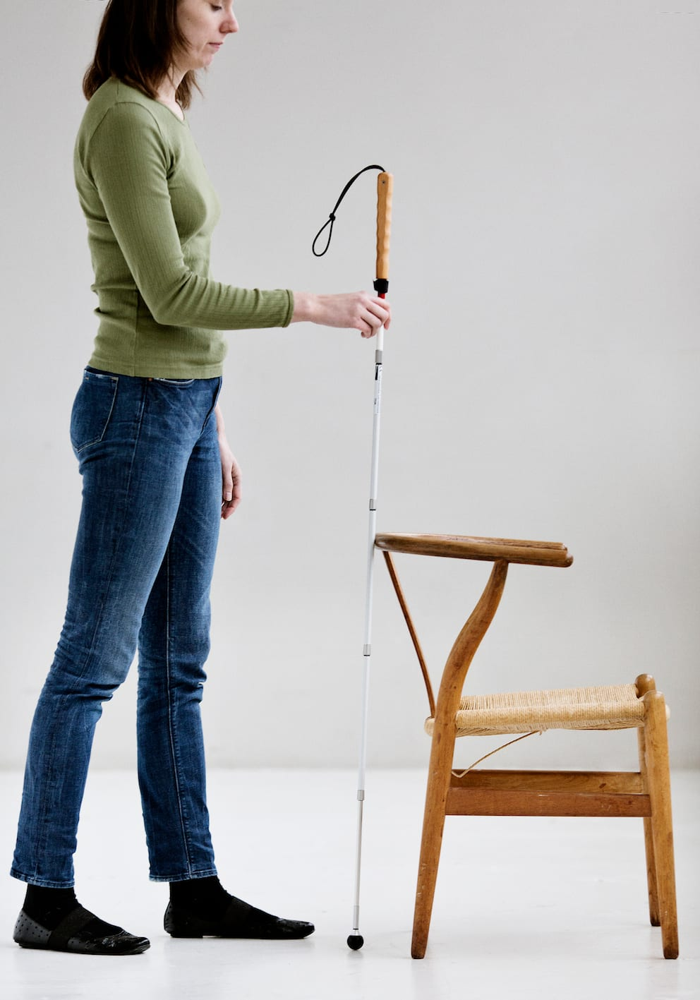
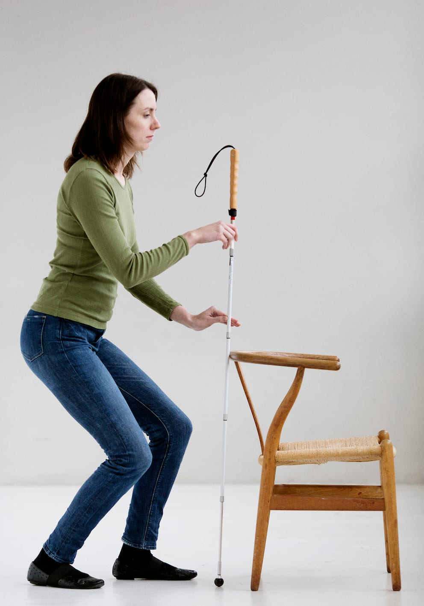
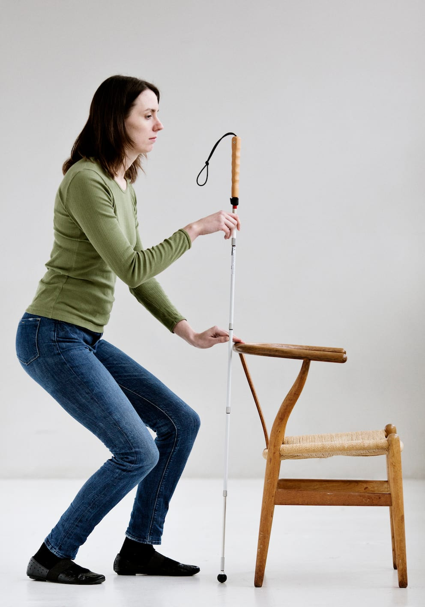

# Undersøgelse af forhindringer

Når man møder en forhindring, som man ønsker at undersøge, må man have særligt fokus på sikkerheden.

- Ved kontakt med genstanden stopper Lykke og bibeholder sin relative afstand til objektet.

- Stokken forbliver i kontakt med objektet på det punkt, hvor kontakten opstod.

- Stokken rejses til lodret i et blyantsgreb eller holdes i et diagonalgreb.

- Lykke træder frem til objektet, mens kontakten til referencepunktet holdes.

- Stokkehåndtaget føres frem for at undersøge højden af objektet.

- Stokken løftes lidt i lodret og bredden af genstanden undersøges. Evt. skiftes hånd.

- Hånden glider ned ad stokken til genstanden for at undersøge den taktilt. Evt. går Lykke på hug bag ved stokken beskyttet af den.

