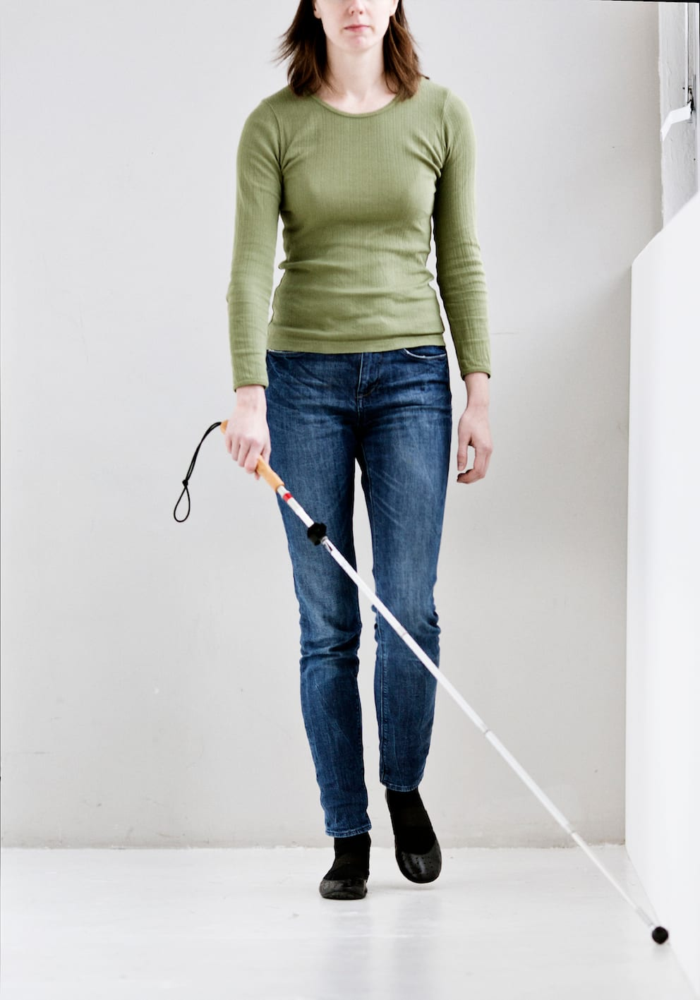
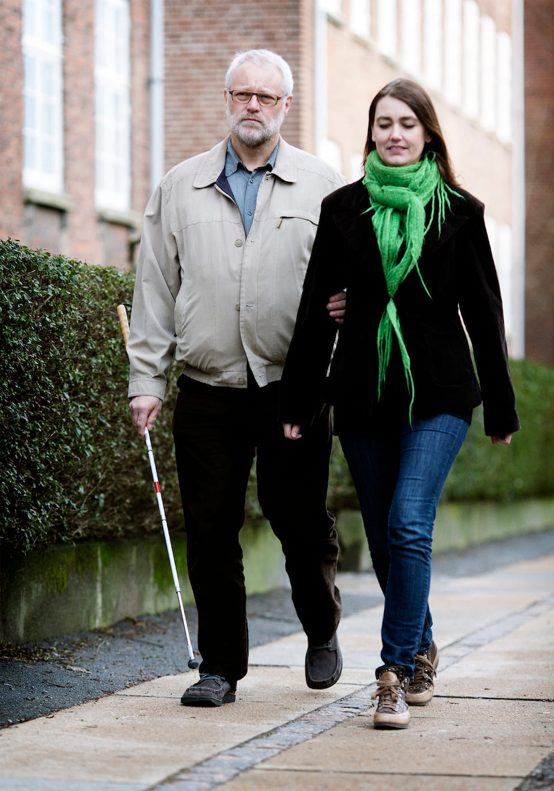

# Introduktion - diagonalteknik

Diagonalteknik anvendes hovedsageligt ved færdsel i kendte omgivelser, da beskyttelsen er begrænset.
Teknikken kan anvendes til at lokalisere et mål ved at holde kontakt med omgivelserne, fx når man følger en væg for at finde en dør.

Diagonalteknik anvendes ligeledes ved færdsel på trapper.

Har man en forholdsvis god synsrest, kan man med fordel anvende en modificeret diagonalteknik til almindelig færdsel, da man kan kompensere for teknikkens manglende sikkerhed med synet.

Man kan evt. anvende diagonalteknik med kort stok, når man bliver ledsaget. Herved har man mulighed for selv at beskytte sig og fx undersøge underlaget undervejs.

Det er forholdsvis let at lære diagonalteknik, men teknikken anvendes typisk over kortere strækninger, da den kan være anstrengende at udføre i længere tid.
