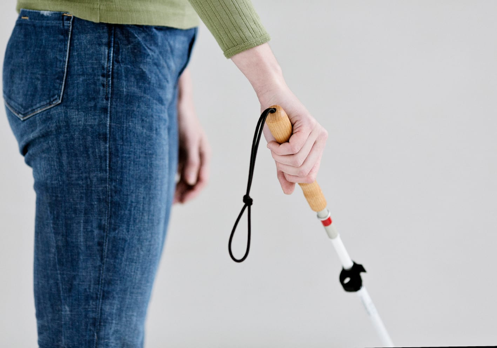
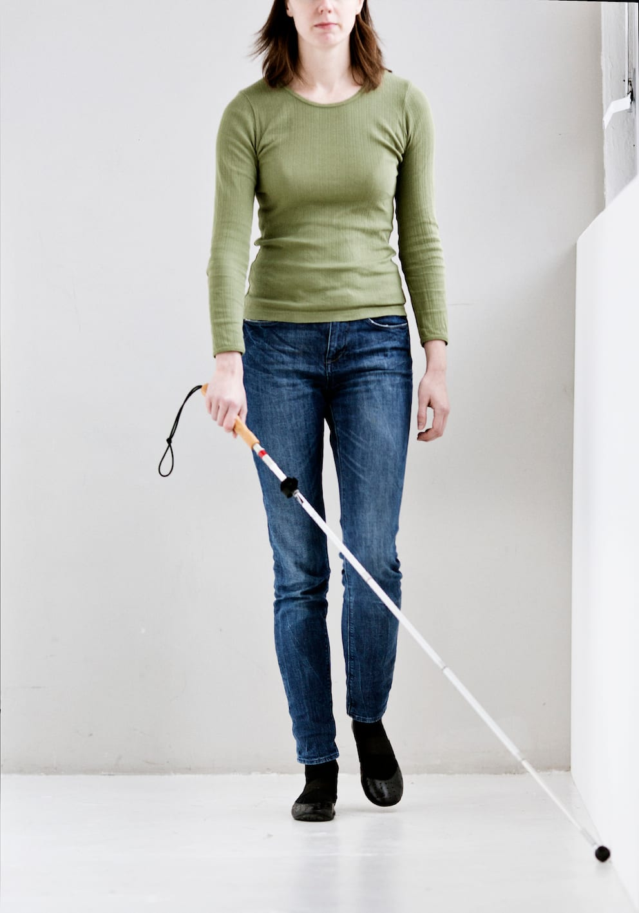
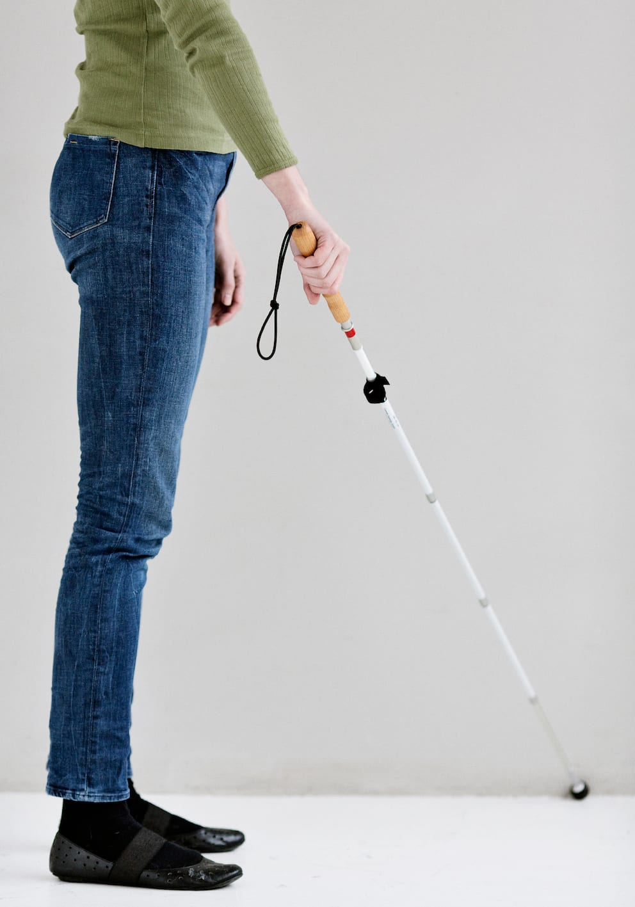

# Grundteknik - diagonalteknik

- Lykke holder om håndtaget med et såkaldt diagonalgreb, hvor de fire fingre omslutter håndtaget, og tommelfingeren peger ned langs stokken.

- Alternativt kan man holde stokken i et blyantsgreb som beskrevet under ”Lodret stok”.

- Armen holdes strakt fremad i gangretningen, så hånden er placeret ca. i hoftehøjde (20 30 cm fra kroppen svarende til en hånds længde).

- Stokken holdes diagonalt ind foran kroppen.

- Stokkespidsen holdes længere fremme end grebet og et par cm længere ude end den modsatte skulder.

- Stokken kan holdes i begge hænder afhængig af, hvilken opgave der skal løses.
