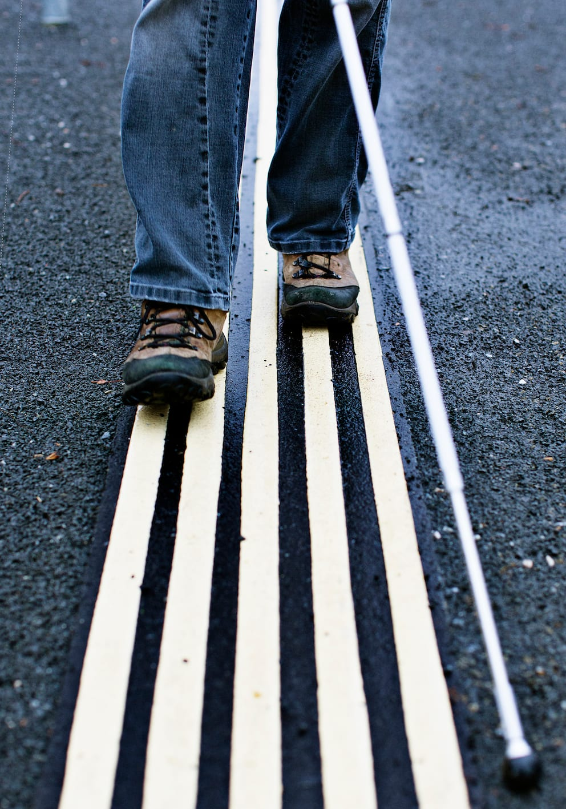
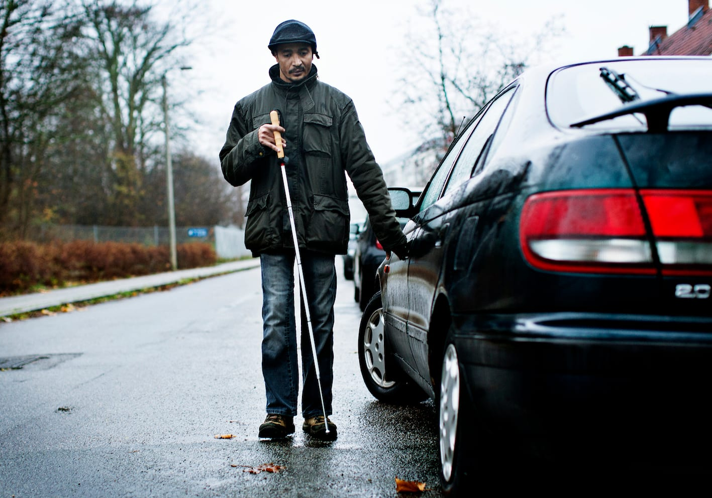
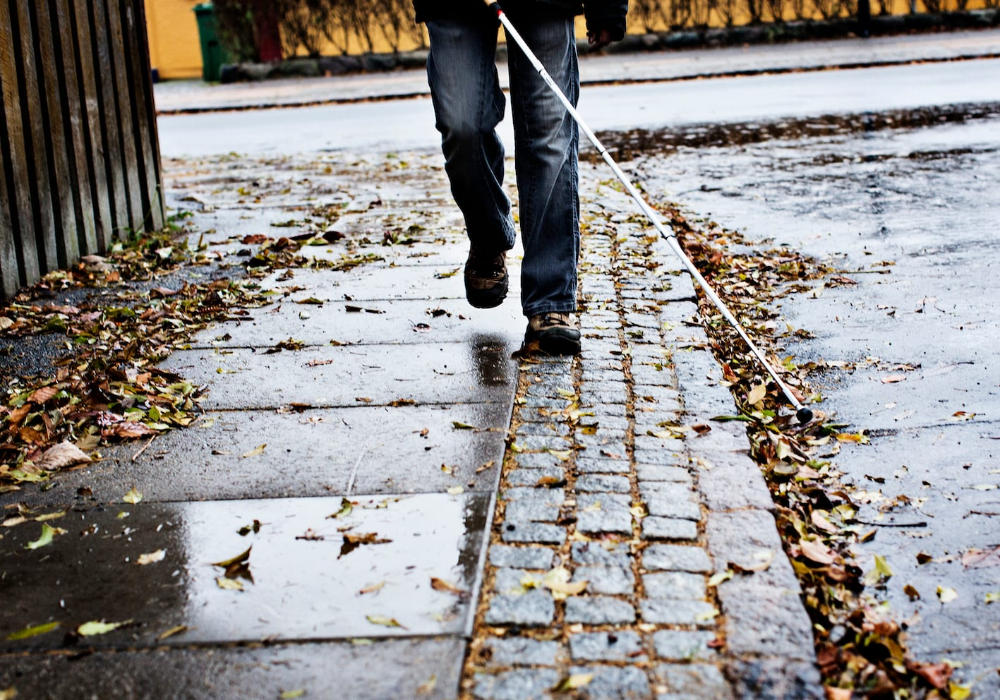
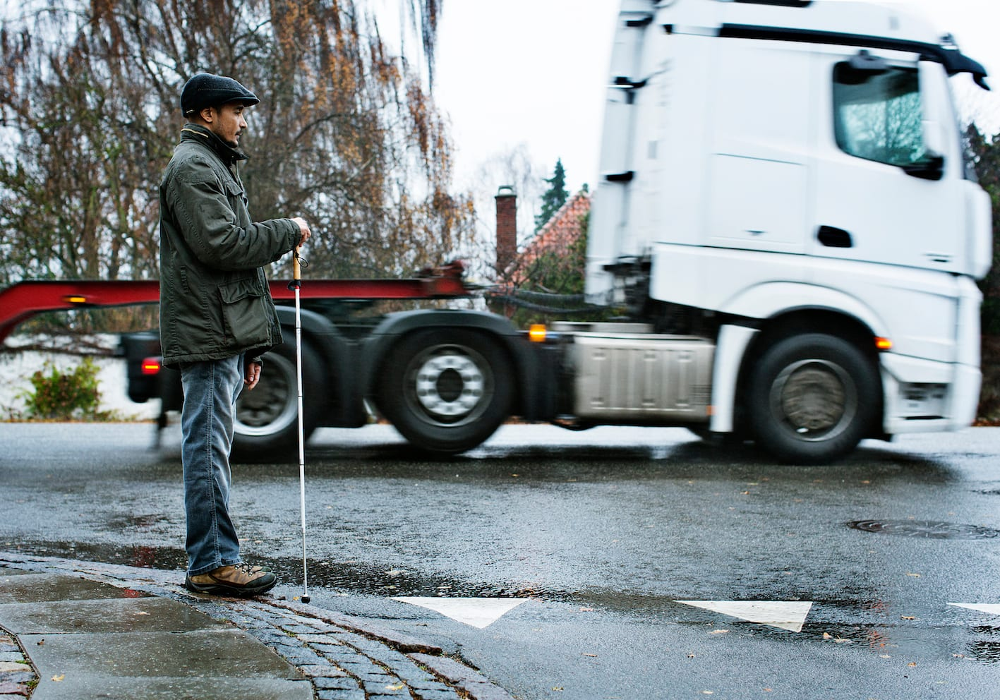
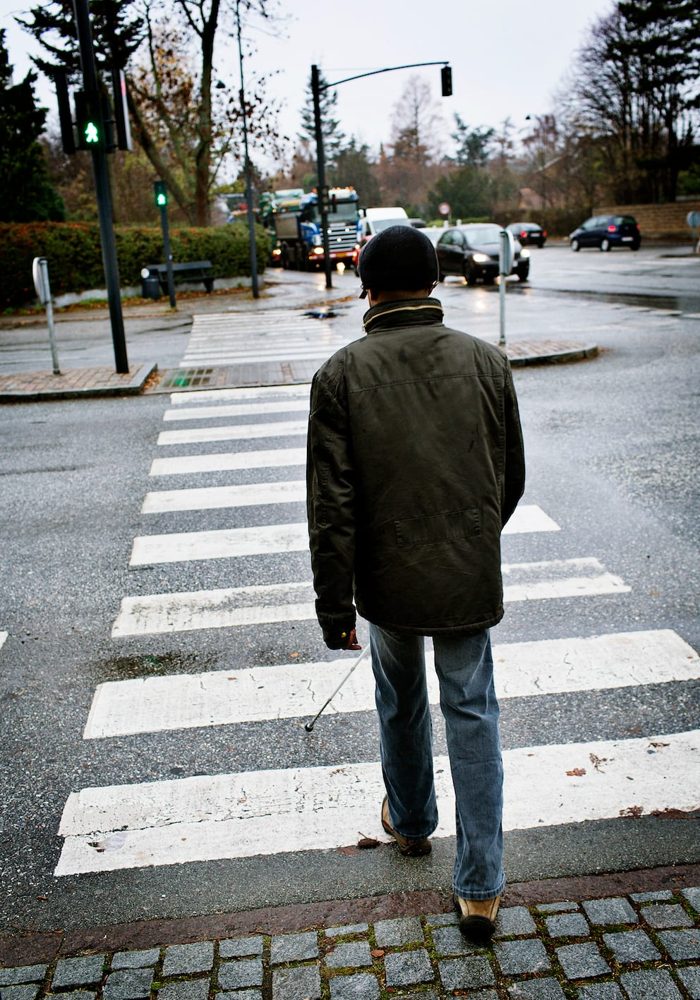

# Introduktion - Trailing - at følge en ledelinje

Trailing er en metode til at færdes i en ønsket linje/retning og dermed bevare orienteringen. Ved systematisk at tage kontakt med omgivelserne (ledelinjen) kan man sikre, at man hele tiden ved, hvor man befinder sig. Man kan benytte trailing, når man ønsker at lokalisere objekter langs en linje fx, en væg, ligesom man kan benytte ledelinjen til at genetablere retningen, når man færdes.

Den ledelinje, som følges kan være af forskellig karakter. Den kan være hhv.:

__1. Taktil (fx en væg, en kantsten eller en lagt ledelinje)__

__2. Auditiv (fx lyden af trafik)__

__3. Visuel (fx et fodgængerfelt eller lamper i loftet)__

Trailing kan udføres uden hjælpemidler, fx med hånden langs en væg. Teknikken kan også udføres med mobilitystok, elektroniske hjælpemidler (ETA) eller ved brug af førerhund.

Anvendes mobilitystokken, kan man traile med hhv. diagonalteknik eller pendulteknik afhængig af omgivelser og formål.
