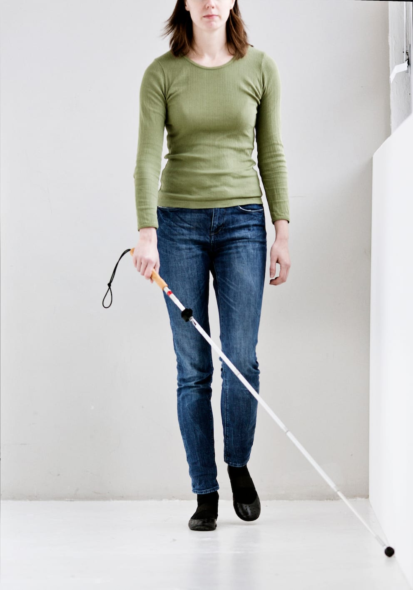

# Trailing med diagonalteknik

Her viser Lykke, hvordan man kan benytte trailing langs en væg, fx for at finde en døråbning.

- Lykke står parallelt med den linje, som skal følges ca. 20 cm fra ledelinjen.

- Hun holder stokken i hånden modsat ledelinjen og stokken holdes diagonalt ind foran kroppen.

- Spidsen holdes i konstant kontakt med ledelinjen.

- Ved at holde hånden omkring hoftehøjde, sikres en god reaktionstid.

- Det kan være en hjælp at forestille sig en lige linje mentalt frem mod målet, mens man går.

- Ved åbninger fortsættes i en tænkt linje fremad og efter nogle skridt genoptages kontakten med ledelinjen igen.
