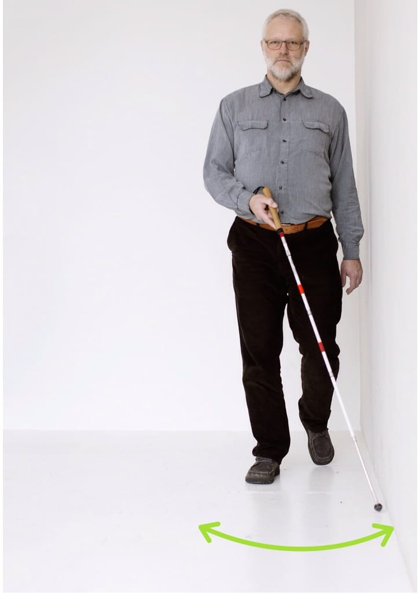
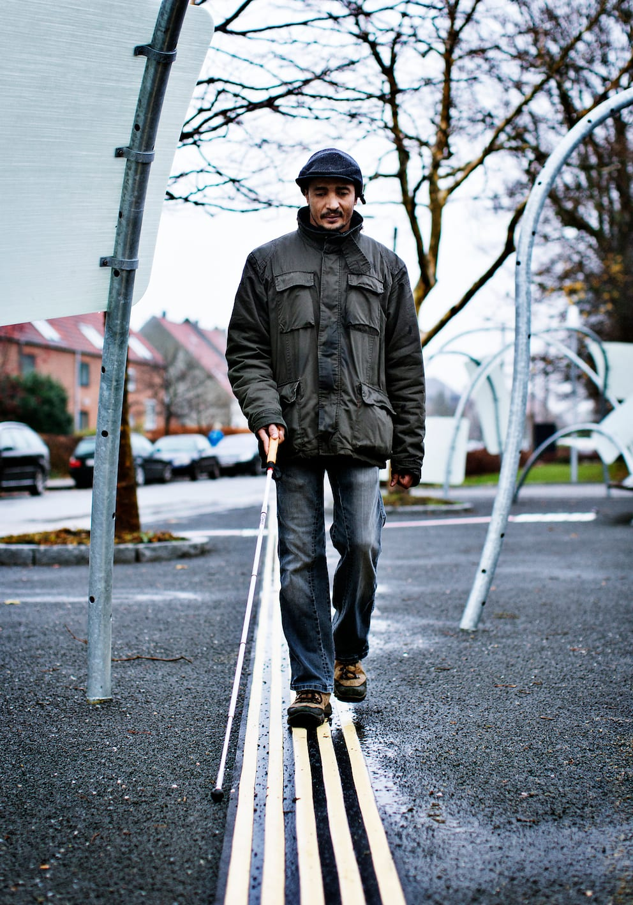
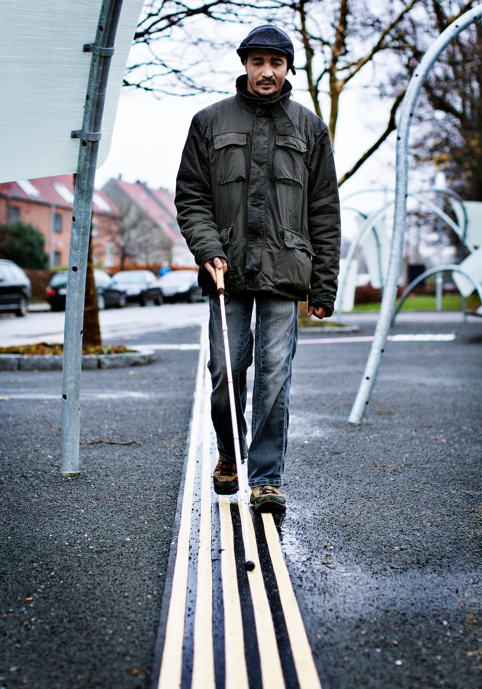
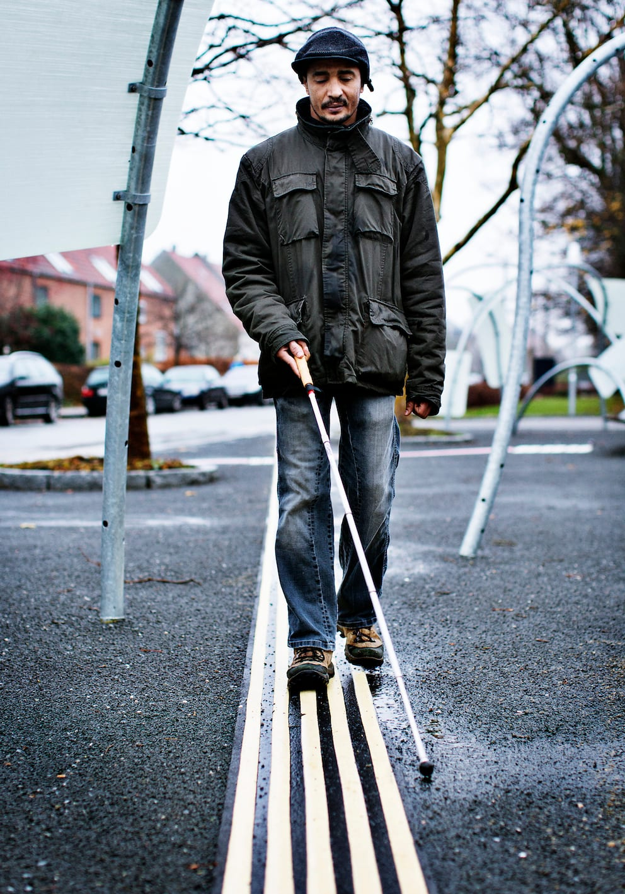

# To-punkt-teknik

To-punkt-teknik anvendes ved trailing med pendulteknik langs lodrette flader, fx en væg eller horisontale flader, fx en græskant eller en lagt ledelinje.

- Hvis man søger noget langs en ledelinje til venstre, skal hver eneste bueslag til venstre have kontakt med den. Her trailer Bo langs en væg.

- Hvis fladen er horisontal, som denne lagte ledelinje, kan man samtidigt mærke ledelinjen med fodsålerne.

