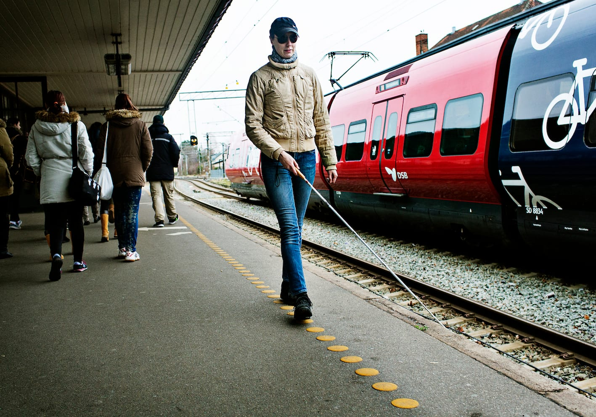
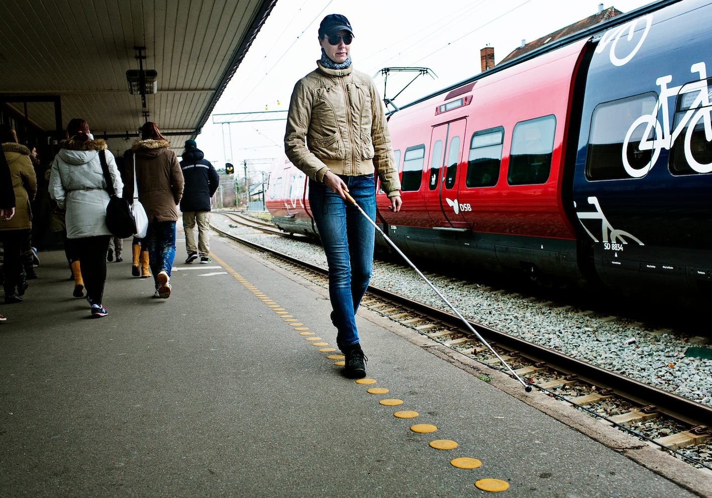
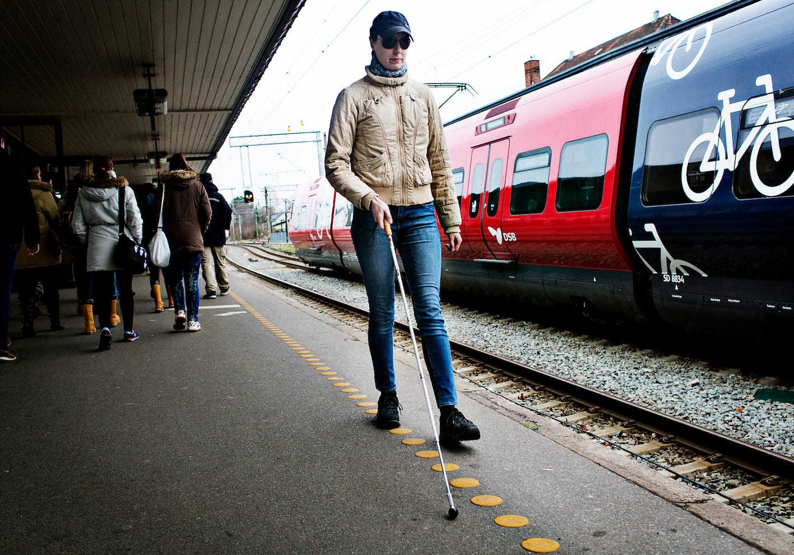
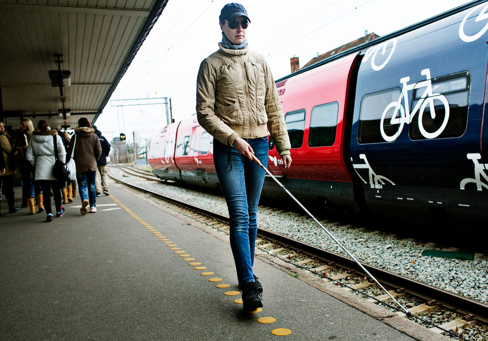

# Tre-punkt-teknik (oppefra og ned)

Denne teknik anvendes, når man anvender en kant som ledelinje, fx en kantsten eller en perronkant.

- Lykke anvender her pendulteknik langs en perronkant ved at lade stokkespidsen falde ud over kanten.

- Derefter trækkes spidsen op langs kanten, således at retning og form på kanten kan fastslås. På den måde kan kanten (ledelinjen) fungere som retningsgiver.

Lykke skal gå så tæt ved kanten, at grundteknikken (pendulteknik) kan opretholdes.
