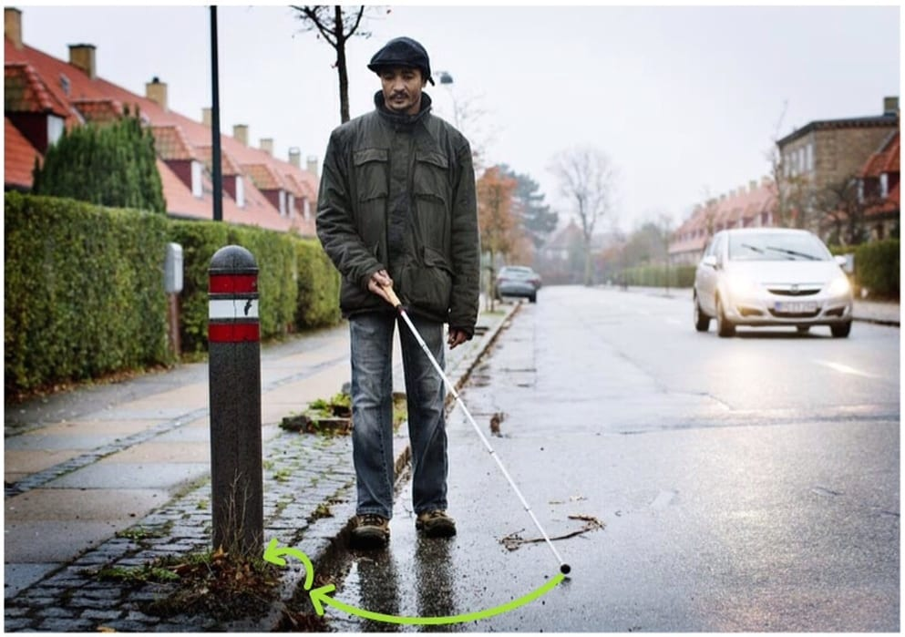
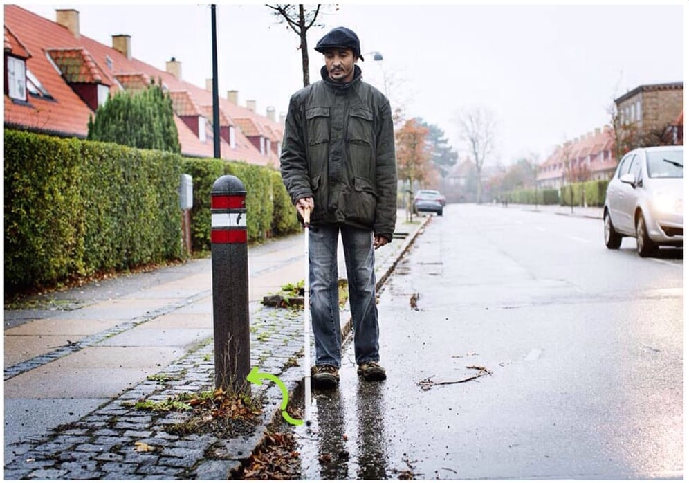
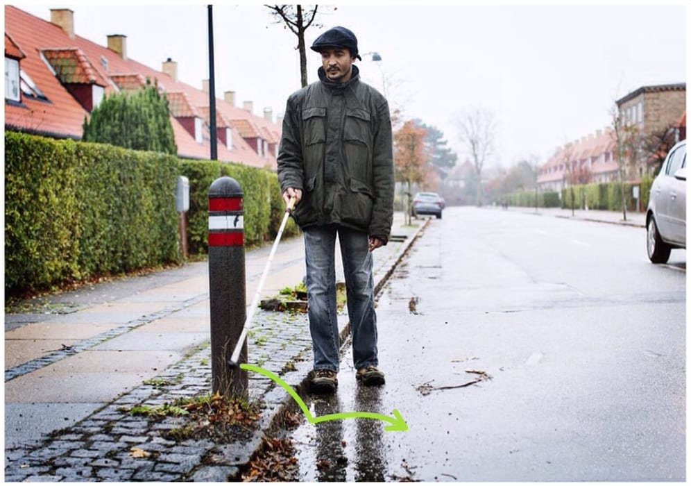

# Tre-punkt-teknik (nedefra og op)

Denne teknik anvendes mest til at finde sig til rette efter at være gået forkert over en gade. Teknikken bruges, når man leder efter en åbning eller andet, der befinder sig over det plan, man færdes på.

- Spidsen rører jorden i siden modsat ledelinjen.

- Spidsen svinges derefter over til den modsatte side og kontakter her ledelinjen, fx en kantsten.

- Spidsen løftes derefter op på den flade, hvorpå der skal trailes, fx oppe på et fortov.

- Dvs. at der i bueslaget holdes stadig kontakt med ledelinjen, og spidsen trækkes op over kanten for at undersøge dette niveau, fx for at finde en åbning i dette niveau eller undersøge, hvornår forhindringen slutter.

- Tempoet holdes lavt for at kompensere for mindre sikker teknik.
