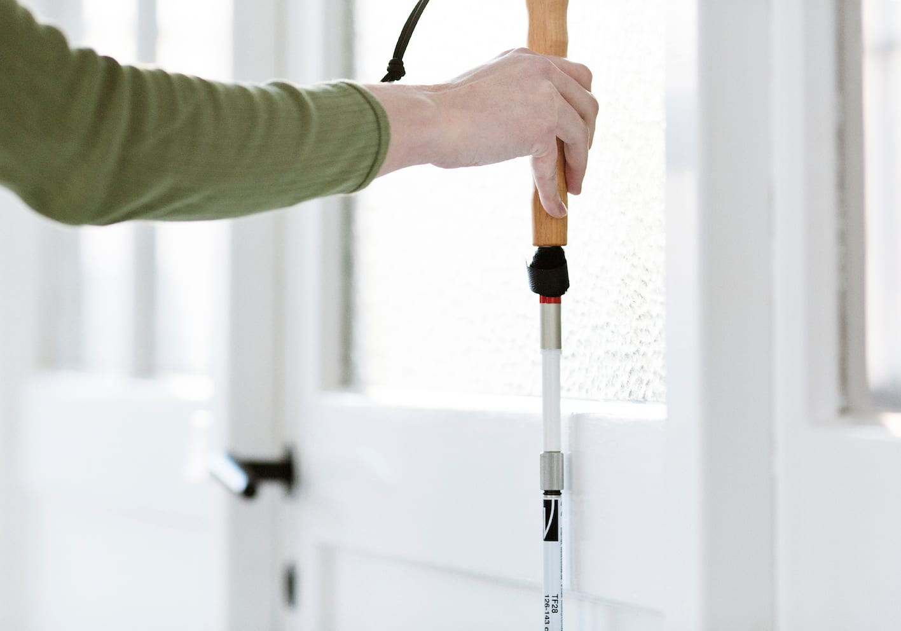
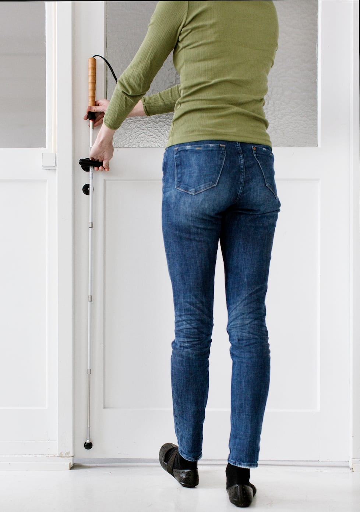
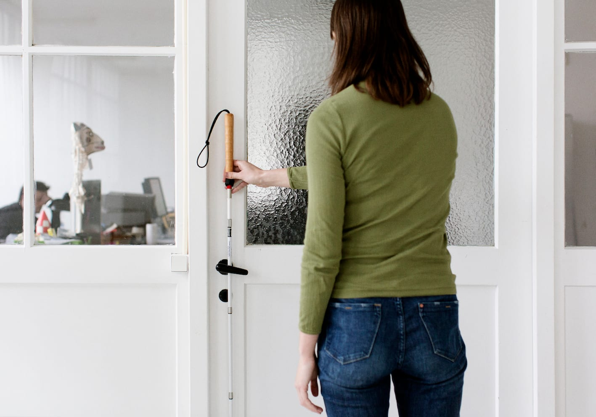
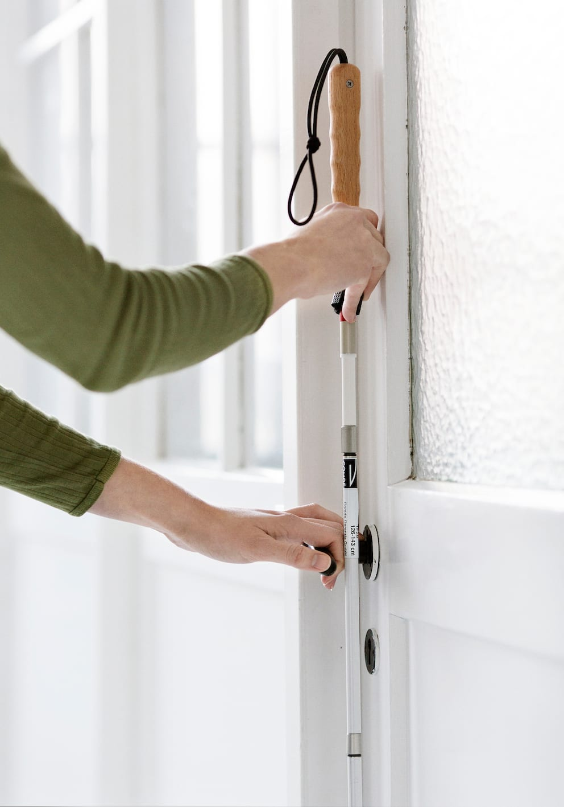
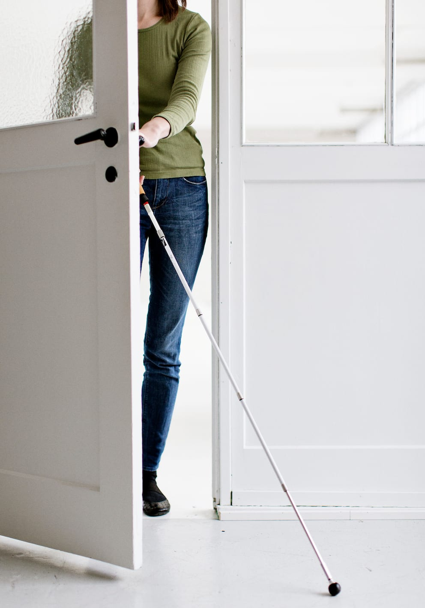

# Passage gennem døre

- Ved kontakt med døren laver Lykke lodret stok, ved at rotere den til et modificeret greb (diagonal- eller blyantsgreb). Hun fører stokken fremad til den kommer i kontakt med døren, mens hun bliver stående i en arms længde væk, for at undgå at døren åbnes i hovedet på hende.

- Lykke kontakter døren med den frie hånd knyttet eller strækker en fod frem som stopklods, hvis døren skulle blive åbnet fra den anden side.

- Lykke løfter stokken let og fører den (i lodret) fra den ene side til den anden for at lokalisere håndtaget. Det er evt. nødvendigt at flytte stokken over i den anden hånd. En alternativ fremgangsmåde kan være at holde stokkespidsen på samme sted på gulvet og føre grebet frem og tilbage over døren i en vifteform.

- Når Lykke har lokaliseret håndtaget, kan hun skubbe til døren for at se, om den kan åbnes på denne måde. Hvis ikke fører hun den frie hånd ned ad stokken til håndtaget og åbner døren.

- Idet Lykke går gennem døren, udfører hun et bueslag med stokken, for at sikre fri vej, hvorefter hun fortsætter gennem døren med diagonalteknik.

Pga. risiko for at blive klemt eller ramt af døren bør passagen kunne udføres i et forholdsvis højt tempo. Ligeledes bør man af sikkerhedshensyn anvende stokken til at søge/undersøge med fremfor hænderne.
