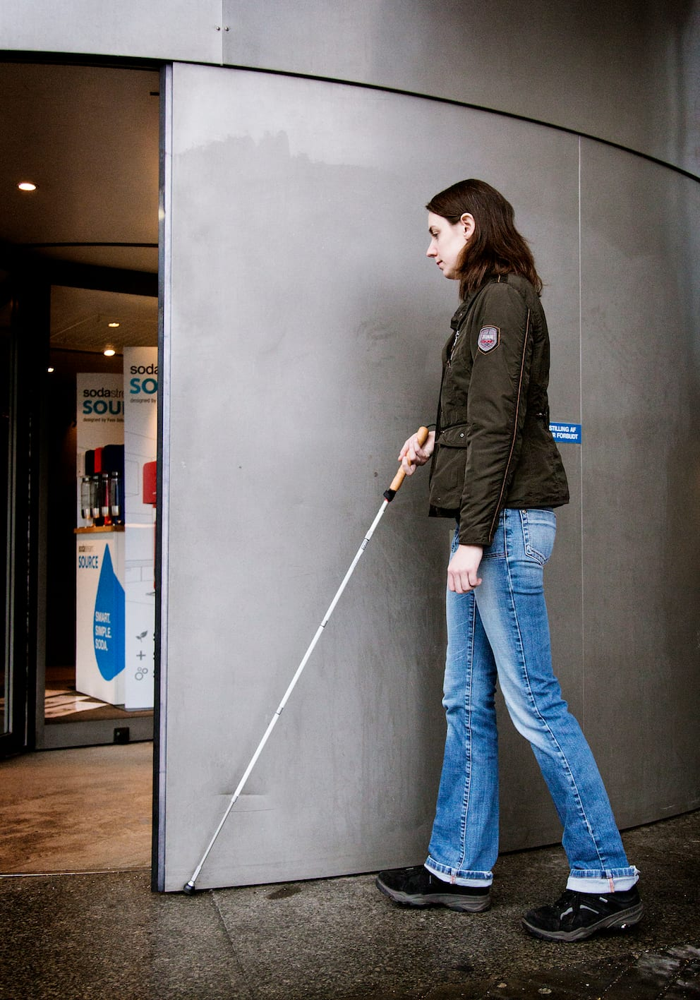
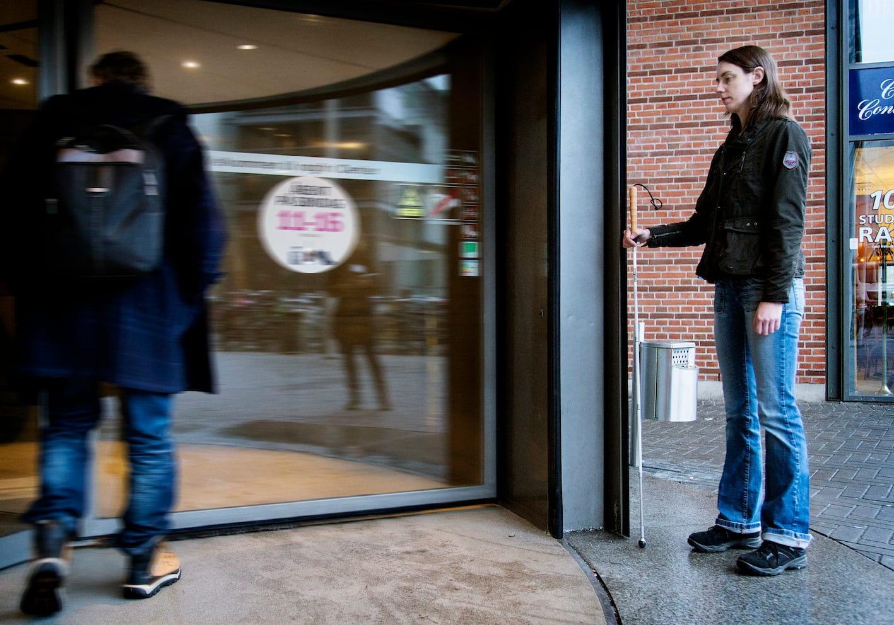
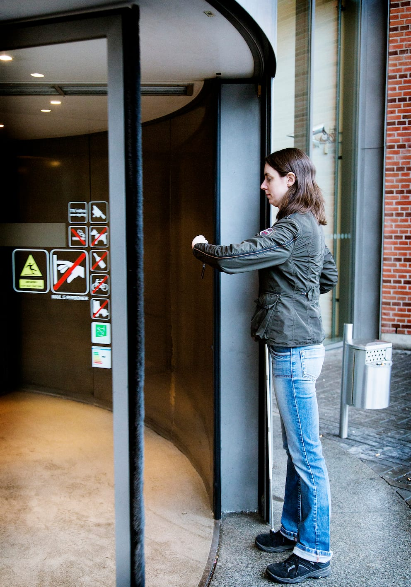
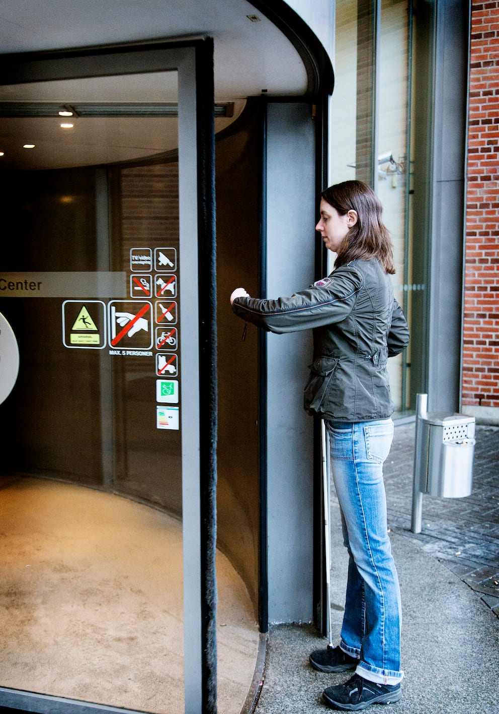
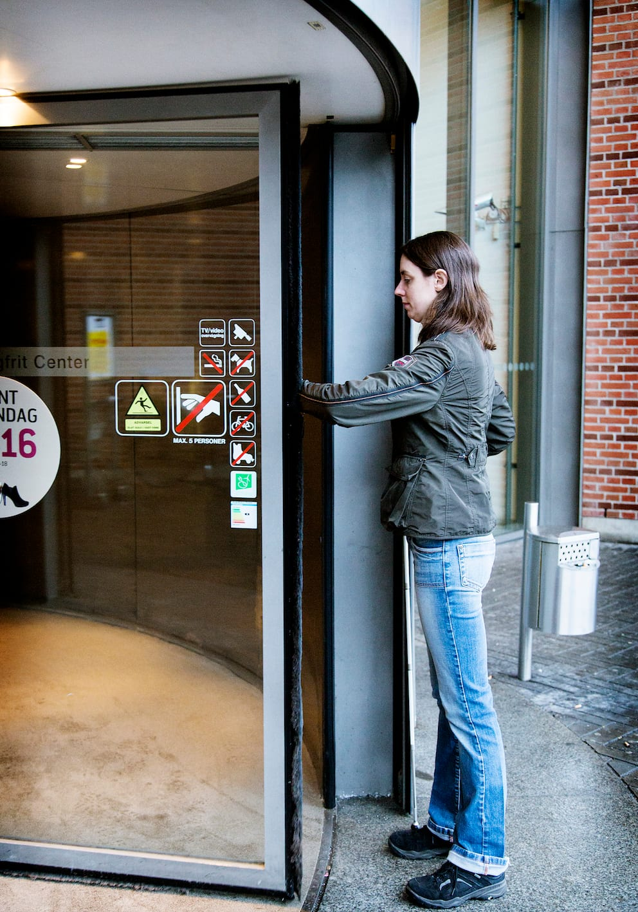
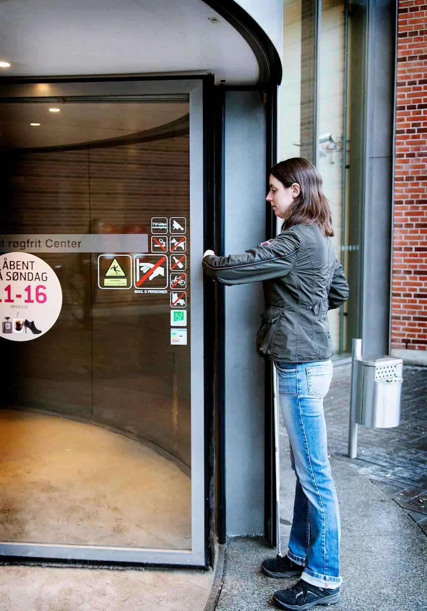
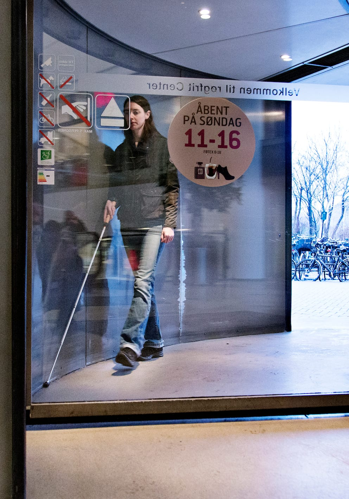
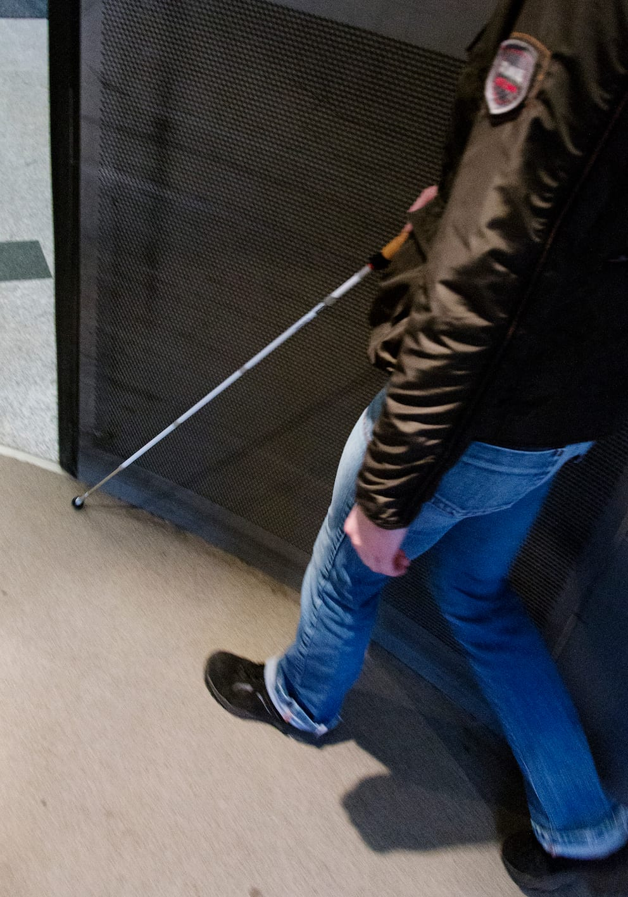

# Passage gennem svingdøre

Nogle personer med blindhed vil være ængstelige for at benytte en svingdør. I mange tilfælde vil der være en almindelig dør eller en skydedør i nærheden, som man kan benytte som alternativ. Er dette ikke tilfældet, er det med den rette teknik muligt at færdes sikkert i en svingdør på egen hånd.

- Her er det Lykke, som nærmer sig svingdøren fra højre side for at undgå trængsel ved døren.

- Hun trailer langs væggen med stokken i højre hånd (pendulteknik). Her kan man evt. samtidig anvende ”høj arm” med venstre arm for at beskytte overkroppen.

- Svingdøren findes enten taktilt ved at traile langs væggen eller auditivt ved at bruge lyden fra døren og de andre fodgængere. Der kan anvendes kendemærker og andre informationer, fx temperaturforskelle, forskelle i underlag m.m. til at fastslå præcist, hvor døren befinder sig. Nogle svingdøre vil befinde sig inde i en cylinder, som rager ud fra væggen.

- Henne ved døren drejer Lykke mod højre og kontakter kanten af døråbningen med venstre hånd (den høje arm).

- Hvis døren kører, kan Lykke træde ind lige efter, at dørbladet har berørt hendes venstre hånd. Her man evt. anvende kort stok teknik.

- Inde i svingdørens cylinder trailer Lykke langs væggen med højre hånd eller albue for at finde det rette tidspunkt at forlade svingdøren. Når kontakten med væggen ophører, drejer hun let mod højre og forlader hurtigt svingdøren, idet hun anvender pendulteknik. Ved at trække til højre bibeholdes den oprindelige færdselsretning, og Lykke undgår kontakt med de personer, der er på vej ind i svingdøren fra den anden side.

