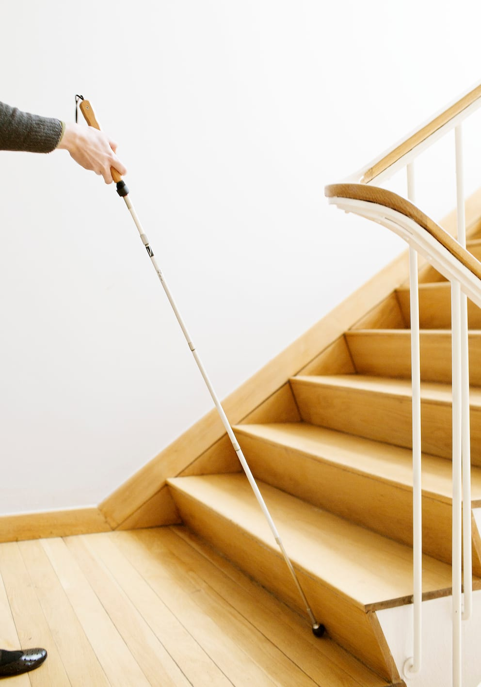
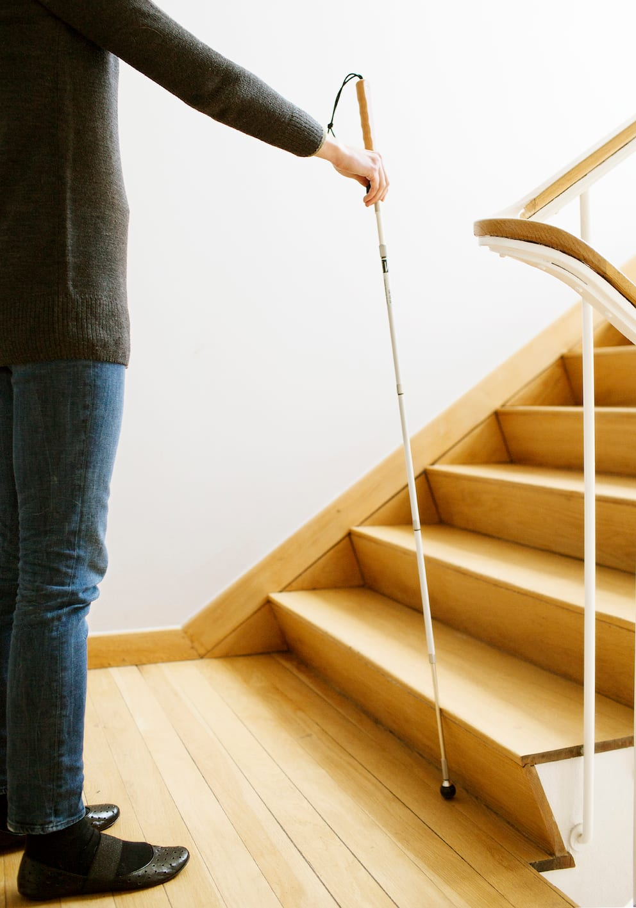
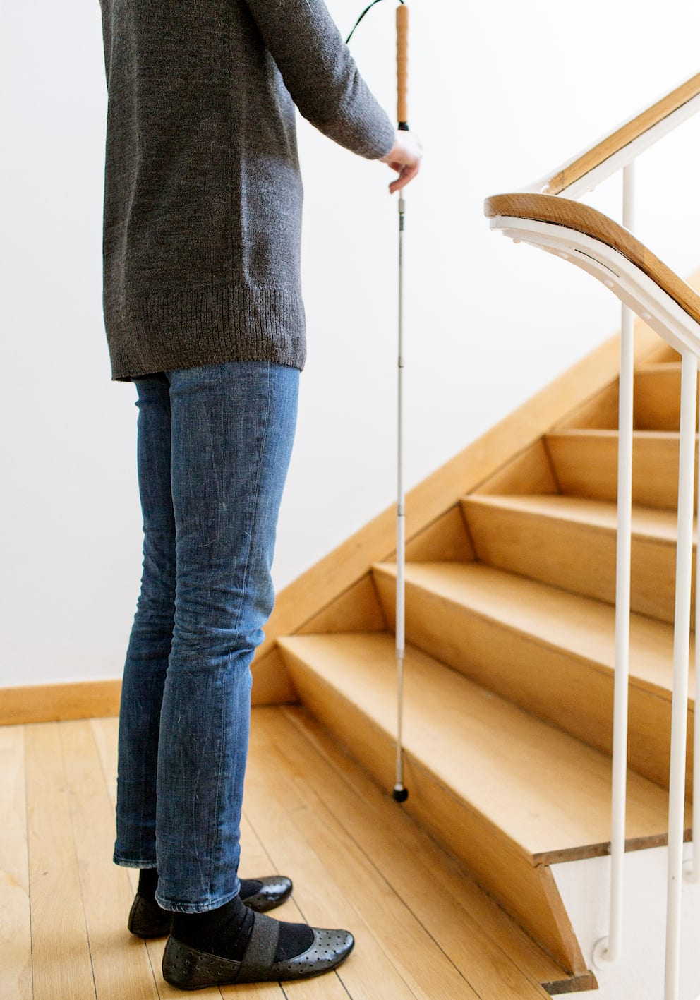
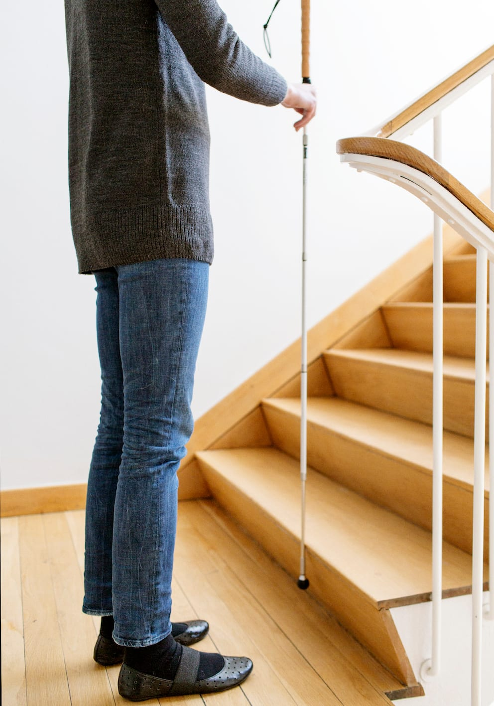
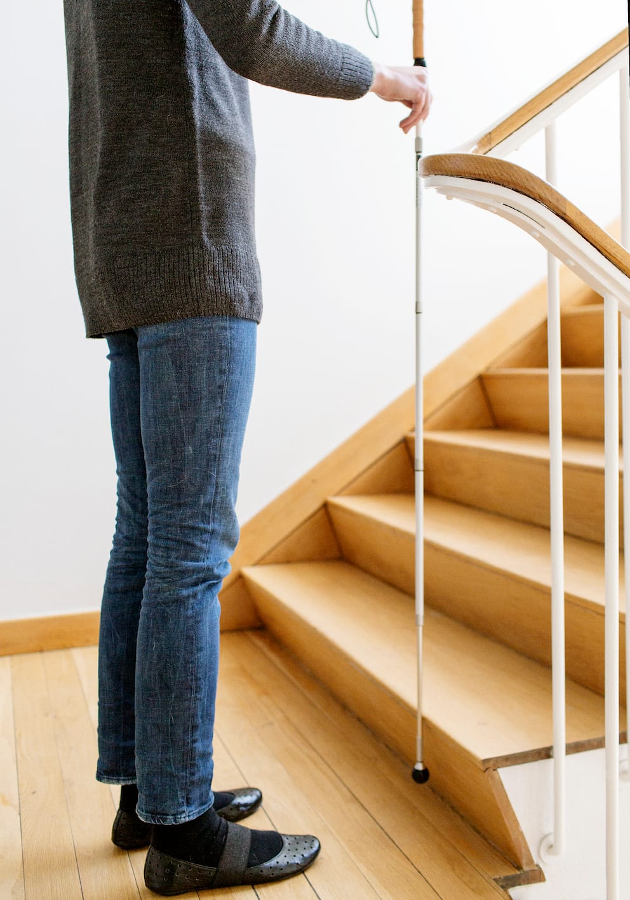
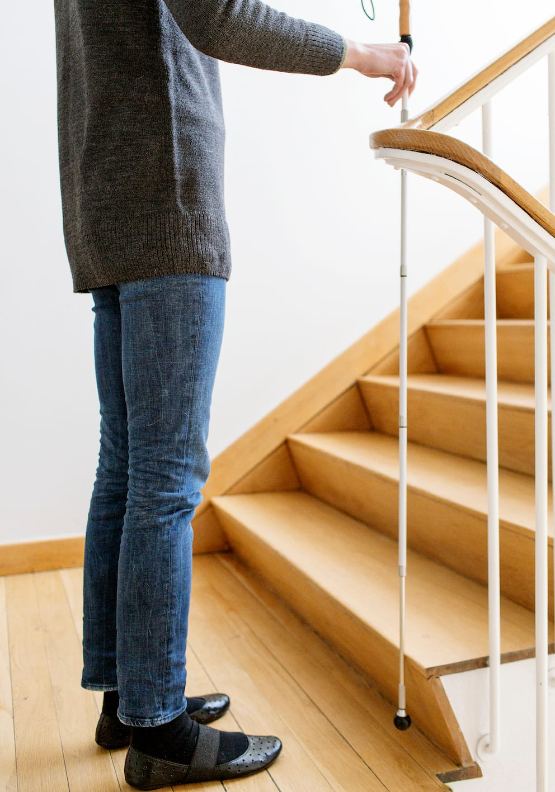
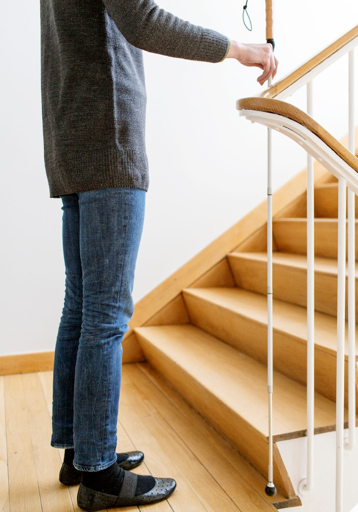
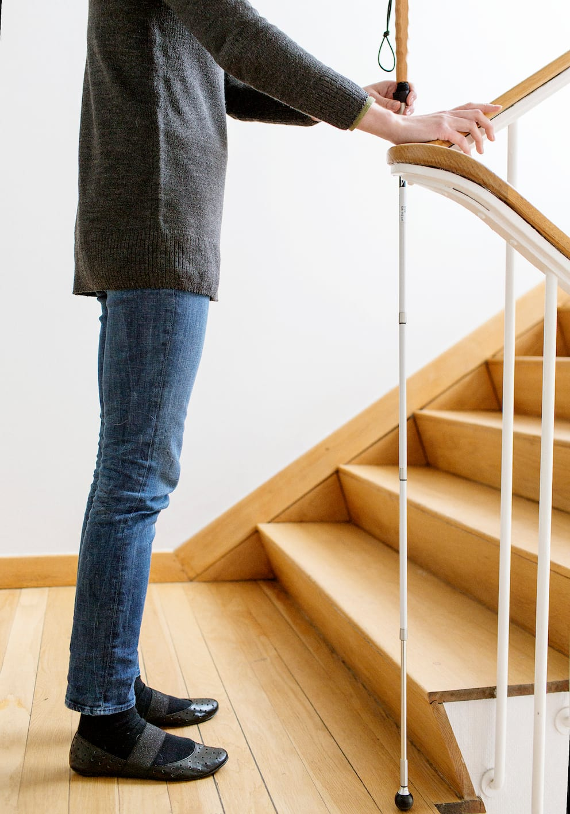
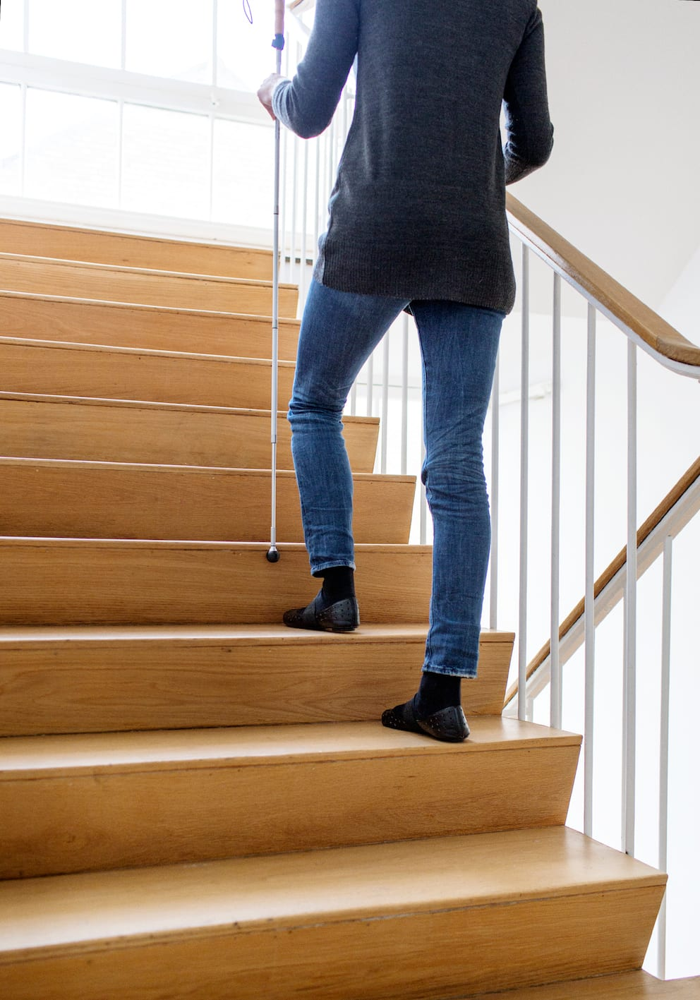

# Op ad trapper

Det kan være hensigtsmæssigt at starte med at øve teknikken til opadgående trappe, in-den man øver teknikken til den nedadgående, da det for mange vil føles mere trygt.

- Ved kontakt med trappen, laver Lykke lodret stok og sikrer sig, at det er en trappe. Stokken kan holdes enten diagonalt med diagonalgreb eller lodret i blyantsgreb. Der gribes lidt neden for håndtaget.

- Lykke undersøger trappens bredde med lodret stok og stadig kontakt til trinnet.

- Lykke søger her mod højre side af trappen for at finde gelænderet. Afhængig af afstanden kan det være nødvendigt at træde nogle skridt sidelæns, eller at dreje sig og gå parallelt med trappen med diagonalteknik. Stokkespidsen følger da foden af nederste trin.

- Evt. flyttes stokken over i den anden hånd for at få hånden fri til gelænderet.

- Lykke retter ind enten med fødderne eller med stokken.

- Trinnets højde og dybde undersøges med lodret stok.

- Lykke svinger armen frem, til den er næsten parallel med gulvet. Derved trækkes stokkespidsen op over trinnet og hviler mod kanten af andet trin. Stokken kan holdes i midterlinjen for at yde maksimal beskyttelse.

- Måske passer det bedre, at stokken hviler mod tredje trin. Det er ikke afgørende. Det væsentlige er, at man gør det samme hver gang.

- Armen fikseres i denne stilling, vægten lægges fremad, og Lykke går op ad trappen, mens stokken berører kanten af hvert trin let. Stokken er hele tiden et trin foran.

- Når stokken ikke længere støder mod et trin, har Lykke et trin tilbage (eller to afhængig af udgangspositionen). Hun skifter til pendulgreb og laver et bueslag, idet hun træder op på afsatsen.
