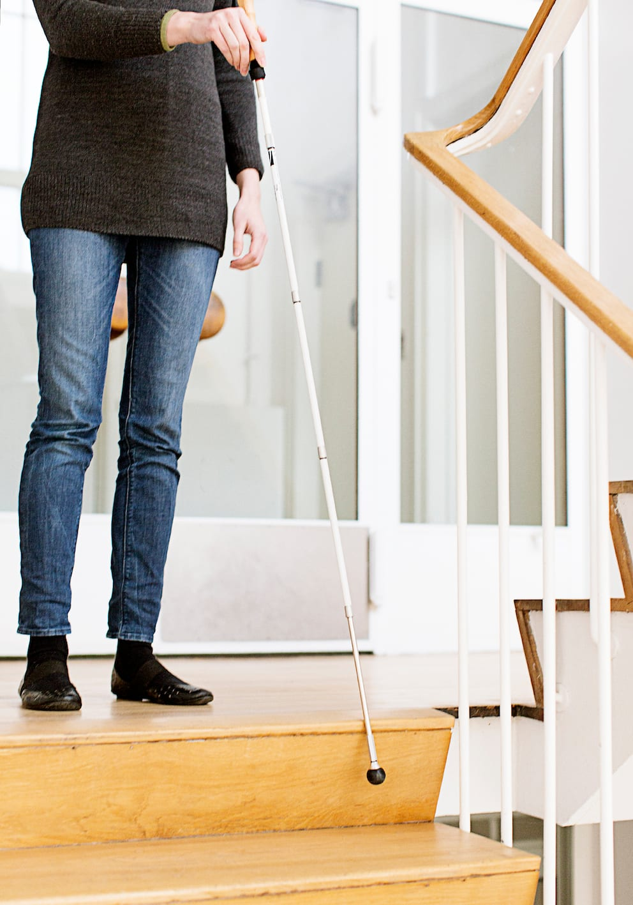
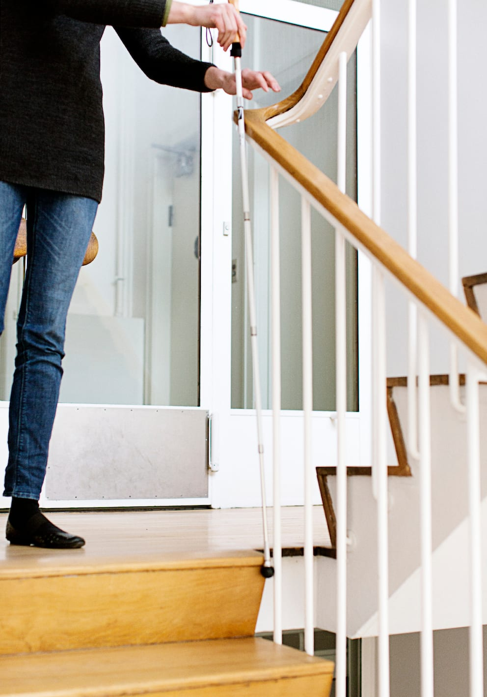
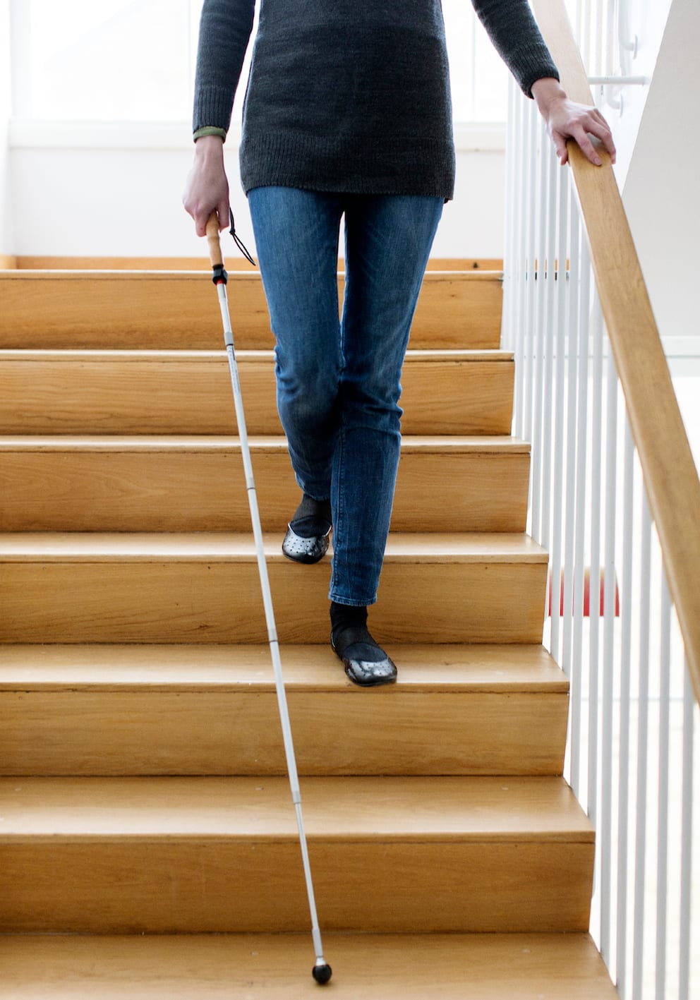
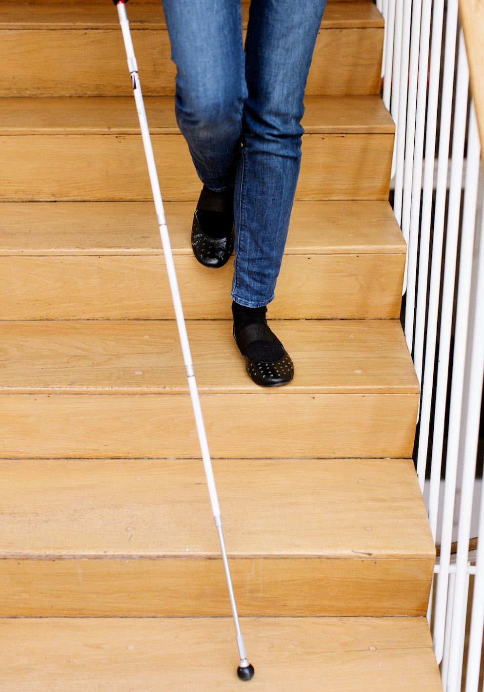

# Ned ad trapper

Teknikken til selvstændig færdsel på nedadgående trappe kan med fordel øves, efter afprøvning af opadgående trappe, da det det for mange vil føles mest trygt.

- Ved kontakt med trappen laver Lykke lodret stok, og sikrer sig, at det er en trappe. Stokken kan holdes enten diagonalt med diagonalgreb eller lodret i blyantsgreb. Der gribes lidt neden for håndtaget.

- Trappens bredde undersøges med lodret stok og stadig kontakt til trinnet.

- Lykke søger her mod venstre side af trappen for at finde gelænderet. Det kan være nødvendigt at flytte stokken til den anden hånd, for at kunne tage fat i gelænderet. Afhængig af afstanden kan det være nødvendigt at træde nogle skridt sidelæns, eller at dreje sig og gå parallelt med trappen med diagonalteknik. Stokken hviler da på kanten af det første trin.

- Lykke retter ind på kanten af trinnet enten med fødderne eller med stokken.

- Stokken holdes i en modificeret diagonalteknik med spidsen ud for modsatte fod. Det er vigtigt at stokkespidsen ikke rager uden for kroppens bredde. Der gribes højt på gummihåndtaget.

- Stokkespidsen skubbes ud over kanten på det andet trin og hviler let på trinnet. Det kan være nødvendigt at sænke armen lidt.

- Lykke fikserer her armen i en position, hvor stokkespidsen let berører hvert enkelt trin,  mens hun går ned ad trappen. Man kan også løfte stokken lidt, så den ikke berører trappen før den møder gulvet ved foden af trappen.

- Når stokkespidsen rammer gulvet, er der et trin tilbage.

- Ved trappens fod fortsættes med pendulteknik.
