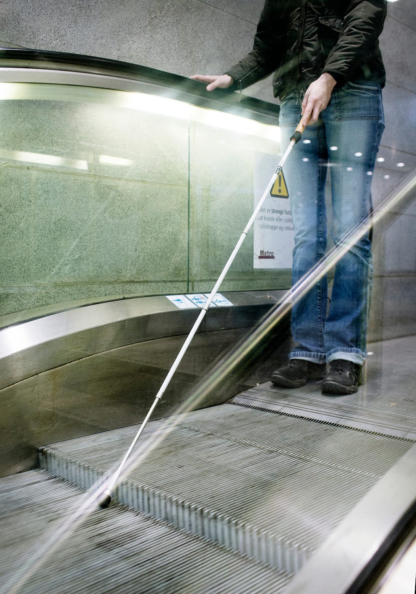
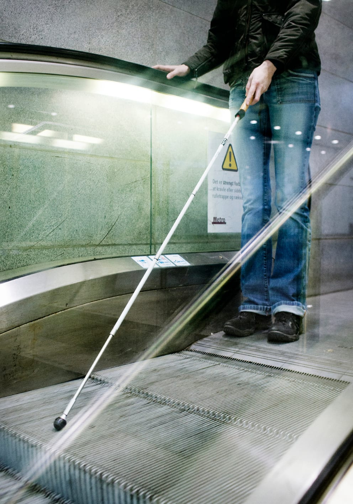
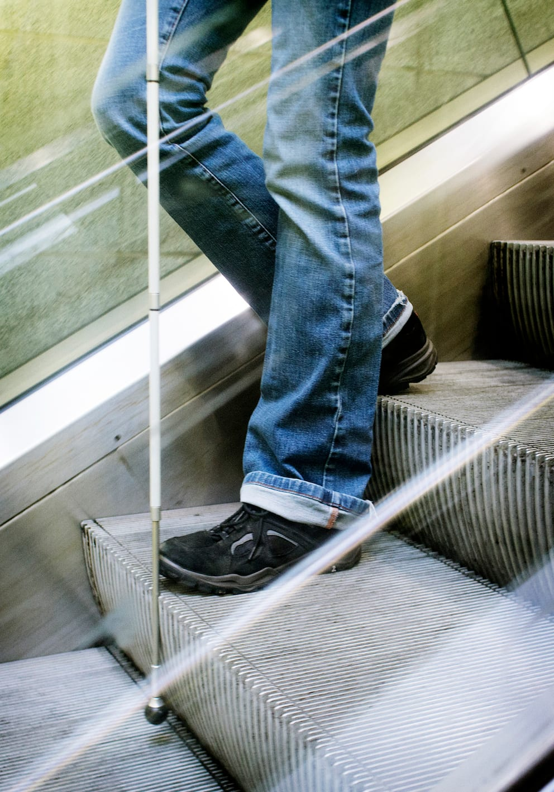

# Rulletrapper

- Lykke lokaliserer rulletrappen ved at lytte efter lyden fra rulletrappen og evt. andre fodgængere.

- Foran rulletrappen ligger en metalplade. Lykke kan bruge lyden fra stokken på metalpladen som information om, at hun er helt henne ved trappen.

- Hun flytter stokken over i venstre hånd og finder håndlisten i højre side med sin frie hånd. Hun lægger her mærke til, om rulletrappen kører væk fra hende eller imod hende. Sidstnævnte rulletrappe kan ikke benyttes.

- Lykke går nu frem til kanten af metalpladen og lokaliserer trinnene med stokken. Ved at lade stokkespidsen ”køre med trappen”, kan hun fastslå om trappen kører op eller ned.

- Lykke går derefter ud på trappen med et normalt skridt, og når trinnet bliver dannet, er der tid nok til at justere føddernes placering på trinnet om nødvendigt.

- På selve rulletrappen placerer man fødderne forskudt på hver sit trin. Når niveauforskellen udlignes betyder det, at trappen er ved at være slut. Man kan samtidigt mærke at håndlisten bliver vandret. Evt. strækkes hånden ekstra langt frem for på denne måde at få informationen så tidligt som muligt. Her ses Lykke med fødderne placeret forskudt på en nedadgående rulletrappe.

- Lykke løfter tæerne på forreste fod let, når hun får kontakt med kanten af reposen ved slutningen af trappen. Hun fortsætter fremad uden stop med god stokketeknik for at undgå at stå i vejen for efterfølgende passagerer.
