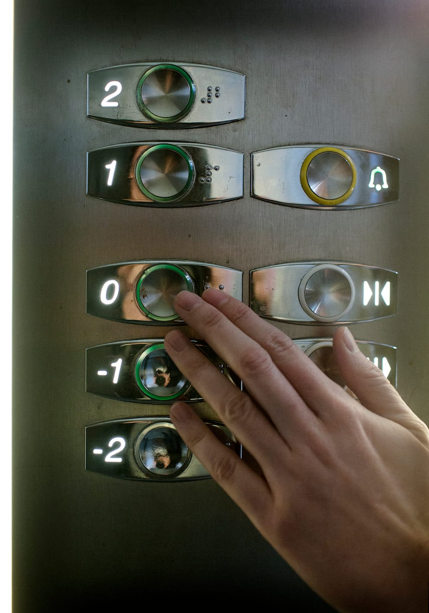

# Introduktion - elevatorer

Det er en forudsætning at personen med blindhed kender til opbygningen og funktionen af den pågældende elevator. Det er derfor nødvendigt at undersøge forholdene i og omkring elevatoren sammen med O&M-instruktøren. Det er bl.a. relevant at vide, hvor betjeningspanelerne er placeret, hvor stopknappen og nødkaldsknappen befinder sig, om der er punktskrift på knapperne, om der er fotoceller ved dørene, som man skal undgå, og om etagerne bliver annonceret.

